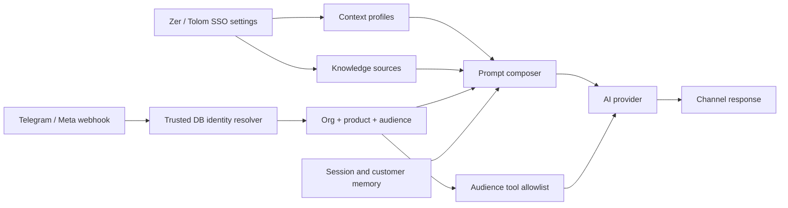

# Adaptive Agent Context Plan

## Status

**Implemented (runtime).** The gateway-side of this plan is wired and shipped; the product settings UI is not.

What is implemented:

- **Audience resolution** — `AgentAudience = "internal" | "customer"` in `src/gateway/types.ts`; resolved from trusted DB state only: Mode A → `internal`, Mode B → `channel_connections.audience` (default `customer`), Facebook/Instagram webhook → `customer`, unknown/failed classification → `customer` (fail closed).
- **Tool gating** — `getProductTools()` in `src/gateway/webhook-helpers.ts` returns an empty tool set for `customer` audiences; the internal/customer split is part of the tool-cache key.
- **Profile loading & prompt composition** — `loadAgentProfile()` in `src/state/agent-profile.ts` reads the active `agent_context_profiles` row for `(organization_id, audience)` and never throws; `src/gateway/agent-handler.ts` loads profile + knowledge + wizard state in parallel with the session and composes the system prompt as **base → profile → knowledge → wizard** (`formatProfileContext`).
- **Knowledge visibility** — `searchKnowledge()` filters `agent_knowledge_sources` by `visibility ∈ {internal, customer, both}` when an audience is supplied (`src/state/knowledge.ts`).
- **Migration** — `channel_connections` (with `audience` column) and `agent_context_profiles` are part of the applied migrations; sessions/audit log use generic `channel`/`channel_chat_id`/`channel_user_id` columns.

What remains:

- **Product settings UI (Zer/Tolom)** — no profile editor exists yet in either app; the `agent_context_profiles`/`agent_knowledge_sources` rows are currently managed via SQL/dashboard tooling only. This is Phase 4 of the plan below.
- The gateway dashboard (`/dashboard`) is a usage-analytics + handoff inbox, **not** a profile editor.
- Optional: connection-audience reclassification UI for orgs that want a Meta channel to behave as `internal`.

## Outcome

Organization owners can manage stable context for their AI assistant through the existing SSO-protected settings in Zer or Tolom. Telegram, Messenger, Instagram, and WhatsApp use that context when answering on the organization’s behalf without allowing organization-provided content to override tenant isolation, authorization, tool, or safety rules.

The first release supports two independently configured contexts:

- **Team Assistant** — for linked staff channels such as SSO-linked Telegram.
- **Customer Chatbot** — for public Messenger, Instagram, WhatsApp, and explicitly customer-facing custom bots.

Saved changes take effect on the next message without restarting or redeploying the Gateway.

## Architecture

Use four context layers with strict precedence:

1. **Core Gateway prompt** — immutable, developer-owned safety, tenancy, and tool rules.
2. **Organization profile** — structured information configured by an authorized organization owner.
3. **Audience-scoped knowledge** — retrieved documents filtered for staff or customer visibility.
4. **Conversation state** — existing session history and customer memory.

Organizations must not be able to replace the raw system prompt. Their context remains subordinate to Gateway security rules.



## Scope

- **Complexity:** Complex, cross-application feature.
- **Systems:** Agent Gateway, Zer settings, Tolom settings, and their Supabase schemas.
- **Estimated impact:** Two matching product-database migrations and approximately 15–20 source, generated, and test files.
- **Parallelization:** After the schema and TypeScript contracts are fixed, the Gateway runtime, Zer settings, and Tolom settings can be implemented independently.

## Security prerequisite: trusted audiences

Facebook currently receives the same internal tool set as linked Telegram. That is unsafe for a public customer chatbot because those tools can access service-role-backed business data.

Introduce a trusted audience in the Gateway context:

```ts
type AgentAudience = "internal" | "customer";
```

Rules:

- `internal` receives the existing organization business tools.
- `customer` receives public knowledge and a customer-safe tool allowlist.
- The initial customer tool allowlist contains no internal data tools.
- Unknown or unclassified connections fail closed to `customer`.
- Audience is resolved from trusted database configuration, never from the incoming message or model output.

## Data model

### 1. Add `agent_context_profiles`

Store one row per organization and audience.

| Field | Purpose |
|---|---|
| `organization_id` | Tenant boundary |
| `audience` | `internal` or `customer` |
| `assistant_name` | Organization’s preferred assistant name |
| `business_summary` | Stable company description |
| `response_language` | Preferred response language |
| `tone` | Controlled tone selection |
| `contact_details` | Public contact information |
| `business_hours` | Structured operating hours |
| `response_rules` | Bounded organization-specific preferences |
| `handoff_message` | Response used when human help is required |
| `is_active` | Enables or disables the profile |
| `updated_by` | Audit identity |
| `created_at`, `updated_at` | Audit timestamps |

Constraints and authorization:

- Add a unique constraint on `(organization_id, audience)`.
- Apply field length limits and schema validation.
- Do not add an arbitrary `system_prompt` column.
- Enable RLS and authorize against the product’s existing organization-membership helper.
- Define update policies with both `USING` and `WITH CHECK`.
- Repeat authorization checks inside every Server Action and route-handler mutation.
- Grant only the access required by the product settings and Gateway runtime.

### 2. Add knowledge visibility

Extend `agent_knowledge_sources` with:

```ts
type KnowledgeVisibility = "internal" | "customer" | "both";
```

Backfill existing knowledge as `internal` so migration cannot accidentally publish private material.

Visibility rules:

- Internal assistants can retrieve `internal` and `both` sources.
- Customer chatbots can retrieve `customer` and `both` sources.

### 3. Classify channel connections

Store or derive a trusted audience for connection records:

- SSO-linked Telegram: `internal`.
- Messenger, Instagram, and WhatsApp: default `customer`.
- Custom bots: explicitly configurable and default `customer`.
- Existing public connections: migrate to `customer`.

An organization that intentionally uses a Meta channel for staff can explicitly change that connection to `internal` through an authorized settings surface.

## Runtime implementation

| Order | File or area | Change |
|---|---|---|
| 1 | Product Supabase migrations | Add profiles, visibility, audience constraints, indexes, RLS, grants, and safe backfills. |
| 2 | Generated database types | Regenerate types in Zer and Tolom; never patch generated files manually. |
| 3 | `src/gateway/types.ts` | Add `AgentAudience` and include the trusted audience in `GatewayContext`. |
| 4 | Channel resolvers and webhook routes | Resolve audience through `telegram_links`, `custom_bots`, or `channel_connections`; ensure every path supplies the correct product Supabase client. |
| 5 | `src/state/agent-profile.ts` | Add profile loading, validation, normalization, and deterministic prompt formatting. |
| 6 | `src/state/knowledge.ts` | Filter retrieval by `organization_id` and audience visibility. |
| 7 | Tool registry selection | Separate internal tools from customer-safe tools before provider execution. |
| 8 | `src/gateway/webhook-helpers.ts` | Refactor `systemPromptFor` into immutable core instructions plus bounded organization context. |
| 9 | `src/gateway/agent-handler.ts` | Load the profile alongside session, knowledge, and wizard state, then compose all layers before calling the provider. |

### Prompt assembly

The composed system prompt should have explicit sections:

1. Immutable Gateway identity, security, tenancy, and tool rules.
2. Trusted runtime facts: product, organization, channel, and audience.
3. Organization-provided profile, clearly labeled as subordinate context.
4. Retrieved knowledge, clearly labeled as reference material.
5. Existing product-specific behavior rules.

Organization fields and retrieved documents must be treated as data. They cannot authorize tools, change the resolved organization, change the audience, or override the core rules.

### Loading and caching

Do not cache profiles in the first release. Loading the active profile per message provides predictable “save now, effective next message” behavior. Caching can be introduced later with explicit invalidation if measurements show it is necessary.

Profile loading should run in parallel with the existing session, knowledge, and wizard-state reads.

## Product settings

Context management belongs in existing authenticated product settings rather than a separate Agent Gateway login. Zer and Tolom remain the source of truth for organization membership and permissions.

### Zer

Under `apps/zer/src/app/(dashboard)/settings/**`:

- Add an **Agent Context** settings section.
- Require the existing `settings.manage` permission in every mutation.
- Provide **Team Assistant** and **Customer Chatbot** tabs.
- Expose structured profile fields with a response preview.
- Add visibility controls to knowledge-source management.
- Add audience selection for configurable channel connections.

### Tolom

Under Tolom’s existing authenticated settings area:

- Add the same profile and visibility controls.
- Reuse its authenticated organization route/action pattern.
- Validate membership, role, and permission server-side.

Both products should use the same profile validation contract where practical while retaining their established settings architecture and components.

## Implementation phases

### Phase 1: Contracts and migrations ✅ Implemented

1. Define `AgentAudience`, context-profile validation, and knowledge visibility contracts.
2. Create matching migrations in each product database.
3. Add safe backfills and RLS policies.
4. Regenerate Supabase TypeScript types.
5. Verify constraints and tenant access with direct database scenarios.

### Phase 2: Gateway audience boundary ✅ Implemented

1. Add audience to the trusted `GatewayContext`.
2. Update Telegram, custom-bot, and Meta resolvers.
3. Ensure all channel paths use the correct product Supabase client.
4. Split tool selection into internal and customer-safe registries.
5. Make unknown classifications fail closed to customer mode.

This phase must land before exposing configurable customer context on Meta channels.

### Phase 3: Context loading and prompt composition ✅ Implemented

1. Implement `src/state/agent-profile.ts`.
2. Add visibility-aware knowledge retrieval.
3. Refactor prompt construction into immutable and organization-provided sections.
4. Load the profile in `handleAgentMessage`.
5. Preserve safe core behavior when the profile is absent, disabled, or unavailable.

### Phase 4: SSO-protected management ⏳ Remaining (no editor UI in Zer/Tolom yet)

1. Add guarded profile reads and mutations to Zer.
2. Add the Zer Agent Context interface.
3. Add equivalent guarded routes/actions to Tolom.
4. Add the Tolom settings interface.
5. Add knowledge visibility and connection-audience controls.

### Phase 5: Verification and rollout 🟡 Partially done

1. Run unit, integration, and channel-level scenarios.
2. Verify cross-organization isolation.
3. Verify customer channels cannot access internal tools or knowledge.
4. Verify saved changes affect the next message.
5. Run the repository verification gate before rollout.

## Failure and edge-case behavior

- **Missing profile:** Continue with the immutable core prompt.
- **Profile query failure:** Capture the error and continue with safe core behavior.
- **Missing audience classification:** Use `customer`.
- **Disabled profile:** Do not inject organization-profile fields.
- **Private data request on a customer channel:** The customer tool allowlist prevents access regardless of prompt wording.
- **Internal knowledge on a customer channel:** Never return it.
- **Audience change on an existing connection:** Expire or reset its active conversation session so prior context cannot cross the boundary.
- **Deleted or inactive organization:** Do not load context or tools.
- **Prompt-like profile or document content:** Treat it as subordinate data, not as authorization or system instructions.
- **Concurrent profile edits:** Use `updated_at` or optimistic concurrency to prevent silent overwrites.
- **Cross-product organization IDs:** Always use the Supabase client associated with the resolved product.

## Acceptance criteria

1. An authorized organization owner can save separate internal and customer profiles through existing SSO-protected settings.
2. An unauthorized member cannot read or mutate another organization’s profile.
3. SSO-linked Telegram uses the internal profile, internal knowledge, and internal tool registry.
4. Messenger, Instagram, and WhatsApp default to the customer profile and customer-safe capabilities.
5. Customer channels cannot retrieve internal knowledge or invoke internal data tools.
6. Profile changes affect the next incoming message.
7. Missing or failed profile loading falls back to safe core behavior.
8. Profile, knowledge, session, and tool access never cross organization boundaries.
9. Organization-provided content cannot override core security or tenant rules.

## Verification plan

### Unit tests

- Profile validation and deterministic formatting.
- Missing and disabled profile fallback.
- Prompt ordering and immutable-rule preservation.
- Audience-to-tool-registry selection.
- Knowledge visibility matrix.

### Integration tests

- Organization A cannot load or update Organization B’s profile.
- Unauthorized members cannot mutate profiles.
- Customer retrieval excludes internal knowledge.
- Unknown audience receives customer-safe capabilities.
- Every channel path supplies the correct product database client.

### End-to-end scenarios

1. Sign into Zer or Tolom as an organization owner and edit the Team Assistant profile.
2. Send a linked Telegram message and observe the updated internal context.
3. Edit the Customer Chatbot profile.
4. Send a Messenger message and observe the customer-specific response.
5. Ask Messenger for private business data and confirm it cannot invoke an internal tool.
6. Update a profile and confirm the next message uses it.
7. Repeat with two organizations and confirm no profile or knowledge crosses tenants.

### Repository commands

Run the scoped checks while implementing, then the full Gateway gate:

```bash
pnpm validate:types
pnpm test:unit
pnpm test:integration
pnpm test:e2e
pnpm validate
```

## Non-goals

- Allowing organizations to replace the raw system prompt.
- Giving customer channels unrestricted internal business tools.
- Building a separate Gateway SSO application.
- Redesigning long-term semantic memory.
- Automatically crawling organization websites or social profiles.
- Adding customer write operations without a separate confirmation and authorization design.
