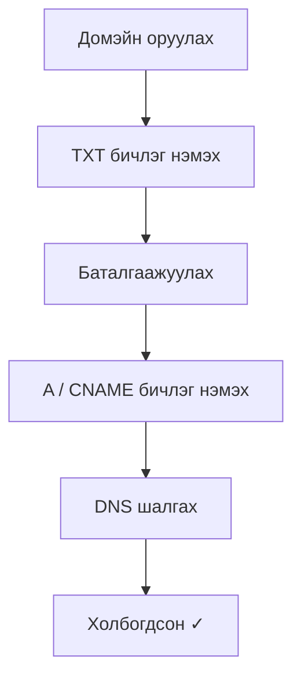

# Өөрийн домэйн (Custom Domain)

Нийтийн дэлгүүрээ өөрийн домэйноор нээх боломжтой.
Жишээ нь: `shop.mydomain.mn` эсвэл `mydomain.mn`.

## Алхам 1. Домэйнээ оруулах

1. **Тохиргоо → Байгууллага** цэс рүү орно.
2. **Өөрийн домэйн** хэсэгт домэйноо бичээд **хадгална**.
   - Жишээ: `shop.mydomain.mn` (зөвлөдөг) эсвэл `mydomain.mn`
   - `https://` угтвар, `/` зам бичихгүй — зөвхөн домэйн нэр
3. TXT бичлэгийн утга автоматаар харагдана: `zer-verify=xxxxxxxxxxxx`
   - Энэ утга танай байгууллагад онцгой — **Хуулах** товчоор хуулна.

## Алхам 2. TXT бичлэг нэмээд баталгаажуулах

Домэйнийнхээ DNS тохиргоонд (домэйн худалдаж авсан газрын самбарт) TXT бичлэг нэмнэ:

| Төрөл | Нэр | Утга |
|---|---|---|
| TXT | `@` эсвэл хоосон | `zer-verify=xxxxxxxxxxxx` |

Дараа нь **Баталгаажуулах** товчийг дарна.

- Амжилттай бол домэйн **баталгаажсан** болно.
- Домэйн өмчлөлийг баталгаажуулсны дараа систем домэйнийг автоматаар Zer рүү холбоно.

## Алхам 3. DNS чиглүүлэх ба шалгах

Домэйнийнхээ DNS тохиргоонд дараах бичлэгийг нэмнэ:

| Домэйн хэлбэр | Төрөл | Нэр | Утга |
|---|---|---|---|
| Үндсэн домэйн (`mydomain.mn`) | A | `@` | `76.76.21.21` |
| Дэд домэйн (`shop.mydomain.mn`) | CNAME | `shop` | `cname.vercel-dns.com` |

Бичлэгийг нэмсний дараа **DNS шалгах** товчийг дарна.
DNS тархахад хэдэн минутаас цаг хүртэл хугацаа шаардагдана.
Холбогдсон үед **"Холбогдсон ✓"** төлөв харагдана — дэлгүүр таны домэйноор нээгдэнэ.

## Анхаарах зүйлс

- **Домэйн өөрчлөх**: Домэйноо өөрчилбөл шинэ домэйнийг дахин баталгаажуулах шаардлагатай.
- **TXT бичлэгийн байршил**: TXT бичлэгийг домэйнийн үндсэн (root) хэсэгт нэмнэ — `@` эсвэл хоосон нэр.
- **Apex vs дэд домэйн**: `shop.mydomain.mn` хэлбэрийн дэд домэйн CNAME бичлэгтэй — ихэнх DNS үйлчилгээнд хялбар. Үндсэн домэйнд A бичлэг хэрэглэнэ.
- **SSL сертификат**: DNS холбогдсоны дараа автоматаар үүснэ — тусдаа тохиргоо шаардлагагүй.
- **Төлөв харагдахгүй байвал**: Баталгаажуулах алхмыг дахин дарна уу.
