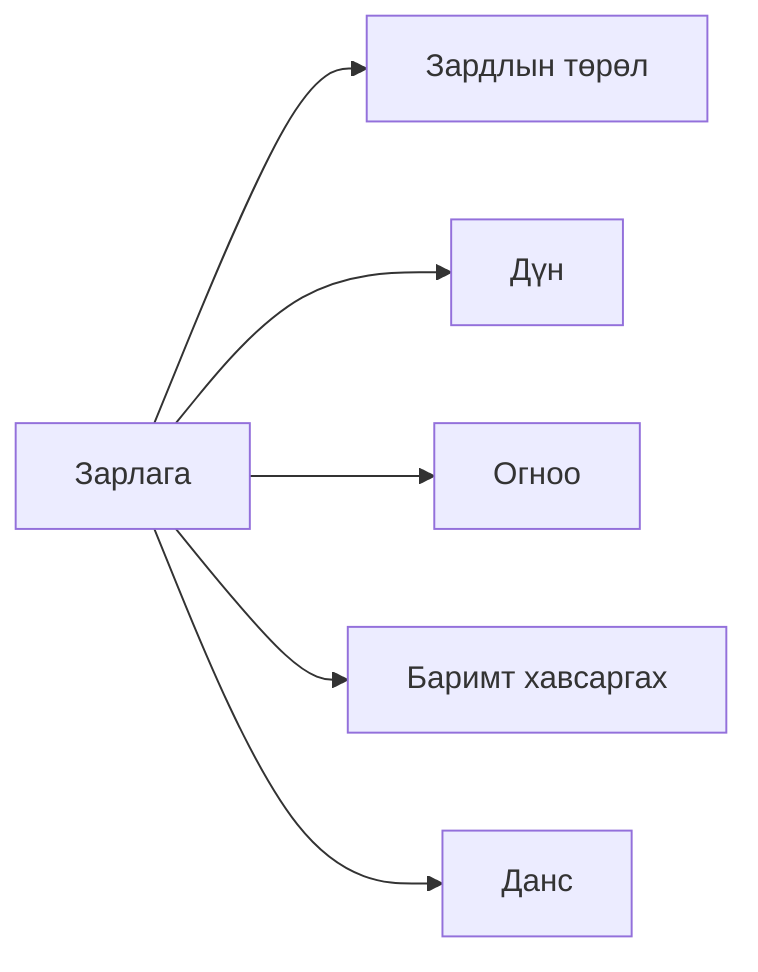

# Зарлага

Зардлын бүртгэл хөтлөх, ангилах, баримт хавсаргах боломж.

## Шинэ зарлага бүртгэх

1. `Зарлага` цэснээс `Шинэ зарлага` товч дарна.
2. Зардлын төрөл, дүн, огноог оруулна.
3. Баримт хавсаргах (зураг, PDF).
4. Санхүүгийн данс сонгох.
5. Хадгалах.

## Онцлогууд

- **Ангилал** — зардлыг төрөл, ангилалаар бүлэглэх
- **Баримт хавсаргах** — зарлагын баримтыг хавсаргах
- **Санхүүгийн интеграци** — автоматаар санхүүгийн бүртгэлд тусгагдах
