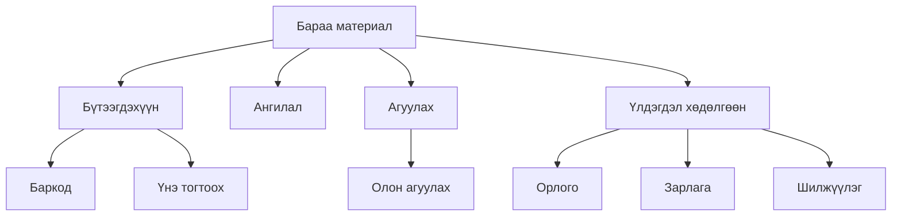
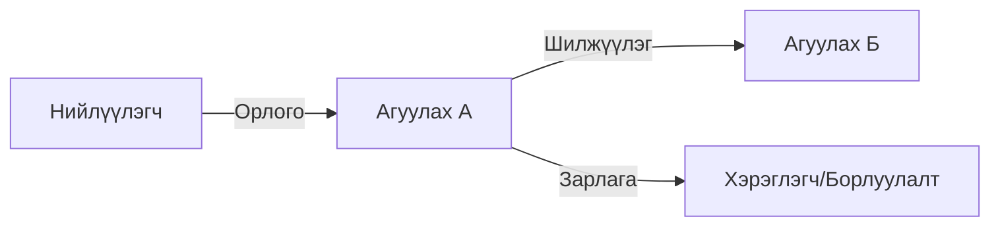

# Бараа материал

Бараа материалын модуль нь бүтээгдэхүүн, агуулах, нөөцийн хөдөлгөөнийг бүрэн хянах боломжийг олгоно.

## Бүтээгдэхүүн

Бүтээгдэхүүний бүртгэл дараах мэдээллийг агуулна:

- **Нэр** — бүтээгдэхүүний нэр
- **SKU** — нөөцийн нэгж код
- **Баркод** — баркод уншигчаар унших код
- **Үнэ** — өртөг, бөөний үнэ, жижиглэнгийн үнэ
- **Ангилал** — бүтээгдэхүүний ангилал
- **Агуулахын үлдэгдэл** — агуулах бүрээр

## Ангилал

Бүтээгдэхүүнийг ангилалд хувааж, бүлэглэх боломжтой.

## Агуулах

Олон агуулахтай ажиллах боломжтой. Агуулах бүрээр барааны үлдэгдлийг тусад нь хянана.

## Үлдэгдэл хөдөлгөөн

Бараа материалын бүх хөдөлгөөний түүх:

- **Орлого** — худалдан авалт, буцаалтаар орсон бараа
- **Зарлага** — борлуулалт, буцаалтаар гарсан бараа
- **Шилжүүлэг** — агуулах хоорондын шилжүүлэг
