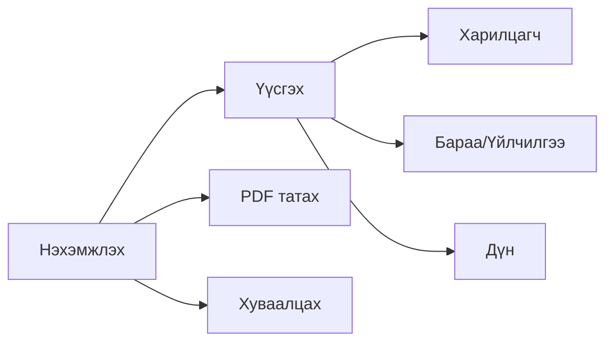

# Нэхэмжлэх

Нэхэмжлэх үүсгэх, PDF татаж авах, нийтийн холбоосоор хуваалцах.

## Нэхэмжлэх үүсгэх

1. `Нэхэмжлэх` цэснээс `Шинэ нэхэмжлэх` товч дарна.
2. Харилцагчийн мэдээлэл оруулах.
3. Бараа/үйлчилгээний мөрүүд нэмэх.
4. Нийт дүн автоматаар бодогдоно.
5. Хадгалах.

## PDF татаж авах

Нэхэмжлэхийг PDF форматаар татаж авах:

- Нэхэмжлэхийн дэлгэрэнгүй хэсгээс `PDF татах` товч
- Нийтийн холбоосоор хэн ч татаж авах боломжтой

## Нийтийн холбоос

Нэхэмжлэх бүр нийтийн холбоостой бөгөөд үйлчлүүлэгчтэй хуваалцах боломжтой.
