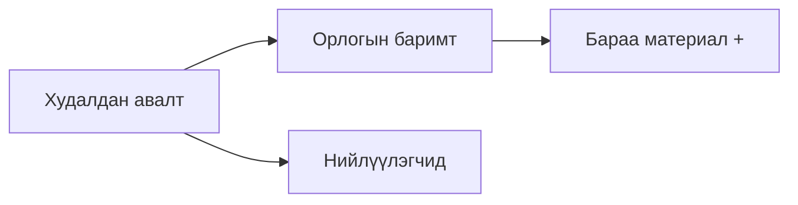

# Худалдан авалт

Худалдан авалтын модуль нь нийлүүлэгчдээс бараа материал худалдан авах, орлогын баримт бүртгэх боломжийг олгоно.

## Орлогын баримт

### Шинэ баримт үүсгэх

1. `Худалдан авалт` цэснээс `Шинэ баримт` товч дарна.
2. Нийлүүлэгч сонгох.
3. Бараа бүтээгдэхүүн, тоо ширхэг, үнийг оруулна.
4. Баталгаажуулах: Баримтыг баталгаажуулснаар барааны үлдэгдэл автоматаар нэмэгдэнэ.

## Нийлүүлэгчид

Нийлүүлэгчдийн бүртгэл хөтлөх:

- Нийлүүлэгчийн нэр, утас, хаяг
- Худалдан авалтын түүх
- Төлбөрийн нөхцөл
