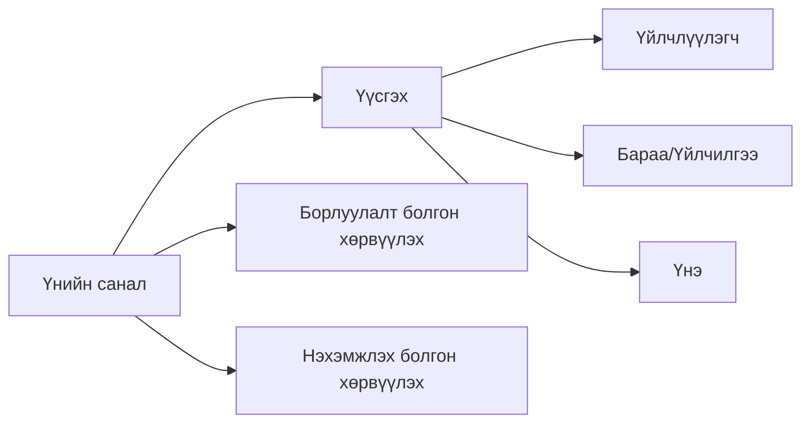

# Үнийн санал

Үнийн санал нь үйлчлүүлэгчид үнийн мэдээлэл өгөх, дараа нь борлуулалтын баримт эсвэл нэхэмжлэх болгон хөрвүүлэхэд ашиглагдана.

## Үнийн санал үүсгэх

1. `Үнийн санал` цэснээс `Шинэ санал` товч дарна.
2. Үйлчлүүлэгч сонгох.
3. Бараа/үйлчилгээ, тоо ширхэг, үнийг оруулна.
4. Хадгалах.

## Борлуулалт/Нэхэмжлэх болгон хөрвүүлэх

Үнийн саналыг баталгаажуулсны дараа:

- `Борлуулалт болгон хөрвүүлэх` — борлуулалтын баримт автоматаар үүснэ
- `Нэхэмжлэх болгон хөрвүүлэх` — нэхэмжлэх автоматаар үүснэ
