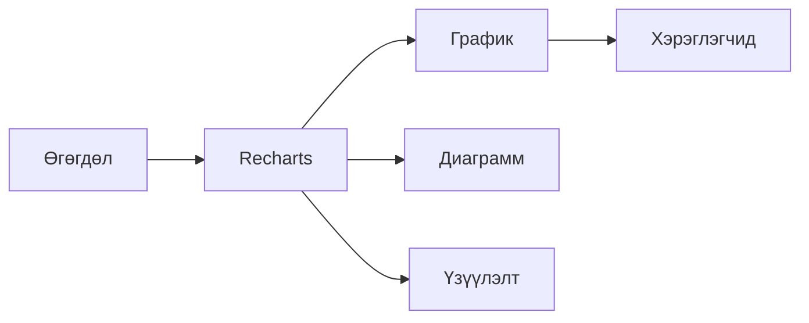

# Тайлан

Харагдац график, KPI үзүүлэлтүүд, санхүүгийн шинжилгээ.

## Боломжит тайлангууд

| Тайлан                               | Тайлбар                                          |
| ------------------------------------ | ------------------------------------------------ |
| **Санхүүгийн хураангуй**             | Нийт орлого, зарлага, ашиг                       |
| **Бүтээгдэхүүний орлого ба ашиг**    | Бүтээгдэхүүн тус бүрийн орлого, ашгийн шинжилгээ |
| **Зардлын бүтэц**                    | Зардлын ангиллаар доут диаграмм                  |
| **Нөөцийн хөдөлгөөний чиг хандлага** | Бараа материалын хөдөлгөөний график              |
| **Хүлээгдэж буй борлуулалт**         | Баталгаажаагүй борлуулалтын жагсаалт             |
| **Шимтгэлийн хураангуй**             | Борлуулагчдын шимтгэлийн дүн                     |

## Тайлан харах

`Тайлан` цэснээс дараах төрлийн харагдацуудыг үзэх боломжтой:

- **Санхүүгийн хураангуй** — нийт орлого, зарлага, цэвэр ашиг
- **Бүтээгдэхүүний орлого ба ашиг** — бүтээгдэхүүн тус бүрийн орлого, ашгийн шинжилгээ
- **Зардлын бүтэц** — зардлыг ангиллаар харуулсан доут диаграмм
- **Нөөцийн хөдөлгөөний чиг хандлага** — бараа материалын хөдөлгөөний чиг хандлагын график
- **Хүлээгдэж буй борлуулалт** — баталгаажаагүй борлуулалтын жагсаалт
- **Шимтгэлийн хураангуй** — борлуулагчдын шимтгэлийн дүн

> Тайлангийн өгөгдлийг CSV форматаар экспортлох боломжтой.
