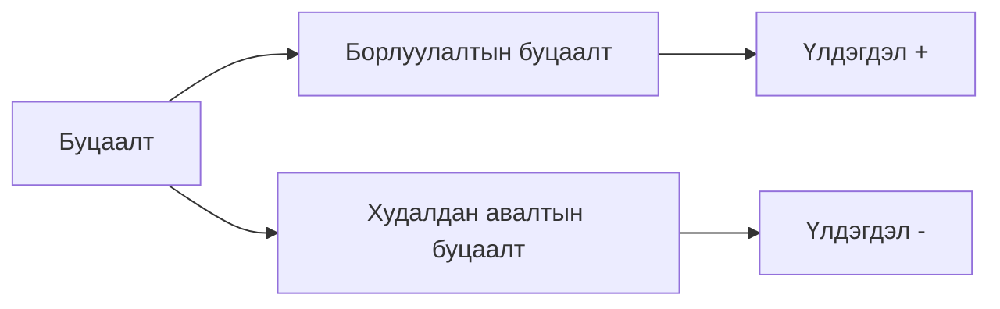

# Буцаалт

Борлуулалт болон худалдан авалтын буцаалтыг бүртгэх, нөөцийг автоматаар сэргээх.

## Борлуулалтын буцаалт

Хэрэглэгч бараагаа буцаасан тохиолдолд:

1. Анхны борлуулалтын баримтыг сонгох.
2. Буцаах бараа, тоо ширхэгийг сонгох.
3. Шалтгаан бичих.
4. Баталгаажуулах — барааны үлдэгдэл автоматаар нэмэгдэнэ.

## Худалдан авалтын буцаалт

Нийлүүлэгчид бараа буцаах:

1. Анхны орлогын баримтыг сонгох.
2. Буцаах бараа, тоо ширхэгийг сонгох.
3. Баталгаажуулах — барааны үлдэгдэл автоматаар хасагдана.
