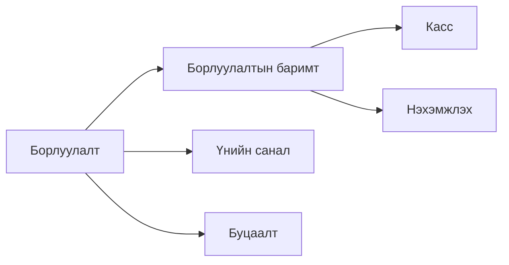
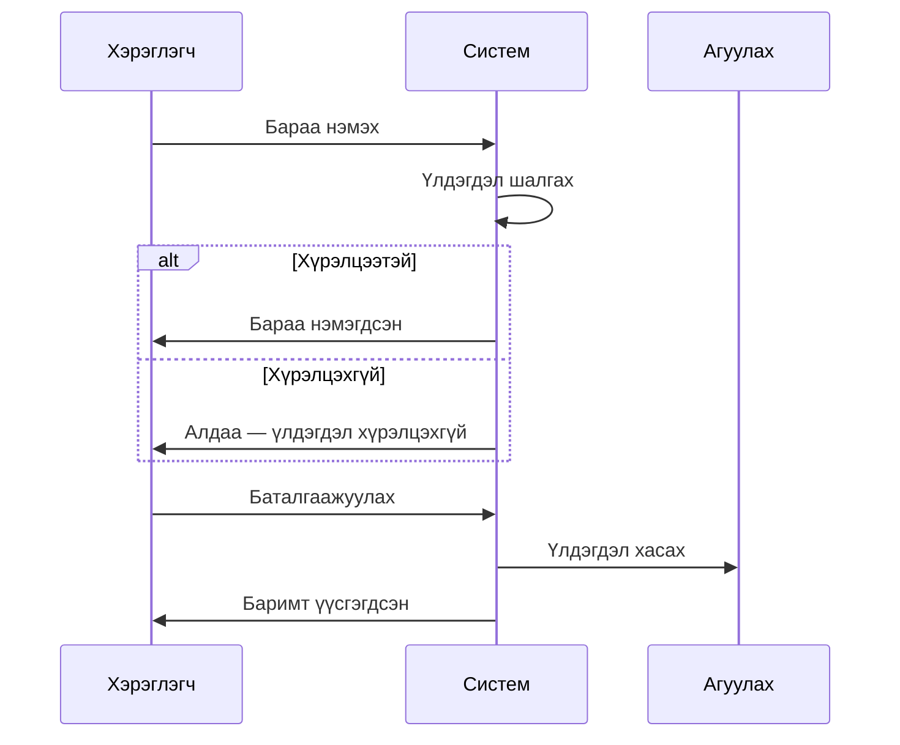

# Борлуулалт

Борлуулалтын модуль нь бараа, үйлчилгээний борлуулалтыг бүртгэх, кассын үйл ажиллагаа, үнийн санал гаргах боломжийг олгоно.

## Борлуулалтын баримт

### Шинэ баримт үүсгэх

1. `Борлуулалт` цэснээс `Шинэ баримт` товч дарна.
2. Бараа бүтээгдэхүүн нэмэх: Бүтээгдэхүүний нэр, тоо ширхэг, үнийг оруулна.
3. Төлбөрийн хэлбэр сонгох: **Бэлэн**, **Карт**, **Мобайл банк** гэсэн 3 төрлийн төлбөрийн хэлбэрээр
   төлбөрөө тусгаарлан бүртгэх боломжтой.
4. Борлуулагч (salesperson) сонгох.
5. Баталгаажуулах: Баримтыг баталгаажуулснаар барааны үлдэгдэл автоматаар хасагдана.

### Онцлогууд

- **Мөр оруулах**: Нэг баримтад олон төрлийн бараа оруулах
- **Барааны үлдэгдэл шалгах**: Баримт үүсгэх үед үлдэгдэл автомат шалгалт
- **Борлуулагч томилох**: Борлуулалтын ажилтан бүртгэх
- **Төлбөрийн хэлбэр**: Хосолсон төлбөр (бэлэн + карт гэх мэт)

## Үнийн санал

Үнийн санал нь үйлчлүүлэгчид үнийн мэдээлэл өгөх, дараа нь борлуулалтын баримт эсвэл нэхэмжлэх болгон хөрвүүлэх боломжтой.

## Буцаалт

Борлуулалтын буцаалтыг [Буцаалт](/guide/features/returns) хэсгээс үзнэ үү.
