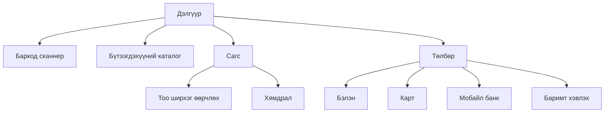

# Дэлгүүр (POS)

Баркод уншигчаар тоноглогдсон кассын цонх.

## Онцлогууд

### Баркод сканнер

Бүтээгдэхүүний баркодыг уншиж, сагсанд шууд нэмэх боломжтой.
Гар утасны камераар баркод унших.

### Сагс

- Бараа нэмэх, тоо ширхэг өөрчлөх, хасах
- Хямдрал хэрэглэх
- Үйлчлүүлэгч, борлуулагч сонгох
- Нийт дүн автомат тооцоо

### Касс

Төлбөрийн хэлбэр сонгох:

- **Бэлэн** — бэлэн мөнгөөр төлөх
- **Карт** — банкны картаар төлөх
- **Мобайл банк** — аппликейшнаар төлөх

### Баримт хэвлэх

Дэлгүүрийн баримтыг термаль принтерт тохируулан хэвлэх.
`@media print` ашиглан хэвлэх загвартай.

### Борлуулалтын түүх

Кассны өмнөх борлуулалтуудыг харах, буцаалт хийх.
