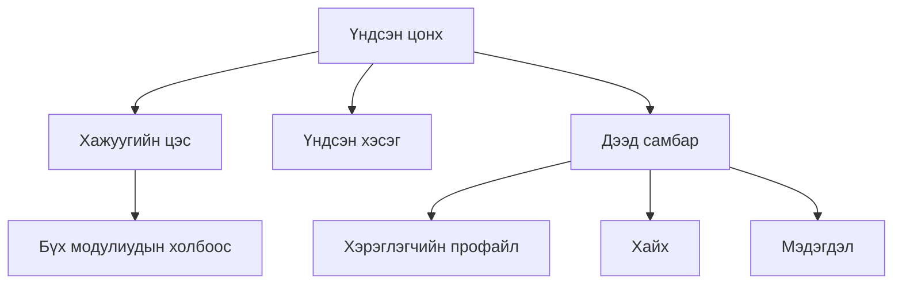

# Эхлэх заавар

## Системд нэвтрэх

1. **Бүртгэл үүсгэх**: Системийн URL хаягаар орж, `Бүртгүүлэх` товч дарна.
2. **Байгууллагаа бүртгэх**: Байгууллагын нэр, утас, хаяг зэрэг мэдээллийг оруулна.
3. **Нэвтрэх**: Имэйл, нууц үгээр системд нэвтрэнэ.

> Системд анх нэвтрэхэд таны имэйл хаяг баталгаажуулах холбоос илгээгдэнэ.

## Үндсэн цонхны бүтэц

- **Хажуугийн цэс** — бүх модулиуд руу хурдан нэвтрэх
- **Үндсэн хэсэг** — сонгосон модулийн агуулга
- **Дээд самбар** — хэрэглэгчийн тохиргоо, хайлт, мэдэгдэл

## Анхны тохиргоо

Системд нэвтэрсний дараа дараах тохиргоог хийхийг зөвлөж байна:

1. **Байгууллагын мэдээлэл** — нэр, хаяг, утас, лого
2. **Ажилтнууд** — хэрэглэгч нэмэх, эрх хуваарилах
3. **Агуулахууд** — агуулахын бүртгэл үүсгэх
4. **Бүтээгдэхүүний ангилал** — ангилал үүсгэх
5. **Дансны төлөвлөгөө** — санхүүгийн данснуудыг тохируулах

> Дэлгэрэнгүй мэдээллийг [Тохиргоо хэсгээс](/guide/features/settings) үзнэ үү.
