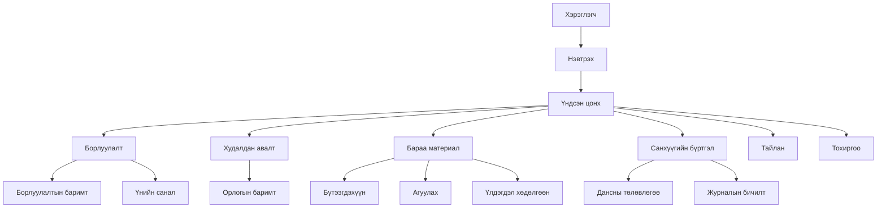
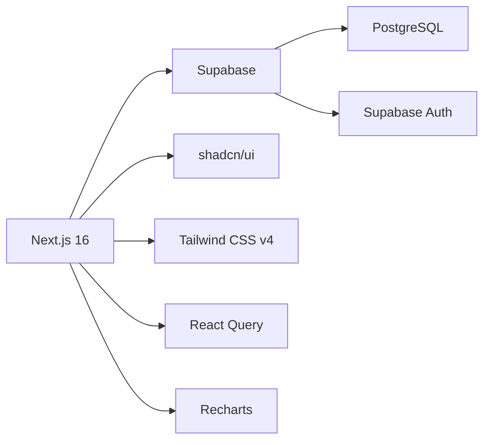

# Zer Mini ERP — Хэрэглэгчийн гарын авлага

> Zer нь Монголын жижиг, дунд бизнес эрхлэгчдэд зориулсан Mini ERP (Аж ахуйн нэгжийн нөөцийн төлөвлөлт) систем юм.
> Бараа материал, борлуулалт, худалдан авалт, санхүүгийн бүртгэл болон бусад үйл ажиллагааг нэгдсэн удирдлага дор авчирна.

## Эхлэх

- [Эхлэх заавар](/guide/getting-started) — системд нэвтрэх, тохиргоо хийх
- [Түгээмэл асуултууд](/guide/faq) — байнга асуудаг асуултууд

## Үндсэн модулиуд

| Модуль                                      | Тайлбар                                      |
| ------------------------------------------- | -------------------------------------------- |
| [Борлуулалт](/guide/features/sales)         | Борлуулалтын баримт, касс, үнийн санал       |
| [Худалдан авалт](/guide/features/purchases) | Худалдан авалтын баримт, ханган нийлүүлэгчид |
| [Бараа материал](/guide/features/inventory) | Бүтээгдэхүүн, агуулах, нөөцийн хөдөлгөөн     |
| [Зарлага](/guide/features/expenses)         | Зардлын бүртгэл, ангилал                     |
| [Буцаалт](/guide/features/returns)          | Бараа буцаалт, нөөц сэргээх                  |
| [Нэхэмжлэх](/guide/features/invoices)       | Нэхэмжлэх үүсгэх, татаж авах                 |
| [Хямдрал](/guide/features/discounts)        | Хямдралын тохиргоо                           |
| [Шимтгэл](/guide/features/commissions)      | Ажилтны шимтгэлийн бүртгэл                   |
| [Тайлан](/guide/features/reports)           | График, үзүүлэлт, шинжилгээ                  |
| [Дэлгүүр](/guide/features/shop)             | Баркод уншигчтай кассын цонх                 |
| [Тохиргоо](/guide/features/settings)        | Байгууллага, хэрэглэгч, эрх, тохиргоо        |

## Технологийн стек

## Системийн шаардлага

- **Вэб хөтөч**: Chrome, Firefox, Edge, Safari — сүүлийн 2 хувилбар
- **Интернет холболт**: тогтвортой интернет холболт
- **Дэлгэцийн нягтрал**: 375px (гар утас) -аас эхлэн бүх төхөөрөмжид тохирно
