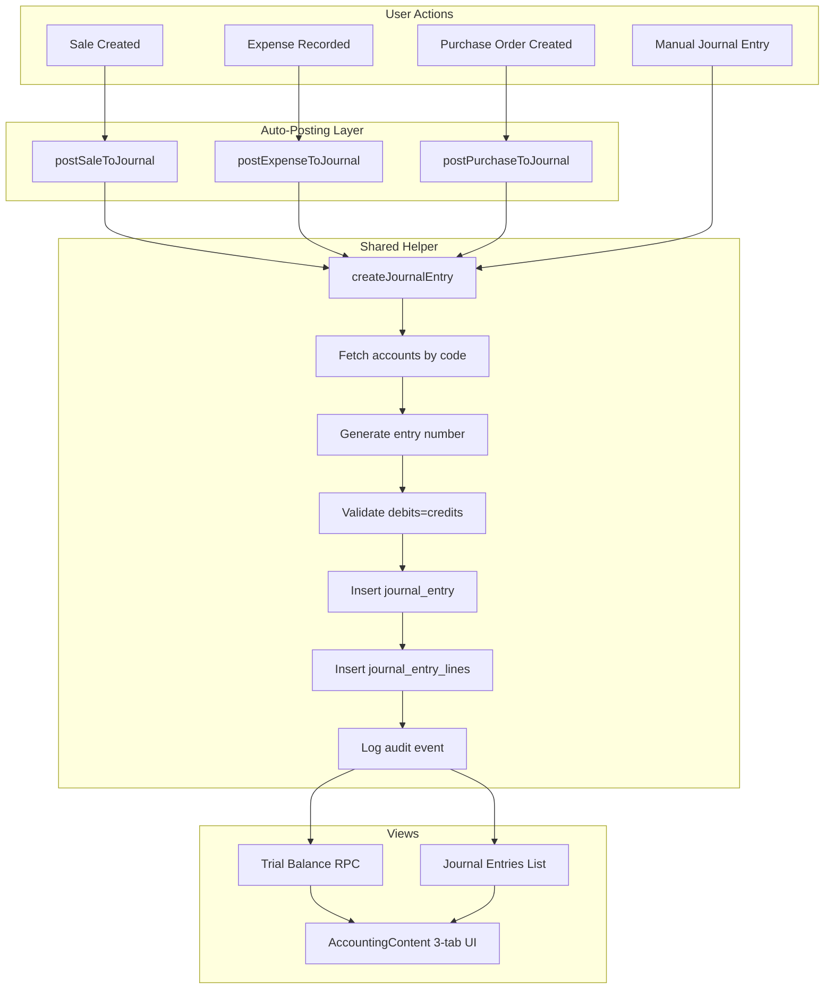

# Accounting

Active contributors: themuuln

## Purpose

The Accounting module implements a double-entry bookkeeping system with chart of accounts, journal entries with debit/credit lines, trial balance, and automatic posting from sales, expenses, and purchases. It provides three tabbed views: Trial Balance, Journal Entries, and Chart of Accounts. The module supports branch-scoped and consolidated views.

## Directory Layout

| Path | Type | Purpose |
|---|---|---|
| `src/app/(dashboard)/accounting/page.tsx` | Server Component | Fetches trial balance, accounts, journal entries with branch/consolidated filtering |
| `src/app/(dashboard)/accounting/accounting-content.tsx` | Client Component | Three-tab layout: trial balance, journal entries, chart of accounts |
| `src/app/(dashboard)/accounting/actions.ts` | Server Action | `createJournalEntry`, `createAccount`, `updateJournalEntry`, `deleteJournalEntry`, `toggleAccountActive` |
| `src/app/(dashboard)/accounting/new/page.tsx` | Server Component | Redirects to `/accounting?create=true` |
| `src/lib/accounting.ts` | Library | `postSaleToJournal`, `postExpenseToJournal`, `postPurchaseToJournal` — auto-posting helpers |
| `src/lib/accounting-utils.ts` | Library | `createJournalEntry` — shared helper that reduces ~70% boilerplate for auto-posting |
| `supabase/migrations/20260617000001_create_purchases_quotations_returns_accounting_discounts.sql` | Migration | Creates chart_of_accounts, journal_entries, journal_entry_lines tables, seed_default_chart_of_accounts function, get_trial_balance RPC |

## Key Abstractions

| Abstraction | Type | Purpose |
|---|---|---|
| `TrialBalanceRow` | Type | account_id, code, name, type, debit_balance, credit_balance |
| `AccountRow` | Type | id, code, name, type, parent_id, is_active |
| `JournalEntryRow` | Type | id, entry_date, entry_number, description, journal_entry_lines[] |
| `createJournalEntry()` | Function | Shared helper in accounting-utils.ts used by all auto-posting functions |

## Database Schema

The accounting system is defined in migration `20260617000001_create_purchases_quotations_returns_accounting_discounts.sql`:

- **`chart_of_accounts`**: Accounts with code, name, type (asset/liability/equity/income/expense), parent_id for hierarchy, is_active flag. Unique constraint on (organization_id, code).
- **`journal_entries`**: Entries with entry_date, entry_number (auto-generated `JE-YYYYMMDD-NNNN`), reference_type and reference_id for linking to source documents, description.
- **`journal_entry_lines`**: Lines with account_id, debit_amount, credit_amount, with constraints ensuring non-negative values and at least one non-zero amount.

The `seed_default_chart_of_accounts` function creates 5 account groups:
- 1000: Asset (1100 Cash, 1200 Bank, 1300 Receivables, 1400 Inventory)
- 2000: Liability (2100 Payables, 2200 Taxes)
- 3000: Equity (3100 Initial Capital, 3200 Retained Earnings)
- 4000: Income (4100 Sales Revenue, 4200 Other Income)
- 5000: Expense (5100 COGS, 5200 Operating Expenses, 5300 Other Expenses)

The `get_trial_balance` RPC computes debit/credit balances per account by sum of journal_entry_lines joined with journal_entries, with type-specific logic (asset/expense = normal debit, liability/equity/income = normal credit).

## How It Works

### Three-Tab Interface

The `AccountingContent` component shows three tabs:

1. **Trial Balance**: Lists all accounts with code, name, type badge, debit balance, and credit balance. Empty state shown when no data exists.
2. **Journal Entries**: Lists entries with date, number, description, total debits/credits. Clicking a row opens the `JournalEntryDetailDrawer`. The `JournalEntryCreateDrawer` is shown for creating new entries.
3. **Chart of Accounts**: Lists all accounts with code, name, type badge, parent account, and active/inactive toggle. The `AccountCreateDrawer` is shown for creating new accounts.

### Branch & Consolidated Views

The accounting page supports three viewing modes:
- **Branch-scoped**: When the user is limited to a branch, only that branch's data is shown
- **Single branch**: Admin users can filter by a specific branch via `?branch=xxx`
- **Consolidated**: Admin users can view all branches' data combined via `?consolidated=true`, toggled by a Switch component

### Manual Journal Entries

Users can create journal entries manually via the `JournalEntryCreateDrawer`. The `createJournalEntry` server action:

1. Validates entry date, description, and line items
2. Generates entry number via `generate_journal_entry_number` RPC
3. Validates debits = credits (within 0.01 tolerance)
4. Inserts the journal entry and lines
5. Logs an audit event

### Auto-Posting

Three auto-posting functions in `src/lib/accounting.ts` use the shared `createJournalEntry` helper from `src/lib/accounting-utils.ts`:

1. **`postSaleToJournal`**: Posts when a sale is created or updated
   - Debits Cash/Receivables (1200/1300) for the paid/total amount
   - Credits Sales Revenue (4100)
   - If items exist, debits COGS (5100) and credits Inventory (1400)

2. **`postExpenseToJournal`**: Posts when an expense is recorded
   - Debits the expense account (5200)
   - Credits Cash/Bank (1200)

3. **`postPurchaseToJournal`**: Posts when a purchase order is created or received
   - Debits Inventory (1400)
   - Credits Accounts Payable (2100) for draft/ordered, or Cash/Bank (1200) for received

The shared `createJournalEntry` function in `accounting-utils.ts` handles:
- Fetching chart_of_accounts by code
- Generating entry number
- Validating debits = credits
- Creating the journal entry and lines
- Logging audit events

## Key Source Files

| File | Purpose |
|---|---|
| `src/app/(dashboard)/accounting/page.tsx` | Server component — fetches trial balance, accounts, journal entries |
| `src/app/(dashboard)/accounting/accounting-content.tsx` | Three-tab UI with trial balance, journal entries, chart of accounts |
| `src/app/(dashboard)/accounting/actions.ts` | All accounting server actions |
| `src/lib/accounting.ts` | Auto-posting functions: postSaleToJournal, postExpenseToJournal, postPurchaseToJournal |
| `src/lib/accounting-utils.ts` | Shared `createJournalEntry` helper |
| `supabase/migrations/20260617000001_create_purchases_quotations_returns_accounting_discounts.sql` | Full accounting schema and seed data |
