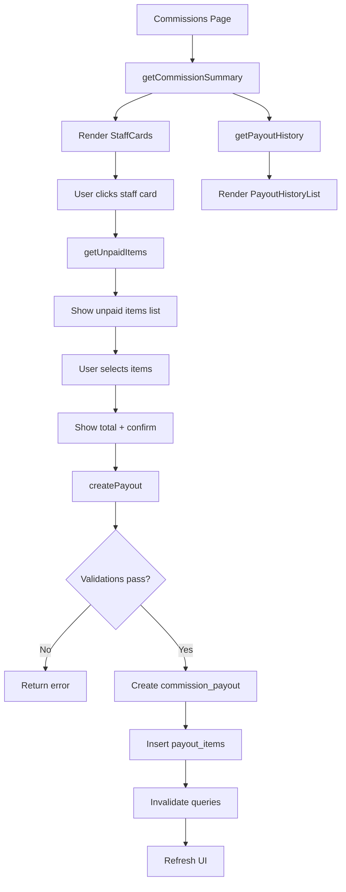

# Commissions

Active contributors: themuuln

## Purpose

The Commissions module tracks sales commissions per staff member, manages commission payouts, and provides a payout history. Commission amounts are stored per sale item, and the module aggregates earned, paid, and unpaid totals per staff member. The UI shows staff summary cards, an unpaid items drill-down with batch payout creation, and a payout history list.

## Directory Layout

| Path | Type | Purpose |
|---|---|---|
| `src/app/(dashboard)/commissions/page.tsx` | Server Component | Commission overview page — fetches org ID, renders `CommissionContent` |
| `src/app/(dashboard)/commissions/commission-content.tsx` | Client Component | Orchestrates staff cards, drill-down, payout history using TanStack Query |
| `src/app/(dashboard)/commissions/actions.ts` | Server Action | `getCommissionSummary`, `getUnpaidItems`, `getPayoutHistory`, `createPayout` |
| `src/app/(dashboard)/commissions/components/staff-card.tsx` | Client Component | Staff summary card showing total/paid/unpaid amounts |
| `src/app/(dashboard)/commissions/components/staff-drill-down.tsx` | Client Component | Unpaid items list with selection, confirmation, and payout form |
| `src/app/(dashboard)/commissions/components/payout-history.tsx` | Client Component | Payout history table |
| `supabase/migrations/20260614160905_add_commission_support.sql` | Migration | Adds `salesperson_id` to sales, `commission_amount` to sale_items, creates `commission_payouts` and `commission_payout_items` tables |

## Key Abstractions

| Abstraction | Type | Purpose |
|---|---|---|
| `StaffCommissionSummary` | Type | Per-staff summary (profileId, fullName, totalEarned, totalPaid, totalUnpaid) |
| `UnpaidSaleItem` | Type | Sale item with commission that hasn't been paid out |
| `PayoutRecord` | Type | Payout record with profile, amount, item count, status |
| `CreatePayoutState` | Type | Payout creation result state |

## Database Schema

The commission system uses two main tables added by migration `20260614160905_add_commission_support.sql`:

- `commission_payouts` — Stores payout batches with organization_id, profile_id, paid_by, total_amount, notes, status, branch_id
- `commission_payout_items` — Links payouts to individual sale_items with the commission amount, with a UNIQUE constraint on sale_item_id to prevent double-payment

Additionally, `sales.salesperson_id` references the staff profile who made the sale, and `sale_items.commission_amount` stores the commission earned for each line item.

## How It Works

### Commission Summary

When the commissions page loads, `CommissionContent` uses three TanStack Query hooks:

1. `useCommissionSummary(orgId)` — Calls `getCommissionSummary` which iterates over all profiles in the org, finds their non-cancelled sales, sums commission_amount from sale_items to get totalEarned, and sums commission_payout_items to get totalPaid. Only profiles with earned commissions are returned.

2. `useUnpaidItems(orgId, profileId)` — Called when a staff card is selected. Gets all non-cancelled sales for the profile, finds sale_items with commission_amount > 0, then subtracts items already referenced in commission_payout_items.

3. `usePayoutHistory(orgId)` — Calls `getPayoutHistory` which fetches all commission_payouts with profile names and item counts.

### Staff Cards

Each staff member with earned commissions is shown as a `StaffCard` — a button with the staff avatar initials, three metric boxes (total earned, paid, unpaid), and selection state. Clicking a card expands the drill-down below.

### Unpaid Items Drill-Down

`StaffDrillDown` shows all unpaid sale items for the selected staff member with:

- Checkbox per item
- Select All / Deselect All toggle
- Real-time total of selected commissions
- Confirmation step before payout creation
- Server action payout via form with `useActionState`

The `createPayout` server action:

1. Validates the payout request (profile exists, items selected)
2. Verifies all sale_items belong to non-cancelled sales for that profile
3. Checks for double-payment (items already in commission_payout_items)
4. Calculates total amount
5. Creates the `commission_payout` record
6. Inserts `commission_payout_items` records
7. On failure, rolls back the payout record

### Payout History

`PayoutHistoryList` shows all completed payouts in a table with columns: date, staff name, amount, item count, paid by, notes.

## Key Source Files

| File | Purpose |
|---|---|
| `src/app/(dashboard)/commissions/commission-content.tsx` | Client orchestrator for the commissions page |
| `src/app/(dashboard)/commissions/actions.ts` | All commission server actions (summary, unpaid items, payout history, create payout) |
| `src/app/(dashboard)/commissions/components/staff-card.tsx` | Staff summary card component |
| `src/app/(dashboard)/commissions/components/staff-drill-down.tsx` | Unpaid items with payout creation |
| `src/app/(dashboard)/commissions/components/payout-history.tsx` | Payout history table |
| `supabase/migrations/20260614160905_add_commission_support.sql` | DB schema for commissions |
