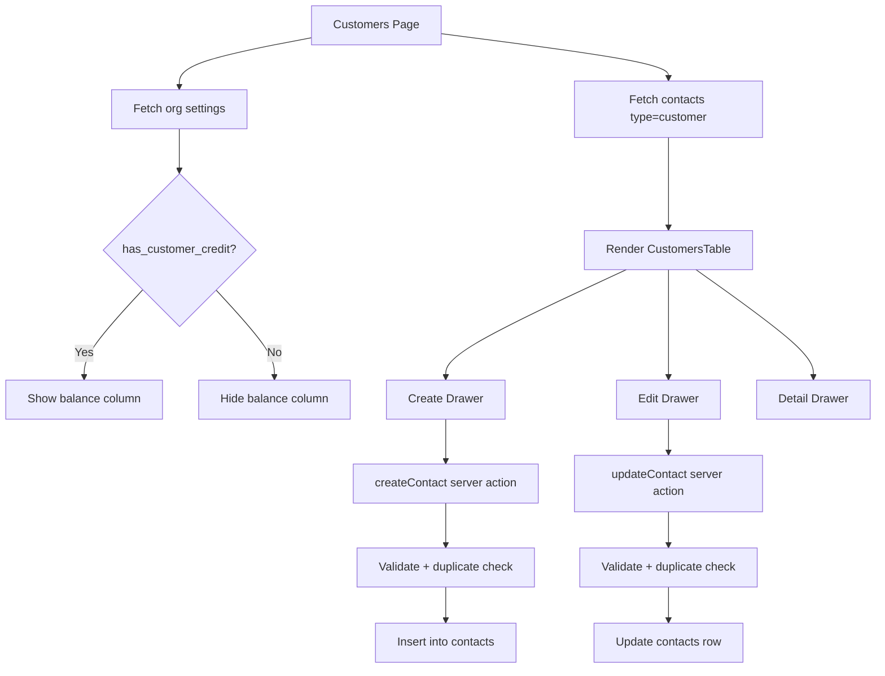

# Customers

Active contributors: themuuln

## Purpose

The Customers module manages the customer (contact) database. It provides create, edit, and detail views via slide-in drawers, a searchable customers data table with balance tracking, and CSV export. Customers are stored in the unified `contacts` table with `type = 'customer'`.

## Directory Layout

| Path | Type | Purpose |
|---|---|---|
| `src/app/(dashboard)/customers/page.tsx` | Server Component | Fetches customers and org settings; renders table or empty state |
| `src/app/(dashboard)/customers/actions.ts` | Server Action | `createContact` and `updateContact` — shared with suppliers |
| `src/components/customers/customers-table.tsx` | Client Component | TanStack DataTable with columns for name, phone, email, balance, actions |
| `src/components/customers/customer-create-drawer.tsx` | Client Component | Slide-in drawer with react-hook-form + zod for creating a customer |
| `src/components/customers/customer-edit-drawer.tsx` | Client Component | Slide-in drawer for editing a customer, uses optimistic updates |
| `src/components/customers/customer-detail-drawer.tsx` | Client Component | Slide-in drawer showing customer detail with info rows |

## Key Abstractions

| Abstraction | Type | Purpose |
|---|---|---|
| `CustomerRow` | Type | Row shape for the data table (id, name, phone, email, address, balance) |
| `CustomerDetailData` | Type | Shape for the detail drawer |
| `CustomerEditData` | Type | Shape for the edit drawer |

## How It Works

### Customer List

The server component at `src/app/(dashboard)/customers/page.tsx`:

1. Fetches the organization's `has_customer_credit` setting to determine whether to show the balance column
2. Queries all contacts with `type = 'customer'` ordered by creation date (descending)
3. Passes data and settings to the client `CustomersTable` component

The `CustomersTable` uses `DataTable` with configurable columns. The balance column is conditionally included based on the org setting. Clicking a customer name or the eye icon opens the `CustomerDetailDrawer`. The pencil icon opens the `CustomerEditDrawer`.

### Customer Creation

The `CustomerCreateDrawer` is a slide-in drawer with a form using react-hook-form + zod. It supports:

- Controlled `open`/`onOpenChange` props for the `?create=true` flow
- Optimistic UI updates via `useOptimisticCreate` hook (TanStack Query)
- Fields: name (required), phone, email, address
- Duplicate name detection in the server action

### Customer Edit

The `CustomerEditDrawer` uses `useOptimisticUpdate` for instant UI feedback. It pre-populates the form with existing values and submits to `updateContact`.

### Customer Detail

The `CustomerDetailDrawer` displays customer info in a structured layout using `InfoRow` components: name, phone, email, address, and balance.

### CSV Export

An `ExportButton` at the top-right provides CSV export via `/api/export/customers`.

### Balance Tracking

The balance column is conditionally shown based on the `has_customer_credit` org setting. When enabled, each customer's `balance` field (from the `contacts` table) is displayed and formatted as currency.

## Key Source Files

| File | Purpose |
|---|---|
| `src/app/(dashboard)/customers/page.tsx` | Server component — fetches customers and settings |
| `src/app/(dashboard)/customers/actions.ts` | `createContact` and `updateContact` server actions with validation |
| `src/components/customers/customers-table.tsx` | DataTable with columns, detail/edit drawers, search |
| `src/components/customers/customer-create-drawer.tsx` | Create drawer with form validation and optimistic create |
| `src/components/customers/customer-edit-drawer.tsx` | Edit drawer with optimistic update |
| `src/components/customers/customer-detail-drawer.tsx` | Detail drawer with InfoRow layout |
