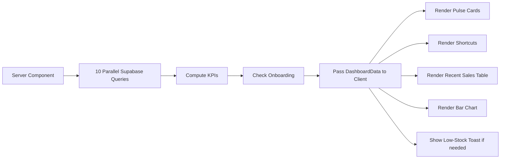

# Dashboard

Active contributors: themuuln

## Purpose

The dashboard provides a daily operations overview for the organization. It displays KPI cards, quick action links, a recent sales table, and a 30-day sales trend chart. It also shows an onboarding checklist for new organizations and a low-stock toast notification.

## Directory Layout

| Path | Type | Purpose |
|---|---|---|
| `src/app/(dashboard)/page.tsx` | Server Component | Fetches all dashboard data in parallel, computes KPIs, renders the client component and onboarding sidebar |
| `src/app/(dashboard)/dashboard-client.tsx` | Client Component | Renders stat cards, shortcut grid, recent sales table, monthly trend chart, low-stock toast |

## Key Abstractions

| Abstraction | Type | Purpose |
|---|---|---|
| `DashboardData` | Interface | Shape for all dashboard stats passed from server to client |
| `PulseCard` | Component | Color-coded stat card for today's metrics (sales, expenses, net profit, pending) |
| `ShortcutCard` | Component | Link card showing a metric count (products, customers, suppliers, etc.) |
| `HeroActionCard` | Component | Large quick-action card that opens create drawers |
| `statusBadgeVariant()` | Function | Maps sale status to badge variant |
| `statusLabel()` | Function | Maps sale status to Mongolian label |

## How It Works

### Data Fetching

The server component (`page.tsx`) runs 10 parallel Supabase queries:

1. **Total products** — count of non-deleted products
2. **Total customers** — count of contacts with `type = 'customer'`
3. **Total suppliers** — count of contacts with `type = 'supplier'`
4. **Today's sales** — sum of `total_amount` for sales today
5. **Today's expenses** — sum of `amount` for expenses today
6. **Low stock products** — all products with their `current_stock` and `min_stock`
7. **Pending sales** — count of sales with `status = 'pending'`
8. **Recent 5 sales** — last 5 sales with contact name, ordered by `created_at`
9. **Inventory value** — sum of `cost_price * current_stock` across all products
10. **Monthly trend** — all sales in the last 30 days, aggregated by day

Branch-scoped queries use `withBranchFilter()` to restrict data to the user's assigned branch when `isBranchScoped` is true.

### Onboarding Checklist

After computing KPIs, the server runs two additional queries to determine onboarding progress:
- Whether any sales exist
- Whether more than one profile exists (team)

Three checklist items are shown if not all are done:
- Add products
- Make first sale
- Invite team members

### Client Rendering

The `DashboardClient` component renders five sections:

1. **Hero Quick Action Cards** — three cards linking to new sale, new expense, and products page
2. **Today's Pulse Strip** — four `PulseCard` components showing today's sales, expenses, net profit, and pending count
3. **Quick Shortcuts Grid** — six `ShortcutCard` components linking to products, customers, suppliers, inventory, low stock, and pending sales
4. **Recent Sales Table** — a simple HTML table showing the last 5 sales with date, contact, amount, and status
5. **Monthly Trend Chart** — a Recharts `BarChart` showing daily sales for the last 30 days

### Low-Stock Toast

A module-level `lowStockToastShownInSession` flag ensures the toast fires only once per page load session. The `useEffect` in `DashboardClient` checks if `lowStockCount > 0` and shows a `sonner` warning toast.

## Key Source Files

| File | Role |
|---|---|
| `src/app/(dashboard)/page.tsx` | Server component: fetches data, computes KPIs, renders client + onboarding |
| `src/app/(dashboard)/dashboard-client.tsx` | Client component: renders all dashboard UI with Recharts chart |
| `src/lib/erp.ts` | `requireAppContext()` — provides `supabase`, `organizationId`, `branchId`, `isBranchScoped` |
| `src/lib/branches.ts` | `withBranchFilter()` — applies branch scoping to Supabase queries |
| `src/lib/format.ts` | `formatCurrency()`, `formatDate()` — formatting utilities |
