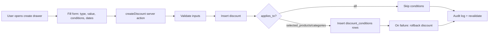

# Discounts

Active contributors: themuuln

## Purpose

The Discounts module manages discount and promotion rules (хямдрал, урамшуулал) for products. Users create discounts with flexible conditions (applies to all products, selected products, or selected categories), validity date ranges, usage limits, and active/inactive toggling. Discounts can be percentage-based or fixed-amount, with a minimum purchase amount threshold. The module also provides an `applyDiscount` server action for runtime cart validation.

## Directory Layout

| Path | Type | Purpose |
|---|---|---|
| `src/app/(dashboard)/discounts/page.tsx` | Server Component | Fetches discounts and their conditions with branch filter |
| `src/app/(dashboard)/discounts/discounts-content.tsx` | Client Component | Manages drawer state, renders ErpDataTable |
| `src/app/(dashboard)/discounts/actions.ts` | Server Actions | `createDiscount`, `updateDiscount`, `toggleDiscountActive`, `applyDiscount` |
| `src/components/discounts/discount-create-drawer.tsx` | Client Component | Slide-in drawer with discount creation form |
| `src/components/discounts/discount-detail-drawer.tsx` | Client Component | Slide-in drawer with discount detail view |

## Key Abstractions

| Abstraction | Type | Purpose |
|---|---|---|
| `DiscountRow` | Type | Row shape with name, type, value, applies_to, dates, usage, conditions |
| `DiscountDetailData` | Type | Shape for detail drawer (excludes conditions) |
| `DiscountCreateDrawer` | Component | Drawer with type/value, applies_to, conditions, dates, limits |
| `DiscountDetailDrawer` | Component | Drawer with value card, info rows, status, conditions |
| `createDiscount` | Server Action | Creates discount with conditions, validates input |
| `updateDiscount` | Server Action | Updates discount fields and replaces conditions |
| `toggleDiscountActive` | Server Action | Toggles is_active with branch-scoped access |
| `applyDiscount` | Server Action | Validates and applies discount to a cart total |

## How It Works

### Discount Model

Each discount has these key attributes:

| Field | Description |
|---|---|
| `type` | `"percentage"` or `"fixed_amount"` |
| `value` | Percentage (0-100) or fixed amount in MNT |
| `applies_to` | `"all"`, `"selected_products"`, or `"selected_categories"` |
| `min_purchase_amount` | Minimum cart total required for the discount to apply |
| `valid_from` / `valid_until` | Date range for validity |
| `usage_limit` | Maximum number of times the discount can be used (null = unlimited) |
| `used_count` | Current usage count (incremented on each application) |
| `is_active` | Whether the discount is currently active |

Conditions are stored in a separate `discount_conditions` table, linked by `discount_id`. Each condition has a `condition_type` (`"product"` or `"category"`) and a `condition_value` (the product ID or category ID).

### Discount Creation

1. User clicks "Шинэ хямдрал" button in the `DiscountsContent` page shell
2. `DiscountCreateDrawer` opens with a react-hook-form + zod form
3. Form sections:
   - **Name and Description** -- basic info
   - **Type and Value** -- radio group for percentage vs fixed amount; currency/percentage input
   - **Applies to** -- radio group: all products, selected products, or selected categories
   - **Conditions** -- when "selected_products" or "selected_categories" is chosen, a dynamic list of comboboxes appears for adding specific products/categories
   - **Validity dates** -- start date (required) and end date (optional) via DatePicker
   - **Min purchase amount** -- currency input
   - **Usage limit** -- optional number input
   - **Active toggle** -- Switch component
4. On submit, `createDiscount` server action:
   - Validates inputs (name required, value > 0, percentage <= 100, valid_from required)
   - Inserts the discount record
   - If `applies_to` is `selected_products` or `selected_categories`, inserts condition rows
   - On conditions failure, rolls back the discount
   - Logs audit event
   - Revalidates "discounts" entity cache



### Discount List View

The list uses `ErpDataTable` with columns: name, type (хувь/тогтмол дүн), value, scope (бүх бүтээгдэхүүн/сонгосон бүтээгдэхүүн/сонгосон ангилал), valid from, valid until, usage (used_count / usage_limit), active (тийм/үгүй badge). Clicking a row opens `DiscountDetailDrawer`.

### Runtime Discount Application

The `applyDiscount` server action validates and calculates a discount for a given cart total:

```mermaid
flowchart TD
    A[Client calls applyDiscount] --> B[Fetch discount by ID + org]
    B --> C{is_active?}
    C -- No --> D[Return error: Идэвхгүй]
    C -- Yes --> E{valid_from <= today?}
    E -- No --> F[Return error: Хугацаа эхлээгүй]
    E -- Yes --> G{valid_until? >= today?}
    G -- No --> H[Return error: Хугацаа дууссан]
    G -- Yes --> I{usage_limit reached?}
    I -- Yes --> J[Return error: Хязгаар дууссан]
    I -- No --> K{cartTotal >= min_purchase_amount?}
    K -- No --> L[Return error: Мин дүн хүрээгүй]
    K -- Yes --> M{type?}
    M -- percentage --> N[discountAmount = cartTotal * value / 100]
    M -- fixed_amount --> O[discountAmount = min(value, cartTotal)]
    N --> P[Increment used_count]
    O --> P
    P --> Q[Return discountAmount + totalAfterDiscount]
```

### Discount Editing and Toggling

- **`updateDiscount`** -- updates discount fields and replaces conditions entirely (deletes old, inserts new). If `applies_to` changes to `"all"`, existing conditions are deleted.
- **`toggleDiscountActive`** -- toggles `is_active` on/off with branch-scoped access verification. Logs activation/deactivation audit events.

## Key Source Files

| File | Role |
|---|---|
| `src/app/(dashboard)/discounts/page.tsx` | Server: fetches discounts + conditions |
| `src/app/(dashboard)/discounts/discounts-content.tsx` | Client: manages state, ErpDataTable, drawers |
| `src/app/(dashboard)/discounts/actions.ts` | Server Actions: CRUD + applyDiscount |
| `src/components/discounts/discount-create-drawer.tsx` | Drawer: creation form with conditions |
| `src/components/discounts/discount-detail-drawer.tsx` | Drawer: detail view with value card |
