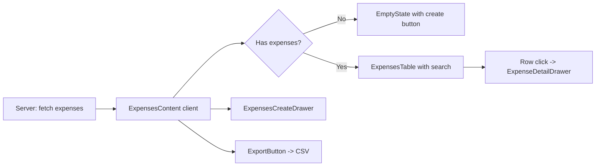

# Expenses

Active contributors: themuuln

## Purpose

The Expenses module provides a simple way to record daily operational expenses with category, amount, date, and payment method. It supports free-form categories (creatable inline), CSV export, and branch-scoped queries.

## Directory Layout

| Path | Type | Purpose |
|---|---|---|
| `src/app/(dashboard)/expenses/page.tsx` | Server Component | Fetches expenses from Supabase with branch filter |
| `src/app/(dashboard)/expenses/expenses-content.tsx` | Client Component | Manages create drawer state, renders table or empty state |
| `src/app/(dashboard)/expenses/expenses-table.tsx` | Client Component | TanStack React Table with search, detail drawer trigger |
| `src/app/(dashboard)/expenses/new/page.tsx` | Server Component | Redirects to `/expenses?create=true` |
| `src/app/(dashboard)/expenses/new/expense-form.tsx` | Client Component | Expense creation form with react-hook-form + zod |
| `src/components/expenses/expenses-create-drawer.tsx` | Client Component | Slide-in drawer wrapping `ExpenseForm` |
| `src/components/expenses/expense-detail-drawer.tsx` | Client Component | Slide-in drawer showing expense detail |

## Key Abstractions

| Abstraction | Type | Purpose |
|---|---|---|
| `ExpenseRow` | Type | Row shape for the expenses table |
| `ExpenseDetailData` | Type | Shape for expense detail drawer |
| `ExpenseForm` | Component | Form with category combobox, amount, date, payment method, description |
| `ExpensesCreateDrawer` | Component | Drawer wrapping ExpenseForm |

## How It Works

### Expense Creation

1. User clicks "Шинэ зарлага" button or navigates to `/expenses?create=true`
2. `ExpensesCreateDrawer` opens with `ExpenseForm`
3. Form fields:
   - **Category** — creatable combobox with preset categories (Түрээс, Тээвэр, Цалин, etc.); user can type a new category to create it on the fly
   - **Amount** — currency input with positive number validation
   - **Date** — date picker, defaults to today
   - **Payment method** — creatable combobox (cash, bank_transfer, card)
   - **Description** — optional text input
4. On submit, `createExpense` server action runs
5. Optimistic UI: the expense is immediately prepended to the query cache
6. On error, cache is rolled back from snapshot

### List View

The list page shows:
- A `PageShell` with title, description, export button, and create button
- `ExpensesTable` (TanStack `DataTable`) with columns: date, category, amount, payment method, description
- Search by category or description
- Sorting and column visibility enabled
- Row click opens `ExpenseDetailDrawer`

### CSV Export

The `ExportButton` component links to `/api/export/expenses` which streams a CSV file named `expenses-YYYY-MM-DD.csv`.

## Key Source Files

| File | Role |
|---|---|
| `src/app/(dashboard)/expenses/page.tsx` | Server: fetches expenses with branch filter |
| `src/app/(dashboard)/expenses/expenses-content.tsx` | Client: drawer state and layout |
| `src/app/(dashboard)/expenses/expenses-table.tsx` | Client: data table with columns |
| `src/app/(dashboard)/expenses/new/expense-form.tsx` | Client: form with validation |
| `src/components/expenses/expenses-create-drawer.tsx` | Drawer wrapping ExpenseForm |
| `src/components/expenses/expense-detail-drawer.tsx` | Drawer with expense detail |
