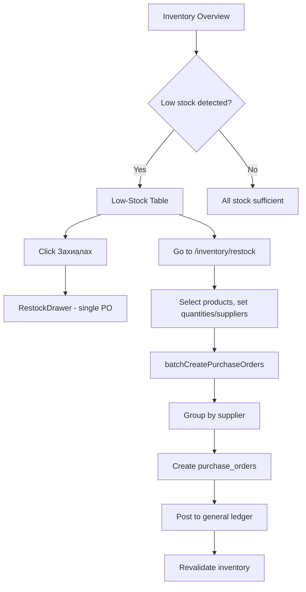
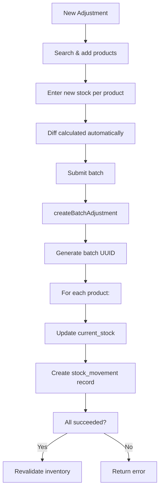

# Inventory

Active contributors: themuuln

## Purpose

The Inventory module provides complete stock management for small retail and wholesale businesses. It covers product stock tracking, valuation, low-stock alerts, stock movements (in/out/adjustment), batch stock adjustments, warehouse management, category management, and a restock/purchase-order flow. All operations are scoped to the user's organization and optional branch filter.

## Directory Layout

| Path | Type | Purpose |
|---|---|---|
| `src/app/(dashboard)/inventory/page.tsx` | Server Component | Inventory overview with KPIs, low-stock table, recent movements, quick links |
| `src/components/inventory/low-stock-section.tsx` | Client Component | Low-stock products table with per-product "Захиалах" button opening `RestockDrawer` |
| `src/components/inventory/restock-drawer.tsx` | Client Component | Quick restock drawer for a single product — creates a purchase order |
| `src/app/(dashboard)/inventory/restock/page.tsx` | Server Component | Full restock page: lists all low-stock products grouped by supplier |
| `src/app/(dashboard)/inventory/restock/restock-content.tsx` | Client Component | Batch restock table: select products, set quantities/costs/suppliers, create multiple POs |
| `src/app/(dashboard)/inventory/restock/actions.ts` | Server Action | `batchCreatePurchaseOrders` — groups selected items by supplier and creates purchase orders with journal posting |
| `src/app/(dashboard)/inventory/movements/page.tsx` | Server Component | Stock movements list page with branch filter |
| `src/app/(dashboard)/inventory/movements/movements-content.tsx` | Client Component | Movements table with detail drawer on row click |
| `src/app/(dashboard)/inventory/movements/actions.ts` | Server Action | `createStockMovement` — creates movement record and atomically updates product stock with rollback |
| `src/app/(dashboard)/inventory/movements/new/page.tsx` | Server Component | New stock movement form page |
| `src/components/inventory/movement-detail-drawer.tsx` | Client Component | Detail drawer for a single stock movement |
| `src/app/(dashboard)/inventory/adjustments/page.tsx` | Server Component | Batch adjustment history, grouped by reference (batch:xxx) |
| `src/app/(dashboard)/inventory/adjustments/adjustments-content.tsx` | Client Component | Adjustment batches table |
| `src/app/(dashboard)/inventory/adjustments/actions.ts` | Server Action | `createBatchAdjustment` — creates adjustment movements for multiple products atomically |
| `src/app/(dashboard)/inventory/adjustments/new/page.tsx` | Server Component | New batch adjustment form page — fetches all products |
| `src/app/(dashboard)/inventory/adjustments/new/adjustment-create-form.tsx` | Client Component | Interactive form: select products, set new stock, see diff, submit batch |
| `src/app/(dashboard)/inventory/warehouses/page.tsx` | Server Component | Warehouse list page (gate check) |
| `src/app/(dashboard)/inventory/warehouses/warehouses-client.tsx` | Client Component | Warehouse CRUD with TanStack Query, create dialog, detail drawer |
| `src/components/inventory/warehouse-detail-drawer.tsx` | Client Component | Warehouse detail slide-in drawer |
| `src/app/(dashboard)/inventory/categories/page.tsx` | Server Component | Category list with product counts |
| `src/components/categories/categories-table.tsx` | Client Component | Categories data table |

## Key Abstractions

| Abstraction | Type | Purpose |
|---|---|---|
| `LowStockProduct` | Type | Shape for low-stock table rows (id, name, sku, unit, current_stock, min_stock, category, cost_price) |
| `RecentMovement` | Type | Shape for recent movements on the overview |
| `MovementRow` | Type | Shape for movements list table |
| `AdjustmentBatchRow` | Type | Shape for adjustment history grouped by batch reference |
| `RestockProductRow` | Type | Shape for restock page table rows |
| `ProductOption` | Type | Shape for product combobox options in movement/adjustment forms |
| `SupplierOption` | Type | Shape for supplier combobox options |
| `Warehouse` | Type | Shape for warehouse records |

## Database Tables

| Table | Purpose |
|---|---|
| `stock_movements` | Records every stock change with type (in/out/adjustment), quantity, unit cost, reference, notes |
| `products.current_stock` | Denormalized stock level on the product row, updated atomically on each movement |
| `products.min_stock` | Minimum stock threshold for low-stock alerts |
| `warehouses` | Physical storage locations, supports multi-warehouse setup |
| `categories` | Product categorization |
| `purchase_orders` | Created during restock flow |
| `purchase_order_items` | Line items for purchase orders |

## How It Works

### Inventory Overview

The overview page at `/inventory` fetches four queries in parallel:

1. All non-deleted products with stock info
2. All products for inventory value calculation (`cost_price * current_stock`)
3. Recent 10 stock movements
4. All suppliers for the restock drawer

It computes three KPIs — **total products**, **inventory value**, and **low-stock count** — displayed in `KpiGrid` with `StatCard` components. Below the KPIs, the `LowStockSection` shows products where `current_stock < min_stock` in a table with a "Захиалах" (Order) button per row. A "Recent Movements" card shows the last 10 movements. Quick link buttons navigate to categories, movements, and warehouses.

### Low-Stock to Restock Flow

There are two entry points for restocking:

1. **Quick restock drawer** (`RestockDrawer`): Opened from the low-stock table's "Захиалах" button. A single-product form with supplier combobox, order date, suggested quantity (`min_stock - current_stock`), unit cost, and total amount. Submits via `createPurchaseOrder` server action.

2. **Full restock page** (`/inventory/restock`): Lists all low-stock products with checkbox selection, editable quantity/cost/supplier per row, "Select All" toggle, and "Захиалга үүсгэх" button. `batchCreatePurchaseOrders` groups selected items by supplier, creates one purchase order per supplier group, and posts each to the general ledger via `postPurchaseToJournal`.

### Stock Movements

Single stock movements are created at `/inventory/movements/new`. The `createStockMovement` server action:

1. Validates input via `validateStockMovementInput`
2. Verifies the product belongs to the organization
3. Inserts a `stock_movements` record
4. Atomically updates `products.current_stock` with a `.gte()` guard preventing negative stock on decrements
5. On failure, rolls back the movement insert

The movements list page shows the last 50 movements with branch filtering. Clicking a row opens the `MovementDetailDrawer`.

### Batch Stock Adjustments

Physical inventory counts use batch adjustments at `/inventory/adjustments/new`. The `AdjustmentCreateForm` lets users:

1. Search and add products via combobox
2. Enter the **new stock** value for each product
3. See the computed **diff** (new - current) in real-time with color coding (green for increase, red for decrease)
4. Add optional notes
5. Submit via `createBatchAdjustment`

The `createBatchAdjustment` server action generates a batch UUID, uses `batch:{uuid}` as the reference for all movements, iterates over items to update `product_variants.current_stock` and `products.current_stock`, and creates one `stock_movements` record per item with type `adjustment`.

The adjustment history page groups movements by reference and shows the batch date, item count, total quantity change, notes, and creator.

### Warehouses

The warehouses page uses a client component with TanStack Query for CRUD operations. It displays a list of warehouses with name, location, status (default/regular), and creation date. A dialog allows creating new warehouses. Clicking a row opens the detail drawer.

### Categories

Categories are listed with their product count (computed in JavaScript from a separate products query to avoid RLS FK issues). The `CategoryCreateDrawer` component allows creating new categories.

### Restock Batch Purchase Orders

The full restock flow (`/inventory/restock`) provides an interactive table where users can:

- Select individual products or all products
- Edit order quantity (defaults to `min_stock - current_stock`)
- Edit unit cost
- Assign a supplier per product (auto-selects last used supplier if available)
- Create purchase orders grouped by supplier

The `batchCreatePurchaseOrders` action in `src/app/(dashboard)/inventory/restock/actions.ts` iterates over supplier groups, generates PO numbers via `generate_purchase_order_number` RPC, inserts `purchase_orders` and `purchase_order_items`, and fires `postPurchaseToJournal` asynchronously for each order.

## Key Source Files

| File | Purpose |
|---|---|
| `src/app/(dashboard)/inventory/page.tsx` | Server component — inventory overview with KPIs, low-stock, recent movements |
| `src/components/inventory/low-stock-section.tsx` | Low-stock table with per-row restock button |
| `src/components/inventory/restock-drawer.tsx` | Quick restock drawer for single product |
| `src/app/(dashboard)/inventory/restock/page.tsx` | Full restock page — server data fetch |
| `src/app/(dashboard)/inventory/restock/restock-content.tsx` | Batch restock table with supplier grouping |
| `src/app/(dashboard)/inventory/restock/actions.ts` | `batchCreatePurchaseOrders` server action |
| `src/app/(dashboard)/inventory/movements/actions.ts` | `createStockMovement` with atomic stock update and rollback |
| `src/app/(dashboard)/inventory/adjustments/actions.ts` | `createBatchAdjustment` with batch UUID |
| `src/app/(dashboard)/inventory/adjustments/new/adjustment-create-form.tsx` | Interactive batch adjustment form |
| `src/app/(dashboard)/inventory/warehouses/warehouses-client.tsx` | Warehouse CRUD with TanStack Query |
| `src/app/(dashboard)/inventory/categories/page.tsx` | Category list with product counts |
