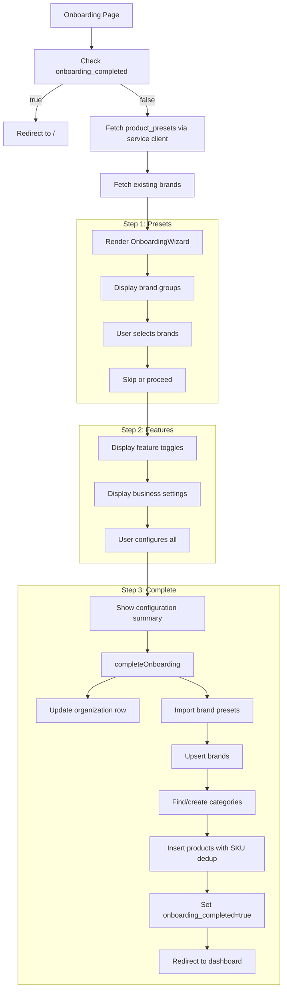

# Onboarding

Active contributors: themuuln

## Purpose

The Onboarding module guides new organizations through initial setup after registration. It follows a three-step wizard: preset brand selection (optional product catalog import), feature/module toggles, and final confirmation. The wizard configures org settings, enabled features, and imports brand product presets via a service client (bypassing RLS).

## Directory Layout

| Path | Type | Purpose |
|---|---|---|
| `src/app/(onboarding)/onboarding/page.tsx` | Server Component | Checks onboarding status, fetches presets and existing brands |
| `src/app/(onboarding)/onboarding/wizard-client.tsx` | Client Component | Three-step wizard: presets, features, complete |
| `src/app/(onboarding)/onboarding/actions.ts` | Server Action | `completeOnboarding` — saves settings, imports brand presets |

## Key Abstractions

| Abstraction | Type | Purpose |
|---|---|---|
| `Preset` | Type | Product preset from product_presets table (brand_name, brand_logo_url, product_name) |
| `BrandGroup` | Type | Aggregated brand info with product count |
| `Step` | Type | Union of "presets" | "features" | "complete" |

## How It Works

### Entry Point

The onboarding page at `src/app/(onboarding)/onboarding/page.tsx`:

1. Calls `requireAppContext()` to get the authenticated user's organization
2. Checks `organizations.onboarding_completed` — if already true, redirects to dashboard
3. Fetches `company_type` for filtering brand presets
4. Uses a **service client** (bypasses RLS) to fetch all `product_presets`
5. Fetches existing brands in the organization to exclude already-imported ones
6. Passes everything to the client `OnboardingWizard`

### Step 1: Brand Presets

The wizard displays branded product presets grouped by brand. Users can:

- Browse available brands with logos and product counts
- Select individual brands to import their product catalog
- Skip entirely (configure later) via a toggle

### Step 2: Features & Settings

Users select from the available features (defined in `FEATURES` constant) and configure business settings:

**Feature toggles** (checkboxes for each module):
- Products, Purchases, Sales, Shop POS, Inventory, Expenses, Customers, Suppliers, Returns, Accounting, Discounts, Reports, Commissions, Audit

**Business settings toggles** with live description updates:
- `has_suppliers` — Whether the business works with suppliers
- `has_inventory` — Whether to track stock levels
- `has_customer_credit` — Whether to track customer credit/balances
- `has_multi_branch` — Whether the business has multiple branches
- `has_variants` — Whether products have variants (size, color, etc.)
- `has_brands` — Whether to categorize by brand
- `has_categories` — Whether to use categories
- `has_email_reports` — Whether to use email reporting
- `has_audit_log` — Whether to track audit logs

### Step 3: Complete

The final step shows a summary of all selected configurations. Clicking "Хяналтын самбар руу очих" triggers `completeOnboarding` action.

### Onboarding Completion

The `completeOnboarding` server action in `src/app/(onboarding)/onboarding/actions.ts`:

1. Validates authentication and gets organization ID
2. Updates the organization row with:
   - `enabled_features` (string array of feature keys)
   - All boolean business settings
   - `onboarding_completed = true`
3. If brand presets were selected, uses a **service client** (bypasses RLS) to:
   - Fetch all presets for the selected brands
   - Upsert brands (create if not exists)
   - Find or create categories
   - Check SKU uniqueness before inserting products
   - Insert product records with all preset data (name, sku, unit, prices, min_stock, images)
4. Calls `revalidatePath("/")` and `redirect("/")` to the dashboard

## Brand Preset Import Details

The brand preset import uses a service client (`createServiceClient()`) that bypasses RLS to create records in the user's organization. For each preset:

1. **Brand**: Check if brand exists, create if not
2. **Category**: Check if category exists for the org, create if not
3. **Product**: Check SKU uniqueness, then insert with all fields including image_url and image_urls

## Key Source Files

| File | Purpose |
|---|---|
| `src/app/(onboarding)/onboarding/page.tsx` | Server component — checks status, fetches presets |
| `src/app/(onboarding)/onboarding/wizard-client.tsx` | Three-step wizard UI with all settings toggles |
| `src/app/(onboarding)/onboarding/actions.ts` | `completeOnboarding` — saves settings and imports presets |
