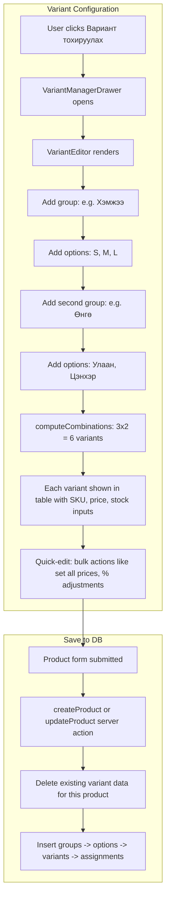
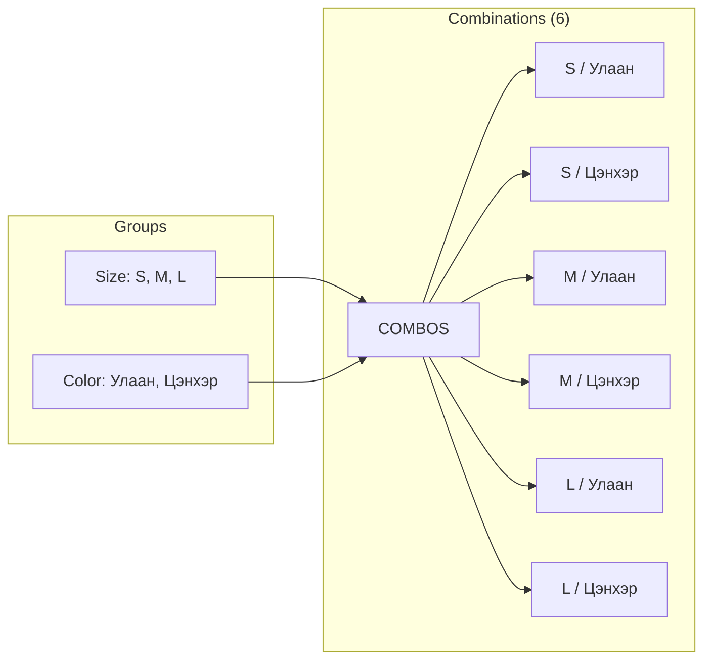
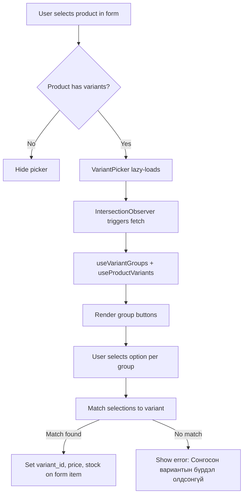
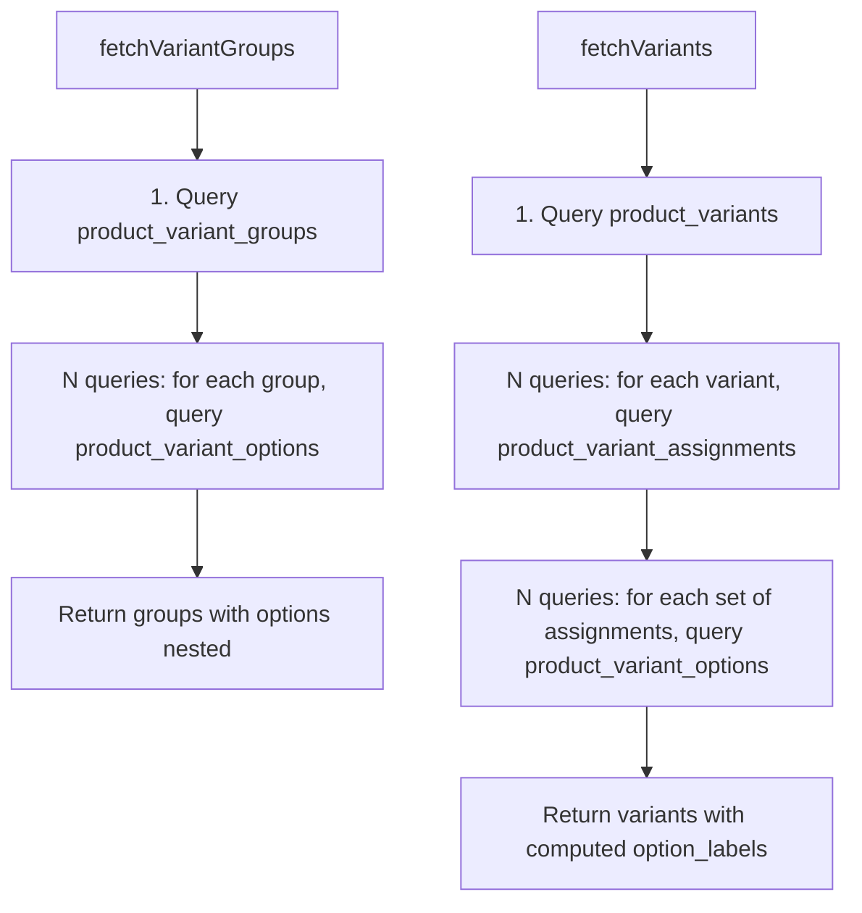

# Product Variants

Active contributors: themuuln

## Purpose

The Product Variants system allows products to have multiple variations (e.g., different sizes, colors, materials). Each variant can have its own SKU, price, stock level, and image. The system supports one or more variant groups per product (e.g., Size x Color), with all combinations automatically generated. Variants are displayed in a picker component within sale, invoice, purchase, and quotation forms.

## Directory Layout

| Path | Type | Purpose |
|---|---|---|
| `src/components/products/variant-picker.tsx` | Client Component | Lazy-loading picker for selecting a variant in forms |
| `src/components/products/variant-editor.tsx` | Client Component | Full variant editor: groups, options, SKU/prices/stock per combination |
| `src/components/products/variant-manager-drawer.tsx` | Client Component | Slide-in drawer wrapping VariantEditor with breadcrumb |
| `src/lib/query/hooks/use-product-variants.ts` | Query Hooks | TanStack Query hooks: `useVariantGroups`, `useProductVariants` |

## Database Schema

Variants use four related tables:

```
product_variant_groups  (id, product_id, name, sort_order)
       |
       v
product_variant_options (id, group_id, value, sort_order)
       |
       v
product_variant_assignments (id, variant_id, option_id)
       |
       v
product_variants       (id, product_id, sku, barcode, cost_price, sale_price,
                        current_stock, min_stock, image_urls, is_active)
```

- A **group** is a category of variation (e.g., "Хэмжээ" for Size, "Өнгө" for Color)
- An **option** is a value within a group (e.g., "S", "M", "L" under Size)
- A **variant** is a unique combination of options across all groups (e.g., Size: M, Color: Улаан)
- **Assignments** link each variant to its constituent option IDs

## Key Abstractions

| Abstraction | Type | Purpose |
|---|---|---|
| `LocalVariantGroup` | Type | Client-side group with local temp IDs (name, options array) |
| `LocalVariantData` | Type | Client-side variant data (option_ids, sku, prices, stock) |
| `VariantGroupWithOptions` | Type | Server-fetched group with its options |
| `ProductVariant` | Type | Server-fetched variant with computed `option_labels` string |
| `SelectedVariant` | Type | Selection result passed to parent form (variant_id, labels, prices, stock) |
| `VariantPicker` | Component | Lazy-loading picker for selecting a single variant in transaction forms |
| `VariantEditor` | Component | Full editor for creating/editing groups, options, and variant data |
| `VariantManagerDrawer` | Component | Nested slide-in drawer wrapping VariantEditor |
| `VariantSummaryCard` | Component | Compact card showing configured variant count and preview |
| `useVariantGroups` | Hook | TanStack Query for fetching groups + options for a product |
| `useProductVariants` | Hook | TanStack Query for fetching variants with computed labels |
| `computeCombinations` | Function | Cartesian product of all group options to generate all variant combinations |

## How It Works

### Variant Editor Flow (Product Create/Edit)



### Group and Option Management

The `VariantEditor` provides:
- **Preset suggestions**: Quick-add buttons for common groups ("Хэмжээ" with S/M/L/XL, "Өнгө" with Улаан/Цэнхэр/Хар/Цагаан, "Материал" with Хөвөн/Полиэстр/Ноос)
- **Quick-add options**: An inline input that accepts comma-separated values (e.g., "S, M, L, XL") to add many options at once
- **Group drag-and-drop** and individual option removal

### Combination Generation

`computeCombinations` computes the Cartesian product of all options across all groups. For example, with groups Size (S, M, L) and Color (Red, Blue), it generates 6 combinations:



Each combination gets a row in the variant data table where the user can set:
- **SKU** -- optional unique identifier for the variant
- **Cost price** and **Sale price** -- default from product defaults, editable per variant
- **Current stock** -- separate stock tracking per variant
- **Image URL** -- optional variant-specific image

A `BulkActionBar` allows setting all prices/stock at once, or applying a percentage adjustment (e.g., +20% to all sale prices).

### Variant Picker in Transaction Forms

The `VariantPicker` component is used in sale, invoice, purchase, and quotation forms when a product with variant groups is selected:



Key behaviors:
- **Lazy loading**: The picker uses `IntersectionObserver` with a 200px root margin to only fetch variant data when the picker is near the viewport. This avoids fetching variant data for products that are scrolled out of view in long lists.
- **Selection matching**: Compares the user's selected option IDs to each variant's `option_ids` array (sorted for reliable comparison). A match requires all groups to have a selection and the exact combination to exist.
- **Price auto-fill**: When a variant is selected, the unit price on the form line item is updated to the variant's sale price.
- **Deselection**: Clicking an already-selected option deselects it, reverting the price to the base product price.

### N+1 Query Pattern

The variant query hooks in `use-product-variants.ts` exhibit an N+1 query pattern:



This pattern means:
- `fetchVariantGroups` makes 1 + N queries (N = number of groups)
- `fetchVariants` makes 1 + N + M queries (N = number of variants, M = number of unique assignment sets)

For products with a small number of groups and variants (the typical ERP use case), this is acceptable. For products with many variants, this could be optimized by using a single query with joins instead of per-row queries.

The hooks are structured as two separate TanStack Query calls:
- `useVariantGroups(productId)` -- returns `VariantGroupWithOptions[]` (groups with nested options)
- `useProductVariants(productId)` -- returns `ProductVariant[]` (variants with computed `option_labels` string)

Both share the same query key prefix (`variantKeys.byProduct(productId)`) so they are invalidated together.

### Variant Data in Product Create/Edit

When creating or editing a product, variant data is serialized as JSON in the FormData:

- `variant_groups` -- JSON array of `{ id, name, options: [{ id, value }] }` using local temp IDs
- `variant_data` -- JSON array of `{ option_ids, sku, cost_price, sale_price, current_stock, image_url }`

The server action (`createProduct` or `updateProduct`):
1. Parses the JSON arrays
2. Deletes all existing variant data (assignments → options → variants → groups) via separate queries
3. Inserts new groups, mapping local temp IDs to real DB IDs
4. Inserts options under each group, building a `optionIdMap` (temp ID → real DB ID)
5. For each variant with a non-empty SKU, inserts the variant record with mapped option IDs
6. Creates assignment records linking each variant to its options

The `ProductEditDrawer` lazy-loads existing variant data when the drawer opens by querying the database directly via the Supabase client.

## Key Source Files

| File | Role |
|---|---|
| `src/components/products/variant-picker.tsx` | Lazy-loading picker for transaction forms |
| `src/components/products/variant-editor.tsx` | Full editor UI for groups, options, variant data |
| `src/components/products/variant-manager-drawer.tsx` | Nested drawer wrapping VariantEditor |
| `src/lib/query/hooks/use-product-variants.ts` | TanStack Query hooks with N+1 pattern |
| `src/app/(dashboard)/products/new/actions.ts` | createProduct with variant group/option/variant insertion |
| `src/app/(dashboard)/products/actions.ts` | updateProduct with full variant data replacement |
