# Products

Active contributors: themuuln

## Purpose

The Products module manages the product catalog with full CRUD operations via slide-in drawers. Products include fields for name, SKU, barcode, unit, prices (cost and sale), stock levels (current and minimum), category, brand, and image. The module supports bulk barcode import, barcode scanning via camera, variant groups (size, color, etc.), and soft-delete for historical data integrity.

## Directory Layout

| Path | Type | Purpose |
|---|---|---|
| `src/app/(dashboard)/products/page.tsx` | Server Component | Fetches products with categories and brands |
| `src/app/(dashboard)/products/actions.ts` | Server Actions | `updateProduct`, `deleteProduct` (soft-delete) |
| `src/app/(dashboard)/products/new/actions.ts` | Server Actions | `createProduct` |
| `src/app/(dashboard)/products/bulk/page.tsx` | Client Component | Bulk barcode import page |
| `src/components/products/product-create-drawer.tsx` | Client Component | Slide-in drawer for product creation |
| `src/components/products/product-edit-drawer.tsx` | Client Component | Slide-in drawer for product editing |
| `src/components/products/product-detail-drawer.tsx` | Client Component | Slide-in drawer for product detail view |
| `src/components/products/products-table.tsx` | Client Component | TanStack React Table with search, sorting, column visibility |
| `src/components/products/product-inputs.tsx` | Client Component | Reusable input fields (BarcodeInputField, ProductNameField, etc.) |
| `src/components/products/product-types.ts` | Types | Shared type definitions and constants |

## Key Abstractions

| Abstraction | Type | Purpose |
|---|---|---|
| `ProductRow` | Type | Row shape for products table (name, sku, barcode, prices, stock, brand, category) |
| `ProductDetailData` | Type | Shape for detail drawer (includes variants with option_labels) |
| `ProductEditData` | Type | Shape for edit drawer (includes brand info) |
| `ProductCreateDrawer` | Component | Create form with all fields, variant manager, barcode scanner |
| `ProductEditDrawer` | Component | Edit form pre-populated, lazy-loads existing variant data |
| `ProductDetailDrawer` | Component | Detail view with image gallery, info rows, variants list, delete action |
| `ProductsTable` | Component | DataTable with image column, name/SKU search, brand display, row click for detail |
| `createProduct` | Server Action | Creates product with organization scoping, variant group/option/variant creation |
| `updateProduct` | Server Action | Updates product and replaces variant data entirely |
| `deleteProduct` | Server Action | Soft-deletes (sets `deleted_at`), preserving historical references |

## How It Works

### Product CRUD Flow

```mermaid
flowchart TD
    subgraph "Create"
        A[ProductCreateDrawer] --> B[Fill: name, SKU, barcode, unit, category, brand]
        B --> C[Fill: cost/sale prices, stock]
        C --> D[Optional: configure variants]
        D --> E[createProduct server action]
        E --> F[Insert product]
        F --> G[Insert variant groups/options/variants if provided]
        G --> H[Optimistic UI update via TanStack Query]
    end

    subgraph "Edit"
        I[ProductEditDrawer] --> J[Pre-populated form]
        J --> K[Lazy-load existing variant data from DB]
        K --> L[updateProduct server action]
        L --> M[Replace all variant data: delete old, insert new]
    end

    subgraph "Detail"
        N[Click row in ProductsTable] --> O[ProductDetailDrawer]
        O --> P[Fetch variants via useProductVariants]
        P --> Q[Show: image gallery, info rows, variants list]
    end

    subgraph "Delete"
        R[Delete button in drawer] --> S[Confirm dialog]
        S --> T[deleteProduct: set deleted_at]
    end
```

### Product Fields

| Field | Type | Description |
|---|---|---|
| `name` | string | Product name (required) |
| `sku` | string | Stock keeping unit (optional, unique within org) |
| `barcode` | string | Barcode (optional, for scanner lookup) |
| `unit` | string | Unit of measure (ширхэг, кг, л, etc.), creatable combobox |
| `category_name` | string | Category (creatable combobox with presets per company type) |
| `brand_id` | UUID | Brand reference (combobox with logo display) |
| `cost_price` | number | Purchase/cost price |
| `sale_price` | number | Selling price |
| `current_stock` | number | Current inventory quantity |
| `min_stock` | number | Minimum stock threshold (alerts when crossed) |
| `image_url` | string | Product image URL |

### Create Product Form

The `ProductCreateDrawer` uses react-hook-form + zod with these sections:
- **Basic info**: name (with package icon), SKU (with tag icon), barcode (with camera scanner button), unit (creatable combobox with presets like ширхэг/кг/гр/л/мл)
- **Category**: creatable combobox with company-type-specific preset categories (or all presets if no company type set)
- **Brand**: combobox with brand logo thumbnails, fetched via `useBrands`
- **Pricing**: cost price and sale price via `CurrencyInput`
- **Stock**: initial stock and minimum stock
- **Variants**: optional `VariantManagerDrawer` for configuring variant groups

A camera scanner button next to the barcode field opens a `CameraScanner` component (dynamically imported, SSR disabled) that reads barcodes from the device camera.

The form uses `useOptimisticCreate` for optimistic UI: the product is immediately prepended to the query cache, and on error the cache is rolled back.

### Edit Product Form

The `ProductEditDrawer` is triggered from the actions column in `ProductsTable`. When opened:
1. Form fields are pre-populated with `reset()` from react-hook-form
2. Existing variant data is lazy-loaded from the database (groups, options, variants, assignments)
3. On submit, `updateProduct` server action:
   - Validates input via `validateProductInput`
   - Optionally resolves category name to category_id (creates new category if needed)
   - Updates the product record
   - If variant data is present: deletes all existing variant data (assignments, options, variants, groups) in order, then re-inserts new groups, options, variants, and assignments
   - Calls `checkLowStockAndNotify` for low stock alerts
   - Revalidates `/products` path

### Products Table

The `ProductsTable` is a TanStack `DataTable` with:
- **Image column** -- thumbnail or first-character fallback
- **Name column** -- font-medium, filterFn searches both name and SKU
- **Brand column** -- shows brand logo + name
- **SKU, Unit, Sale Price, Current Stock, Min Stock, Category columns**
- **Actions column** -- edit (ProductEditDrawer trigger) and delete buttons
- Sorting enabled, column visibility toggling, and search input placeholder "Нэр эсвэл SKU-аар хайх..."

Clicking a row sets `selectedProduct`, which opens `ProductDetailDrawer`, which also fetches variants via `useProductVariants`.

### Bulk Barcode Import

The bulk import page at `src/app/(dashboard)/products/bulk/page.tsx` provides:
- A form with a dynamic array of barcode/name/price/stock fields
- A file upload to parse a CSV/TSV file with barcodes
- A camera scanner for sequential barcode scanning
- On submit, uses the Supabase client directly to insert multiple products

### Barcode Scanner

Both the create and edit drawers include a camera scanner icon button next to the barcode field. The `CameraScanner` is dynamically imported with `ssr: false` to avoid server-side rendering issues with `navigator.mediaDevices`. When a barcode is scanned, it sets the barcode field value and closes the scanner.

### Soft Delete

Products are soft-deleted by setting `deleted_at` to the current timestamp. The products list query filters with `.is("deleted_at", null)`. This preserves historical references in stock movements, invoices, and sales.

## Key Source Files

| File | Role |
|---|---|
| `src/app/(dashboard)/products/page.tsx` | Server: fetches products with category and brand joins |
| `src/app/(dashboard)/products/actions.ts` | Server Actions: updateProduct, deleteProduct |
| `src/app/(dashboard)/products/new/actions.ts` | Server Actions: createProduct with variant support |
| `src/components/products/product-create-drawer.tsx` | Drawer: create form with all fields and variant manager |
| `src/components/products/product-edit-drawer.tsx` | Drawer: edit form with lazy-loaded variant data |
| `src/components/products/product-detail-drawer.tsx` | Drawer: detail view with image gallery and variants |
| `src/components/products/products-table.tsx` | DataTable with search, sorting, edit/delete actions |
| `src/components/products/product-inputs.tsx` | Reusable form input components |
| `src/components/products/product-types.ts` | Shared type definitions |
| `src/app/(dashboard)/products/bulk/page.tsx` | Bulk barcode import page |
