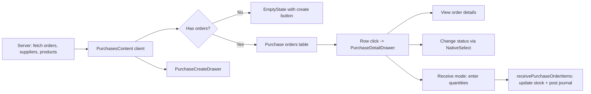

# Purchases

Active contributors: themuuln

## Purpose

The Purchases module manages purchase orders (POs) from suppliers. Users create POs with line items, track status through the procurement lifecycle (draft → sent → partially_received → received → cancelled), receive items with stock updates, and post costs to the general ledger.

## Directory Layout

| Path | Type | Purpose |
|---|---|---|
| `src/app/(dashboard)/purchases/page.tsx` | Server Component | Fetches purchase orders, suppliers, products |
| `src/app/(dashboard)/purchases/purchases-content.tsx` | Client Component | Manages drawer state, renders table or empty state |
| `src/app/(dashboard)/purchases/purchases-table.tsx` | Client Component | Table columns and row definitions |
| `src/app/(dashboard)/purchases/new/page.tsx` | Server Component | Redirects to `/purchases?create=true` |
| `src/components/purchases/purchase-create-drawer.tsx` | Client Component | Slide-in drawer with PO creation form |
| `src/components/purchases/purchase-detail-drawer.tsx` | Client Component | Slide-in drawer with PO detail, status management, and receiving |

## Key Abstractions

| Abstraction | Type | Purpose |
|---|---|---|
| `PurchaseRow` | Type | Row shape for the purchases table |
| `PurchaseDetailData` | Type | Shape for purchase detail (order, items, supplier, creator) |
| `PurchaseCreateDrawer` | Component | Drawer with form for supplier, dates, line items |
| `PurchaseDetailDrawer` | Component | Drawer with detail view, status select, receive items flow |
| `SupplierOption` | Type | Shape for supplier combobox |
| `ProductOption` | Type | Shape for product combobox (includes cost_price) |
| `STATUS_LABELS` | Map | Status → Mongolian label mapping |
| `STATUS_VARIANTS` | Map | Status → badge variant mapping |

## How It Works

### Purchase Order Creation

1. User clicks "Шинэ захиалга" or navigates to `/purchases?create=true`
2. `PurchaseCreateDrawer` opens with a form built with react-hook-form + zod
3. Form sections:
   - **Supplier** — combobox to select from existing suppliers
   - **Order date** and **Expected date** — date pickers
   - **Line items** — dynamic field array with product combobox, quantity, unit cost, and per-row total
   - Variant picker appears when a product has variant groups
   - Item cost auto-fills from the product's `cost_price`
   - **Notes** — optional textarea
4. Total amount computed reactively from line items
5. On submit, `createPurchaseOrder` server action serializes items as JSON in FormData

### PO Status Management

The `PurchaseDetailDrawer` provides:
- A `NativeSelect` dropdown to change PO status (draft → sent → received → cancelled)
- A "Бараа хүлээн авах" receive mode toggle

### Receiving Items

When a PO is in `sent` or `partially_received` status:

1. User clicks "Бараа хүлээн авах" to enter receive mode
2. Each item row shows an input for received quantity (with max from remaining)
3. User enters quantities and clicks "Хүлээн авсан баталгаажуулах"
4. `receivePurchaseOrderItems` server action:
   - Updates `received_quantity` for each purchase order item
   - Increments `current_stock` on each product
   - Adjusts PO status to `received` or `partially_received`
   - Posts journal entries to the general ledger (debit inventory, credit accounts payable)

## Key Source Files

| File | Role |
|---|---|
| `src/app/(dashboard)/purchases/page.tsx` | Server: fetches POs, suppliers, products |
| `src/app/(dashboard)/purchases/purchases-content.tsx` | Client: drawer state and layout |
| `src/app/(dashboard)/purchases/purchases-table.tsx` | Client: table columns |
| `src/components/purchases/purchase-create-drawer.tsx` | Drawer with PO creation form |
| `src/components/purchases/purchase-detail-drawer.tsx` | Drawer with PO detail, status, receiving flow |
