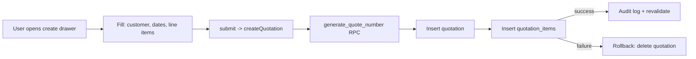
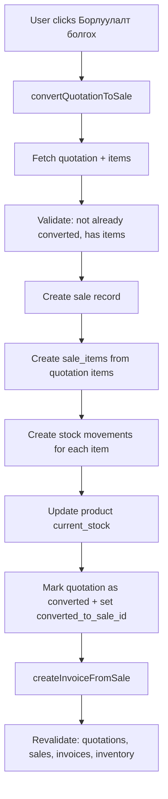

# Quotations

Active contributors: themuuln

## Purpose

The Quotations module manages quote (үнийн санал) creation for customers, including line items, status tracking, and conversion to sales. Users create quotes with products or custom descriptions, manage the quote lifecycle (draft/sent/accepted/rejected/expired/converted), and convert accepted quotes into full sales with automatic invoice generation.

## Directory Layout

| Path | Type | Purpose |
|---|---|---|
| `src/app/(dashboard)/quotations/page.tsx` | Server Component | Fetches quotations, products, customers with branch filter |
| `src/app/(dashboard)/quotations/quotations-content.tsx` | Client Component | Manages drawer state, renders table or empty state |
| `src/app/(dashboard)/quotations/actions.ts` | Server Actions | `createQuotation`, `updateQuotationStatus`, `convertQuotationToSale` |
| `src/app/(dashboard)/quotations/new/page.tsx` | Server Component | Redirects to `/quotations?create=true` |
| `src/components/quotations/quotation-create-drawer.tsx` | Client Component | Slide-in drawer with quotation creation form |
| `src/components/quotations/quotation-detail-drawer.tsx` | Client Component | Slide-in drawer with quotation detail, status change, convert-to-sale |

## Key Abstractions

| Abstraction | Type | Purpose |
|---|---|---|
| `QuotationRow` | Type | Row shape for the quotations table (number, dates, contact, total, status) |
| `QuotationCreateDrawer` | Component | Drawer with customer combobox, line items, date pickers, variant picker |
| `QuotationDetailDrawer` | Component | Drawer with metadata, items table, status select, convert-to-sale action |
| `createQuotation` | Server Action | Creates quotation with auto-generated number and line items |
| `updateQuotationStatus` | Server Action | Changes quote status (draft/sent/accepted/rejected/expired) |
| `convertQuotationToSale` | Server Action | Converts accepted quote to a sale, stock movements, and invoice |

## How It Works

### Quotation Creation

1. User clicks "Шинэ үнийн санал" button or navigates to `/quotations?create=true`
2. `QuotationCreateDrawer` opens with a react-hook-form + zod form
3. User fills in:
   - **Customer** -- combobox to select from existing customers
   - **Issue date** and **Expiry date** -- date pickers
   - **Line items** -- dynamic field array with product combobox, description, quantity, unit price
   - **Variant picker** -- appears when a selected product has variant groups
   - **Notes** -- optional textarea
4. Total amount computed reactively from line items
5. On submit, `createQuotation` server action runs:
   - Generates quote number via `generate_quote_number` RPC
   - Inserts quotation + quotation_items
   - On items failure, rolls back the quotation (hard delete)
   - Logs audit event
   - Calls `revalidateEntities(["quotations"])`

### Quotation List View

The list page shows quotations in a `Card` with a `Table`. Columns: quote number, issue date, contact name, total amount (right-aligned), status badge, and expiry date. Clicking a row opens the `QuotationDetailDrawer`.

Status badges use Mongolian labels: "Ноорог" (draft), "Илгээсэн" (sent), "Хүлээн зөвшөөрсөн" (accepted), "Татгалзсан" (rejected), "Хугацаа дууссан" (expired), "Борлуулалт болсон" (converted). An empty state is shown when no quotations exist.

### Quotation Status Management

The `QuotationDetailDrawer` provides a `NativeSelect` dropdown to update the quotation status. The `updateQuotationStatus` server action:
1. Fetches the current quotation to verify branch access
2. Updates the status field
3. Logs an audit event with old and new values
4. Revalidates the "quotations" entity cache

### Conversion to Sale

When a quotation is accepted, the user can click "Борлуулалт болгох" in the detail drawer. This triggers `convertQuotationToSale`, which performs a multi-step transaction:

Key details of the conversion:
- Creates a `sale` with `payment_method: "invoice"` and status `pending`
- Copies all line items from `quotation_items` to `sale_items`
- For each item with a `product_id`:
  - Creates a `stock_movement` of type `"out"`
  - Decrements `products.current_stock` (clamped to 0)
  - Stock movement failures are logged but do not abort the sale
- Updates the quotation status to `"converted"` and sets `converted_to_sale_id`
- Calls `createInvoiceFromSale` to auto-generate an invoice from the new sale
- Revalidates four entity caches: "quotations", "sales", "invoices", "inventory"

If the quotation was already converted, an error is returned: "Энэ үнийн санал аль хэдийн борлуулалт болсон." If items insertion fails, the sale is rolled back.

## Key Source Files

| File | Role |
|---|---|
| `src/app/(dashboard)/quotations/page.tsx` | Server: fetches quotations, products, customers |
| `src/app/(dashboard)/quotations/quotations-content.tsx` | Client: manages state, table, drawers |
| `src/app/(dashboard)/quotations/actions.ts` | Server Actions: create, update status, convert to sale |
| `src/components/quotations/quotation-create-drawer.tsx` | Drawer: quotation creation form with line items |
| `src/components/quotations/quotation-detail-drawer.tsx` | Drawer: detail view with status change and convert action |
| `src/app/(dashboard)/quotations/new/page.tsx` | Server: redirects to `/quotations?create=true` |
