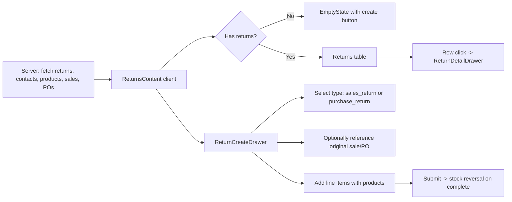

# Returns

Active contributors: themuuln

## Purpose

The Returns module handles both sales returns and purchase returns. Users create returns with line items referencing the original sale or purchase order, specify return reasons, and manage status. When a return is marked completed, stock is automatically reversed.

## Directory Layout

| Path | Type | Purpose |
|---|---|---|
| `src/app/(dashboard)/returns/page.tsx` | Server Component | Fetches returns, contacts, products, sales, purchase orders |
| `src/app/(dashboard)/returns/returns-content.tsx` | Client Component | Manages drawer state, renders table or empty state |
| `src/app/(dashboard)/returns/new/page.tsx` | Server Component | Redirects to `/returns?create=true` |
| `src/components/returns/return-create-drawer.tsx` | Client Component | Slide-in drawer with return creation form |
| `src/components/returns/return-detail-drawer.tsx` | Client Component | Slide-in drawer showing return detail |

## Key Abstractions

| Abstraction | Type | Purpose |
|---|---|---|
| `ReturnRow` | Type | Row shape for the returns table |
| `ReturnCreateDrawer` | Component | Drawer with form for type, reference, line items, dates |
| `ReturnDetailDrawer` | Component | Drawer with return detail view |
| `typeLabels` | Map | Return type → Mongolian label: `sales_return`/`purchase_return` |
| `statusLabels` | Map | Status → Mongolian label: `draft`/`completed`/`cancelled` |

## How It Works

### Return Creation

1. User clicks "Шинэ буцаалт" or navigates to `/returns?create=true`
2. `ReturnCreateDrawer` opens with a react-hook-form + zod form
3. Form fields:
   - **Type** — select: Борлуулалтын буцаалт or Худалдан авалтын буцаалт
   - **Reference** — optional reference to the original sale or purchase order
   - **Contact** — optional contact selection
   - **Return date** — date picker
   - **Reason** — optional textarea for overall return reason
   - **Line items** — dynamic field array with product combobox, quantity, unit price, per-item reason, and variant support
4. On submit, `createReturn` server action serializes items as JSON in FormData

### Stock Reversal

When a return is completed:
- **Sales return**: stock is incremented (items go back to inventory)
- **Purchase return**: stock is decremented (items are sent back to supplier)

The stock reversal happens at the `complete` action, not at creation time.

### List View

The list page shows:
- A `PageShell` with title, description, and create button
- A `Card` with `Table` showing: return number, date, type, contact, total amount, and status badge
- Row click opens `ReturnDetailDrawer` with full return information

## Key Source Files

| File | Role |
|---|---|
| `src/app/(dashboard)/returns/page.tsx` | Server: fetches all return-related data |
| `src/app/(dashboard)/returns/returns-content.tsx` | Client: drawer state and layout |
| `src/app/(dashboard)/returns/new/page.tsx` | Redirect to `/returns?create=true` |
| `src/components/returns/return-create-drawer.tsx` | Drawer with return creation form |
| `src/components/returns/return-detail-drawer.tsx` | Drawer with return detail view |
