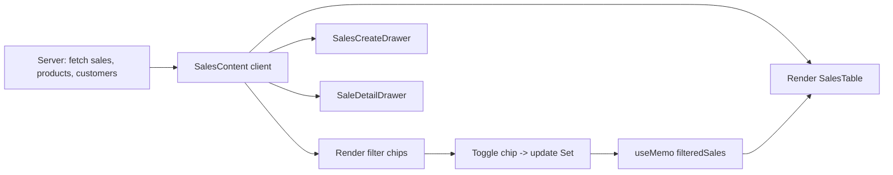

# Sales

Active contributors: themuuln

## Purpose

The Sales module handles sale registration, listing, filtering, and detail viewing. Users create sales with line items, select products via combobox or barcode scanner (including a product browser drawer), pick customers, choose payment methods, apply quick payment actions (Бүгд/Хагас/Төлөөгүй), and manage status. The list view supports filter chips for today, week, balance, payment status, and payment method.

## Directory Layout

| Path | Type | Purpose |
|---|---|---|
| `src/app/(dashboard)/sales/page.tsx` | Server Component | Fetches sales, products, customers; passes to client |
| `src/app/(dashboard)/sales/sales-content.tsx` | Client Component | Manages drawer state, filter chips, sale list rendering |
| `src/app/(dashboard)/sales/sales-table.tsx` | Client Component | TanStack React Table with columns, search, sorting |
| `src/app/(dashboard)/sales/sales-page-client.tsx` | Client Component | Alternate sales page with Base UI drawer |
| `src/app/(dashboard)/sales/new/page.tsx` | Server Component | Redirects to `/sales?create=true` |
| `src/app/(dashboard)/sales/new/sale-form.tsx` | Client Component | Main sale creation form with line items, payment, stock validation |
| `src/app/(dashboard)/sales/[id]/page.tsx` | Server Component | Standalone sale detail page for direct links |
| `src/components/sales/sales-create-drawer.tsx` | Client Component | Slide-in drawer wrapping `SaleForm` |
| `src/components/sales/sale-detail-drawer.tsx` | Client Component | Slide-in drawer showing sale detail with items table |
| `src/components/sales/product-browser-drawer.tsx` | Client Component | Browse and search products in a drawer for line item selection |

## Key Abstractions

| Abstraction | Type | Purpose |
|---|---|---|
| `SaleRow` | Type | Row shape for the sales table |
| `SaleDetailData` | Type | Shape for sale detail drawer (includes items, contact, salesperson) |
| `ProductOption` | Type | Shape for product combobox options |
| `CustomerOption` | Type | Shape for customer combobox options |
| `FilterChip` | Type | Union of filter keys: `today`, `week`, `hasBalance`, `fullyPaid`, `cancelled`, `cash`, `card` |
| `SaleForm` | Component | Complex form with line items, payment section, advanced settings |
| `SalesCreateDrawer` | Component | Drawer wrapping SaleForm with footer actions |
| `SaleDetailDrawer` | Component | Drawer showing sale summary, info rows, items table |
| `SalesTable` | Component | DataTable with columns for date, contact, amount, paid, balance, status, payment method |

## How It Works

### Sale Creation Flow

1. User clicks "Шинэ борлуулалт" button (either in the list page or via `/sales?create=true`)
2. `SalesCreateDrawer` opens with `SaleForm` inside
3. User adds line items: select product via combobox (opens `ProductBrowserDrawer`) or barcode scanner
4. Each line shows quantity, unit price, subtotal, and stock validation warning
5. `VariantPicker` appears when a product has variant groups
6. Payment section: paid amount (with quick actions Бүгд/Хагас/Төлөөгүй), payment method combobox
7. Summary sidebar shows grand total, paid, remaining, payment state badge
8. Advanced settings expandable section: staff picker, status, sale date, notes
9. On submit, `createSale` server action runs with optimistic UI updates via TanStack Query

### Optimistic Updates

The `SaleForm` uses `useMutation` with `onMutate` to:
- Cancel in-flight queries for sales and products
- Snapshot current cache state for rollback
- Optimistically prepend the new sale to the sales list
- Optimistically decrement product stock
- On error, rollback both caches to snapshot
- On settle, invalidate both caches

### Filter Chips

The `SalesContent` component maintains a `Set<FilterChip>` of active filters. Each chip toggles on click. Filtering is done client-side via `useMemo`:

### Sale Detail

Clicking a row in `SalesTable` sets `selectedSaleId`, which triggers a TanStack Query to fetch the full sale with items. `SaleDetailDrawer` opens showing:
- Summary cards (total, paid)
- Info rows (date, contact, salesperson, payment method, balance, status, notes)
- Sale items table (product, quantity, unit price, total)

## Key Source Files

| File | Role |
|---|---|
| `src/app/(dashboard)/sales/page.tsx` | Server: fetches initial data |
| `src/app/(dashboard)/sales/sales-content.tsx` | Client: manages state, filters, drawers |
| `src/app/(dashboard)/sales/sales-table.tsx` | Client: data table with columns and search |
| `src/app/(dashboard)/sales/new/sale-form.tsx` | Client: sale creation form with full logic |
| `src/components/sales/sales-create-drawer.tsx` | Drawer wrapping SaleForm |
| `src/components/sales/sale-detail-drawer.tsx` | Drawer with sale detail view |
| `src/app/(dashboard)/sales/new/page.tsx` | Redirect to `/sales?create=true` |
