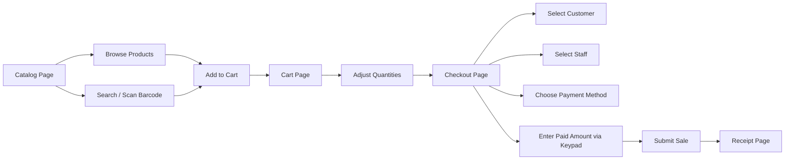

# Shop POS

Active contributors: themuuln

## Purpose

The Shop POS is a mobile-first point-of-sale module designed for retail counters. It provides a product catalog with category chips and search, a cart with a numeric keypad for quick quantity entry, customer picker at checkout, receipt printing, and sales history. The entire UI is in Mongolian and optimized for touch interaction.

## Directory Layout

| Path | Type | Purpose |
|---|---|---|
| `src/app/(dashboard)/shop/page.tsx` | Server Component | Fetches products and categories for the catalog |
| `src/app/(dashboard)/shop/layout.tsx` | Server Component | CartProvider wrapper, header, bottom tab bar |
| `src/app/(dashboard)/shop/cart-context.tsx` | Client Component | React Context + useReducer for cart state with sessionStorage persistence |
| `src/app/(dashboard)/shop/cart/page.tsx` | Client Component | Cart view with quantity controls and checkout link |
| `src/app/(dashboard)/shop/checkout/page.tsx` | Client Component | Checkout flow: customer picker, order summary, payment method, numeric keypad |
| `src/app/(dashboard)/shop/history/page.tsx` | Server Component | Sales history list with links to receipt |
| `src/app/(dashboard)/shop/receipt/[id]/page.tsx` | Server Component | Receipt view with print styles |
| `src/components/shop/catalog-client.tsx` | Client Component | Product grid with search, barcode input, category chips |
| `src/components/shop/category-chips.tsx` | Client Component | Horizontal scrollable category filter chips |
| `src/components/shop/product-card.tsx` | Client Component | Product card with image, price, stock, variant picker, add-to-cart |
| `src/components/shop/numeric-keypad.tsx` | Client Component | On-screen numeric keypad for entering paid amount |
| `src/components/shop/barcode-input.tsx` | Client Component | Barcode search input with camera scanner integration |
| `src/components/shop/camera-scanner.tsx` | Client Component | Camera-based barcode scanner (dynamic import) |
| `src/components/shop/customer-picker.tsx` | Client Component | Customer search with walk-in, existing contact, or create new |
| `src/components/shop/staff-picker.tsx` | Client Component | Salesperson/staff selection |
| `src/components/shop/bottom-bar.tsx` | Client Component | Fixed bottom navigation: Бараа, Сагс, Түүх |
| `src/components/shop/receipt-print-button.tsx` | Client Component | Print button triggering window.print() |
| `src/components/shop/new-sale-button.tsx` | Client Component | Button to start a new sale |
| `src/components/shop/search-bar.tsx` | Client Component | General search bar with clear button |

## Key Abstractions

| Abstraction | Type | Purpose |
|---|---|---|
| `CartContext` | React Context | Provides cart state (items, totals, discount) and actions |
| `CartItem` | Type | Shape for a cart item (productId, name, unitPrice, quantity, variant info) |
| `DiscountInfo` | Type | Shape for applied discount |
| `cartReducer` | Function | Reducer handling ADD_ITEM, REMOVE_ITEM, UPDATE_QUANTITY, APPLY_DISCOUNT, CLEAR_CART, LOAD_FROM_STORAGE |
| `NumericKeypad` | Component | 0-9 keypad with backspace, clear, and confirm for entering amounts |
| `CustomerPicker` | Component | Dropdown for selecting existing customer, walk-in, or creating new |
| `ProductCard` | Component | Card with image, brand, price, stock indicator, VariantPicker, and add-to-cart |
| `CategoryChips` | Component | Horizontal scrollable category filter with "Бүгд" default |

## How It Works

### Cart State

Cart state is managed by `CartContext` using `useReducer`:

- Items are stored in `sessionStorage` (key `zer-shop-cart`) for persistence across page navigations within the session
- Discount is stored separately (`zer-shop-discount`)
- On mount, cart loads from storage; on every change, it persists back
- `computeTotalAmount()`, `computeDiscountedTotal()`, `computeItemCount()` are pure utility functions

### Catalog Page

The catalog (`/shop`) displays:
1. A unified search + barcode input bar at the top (sticky)
2. Camera scanner button opens an overlay
3. Category chips below the search bar (sticky)
4. Product grid (2 columns mobile, 3 tablet, 4 desktop)

Barcode scanning works via:
- Typing a barcode and pressing Enter
- Pasting a barcode value
- Using the camera scanner (dynamic import, SSR disabled)
- On successful scan, the product is added to cart with status feedback

### Checkout Flow

The checkout page (`/shop/checkout`) follows these steps:

1. **Customer picker** — search existing contacts, walk-in, or create new
2. **Staff picker** — select salesperson
3. **Order summary** — list of items with quantities and totals
4. **Payment method** — radio group: Бэлэн, Карт, Данс, Нэхэмжлэл
5. **Paid amount** — clickable display opens `NumericKeypad`
6. **Change display** — shown when paid > total
7. **Submit** — triggers `createShopSale` server action with optimistic updates

### Receipt Printing

The receipt page (`/shop/receipt/[id]`) includes:
- `@media print` CSS targeting 80mm thermal receipt size
- Organization name, receipt number, date
- Customer and salesperson info
- Item rows with quantity, unit price, total
- Totals section with payment method, paid amount, change
- Print button and back-to-history links (hidden during print)

## Key Source Files

| File | Role |
|---|---|
| `src/app/(dashboard)/shop/page.tsx` | Catalog server: fetches products and categories |
| `src/components/shop/catalog-client.tsx` | Client: product grid, search, barcode, category filter |
| `src/app/(dashboard)/shop/cart-context.tsx` | Cart state management with persistence |
| `src/app/(dashboard)/shop/cart/page.tsx` | Cart view with quantity controls |
| `src/app/(dashboard)/shop/checkout/page.tsx` | Checkout with customer picker, payment, keypad |
| `src/components/shop/numeric-keypad.tsx` | On-screen numeric keypad component |
| `src/components/shop/customer-picker.tsx` | Customer search and selection |
| `src/components/shop/product-card.tsx` | Product card with add-to-cart and VariantPicker |
| `src/app/(dashboard)/shop/receipt/[id]/page.tsx` | Receipt page with print styles |
| `src/app/(dashboard)/shop/history/page.tsx` | Sales history list |
| `src/components/shop/bottom-bar.tsx` | Tab navigation: Бараа, Сагс, Түүх |
