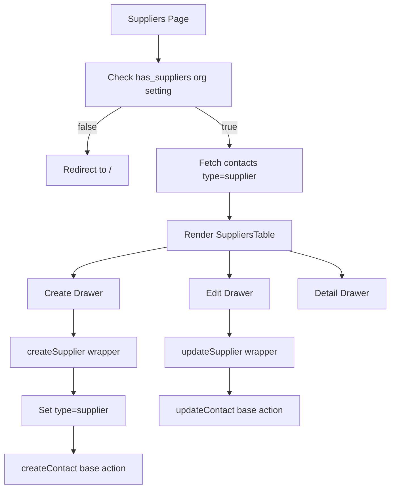

# Suppliers

Active contributors: themuuln

## Purpose

The Suppliers module manages supplier contacts for purchase orders and inventory restocking. It provides create, edit, and detail views via slide-in drawers, a searchable suppliers data table with payable balance tracking, and CSV export. Suppliers are stored in the unified `contacts` table with `type = 'supplier'`. The entire module is gated behind the `has_suppliers` organization setting.

## Directory Layout

| Path | Type | Purpose |
|---|---|---|
| `src/app/(dashboard)/suppliers/page.tsx` | Server Component | Checks org setting, fetches suppliers, renders table or empty state |
| `src/app/(dashboard)/suppliers/actions.ts` | Server Action | `createSupplier` and `updateSupplier` — thin wrappers around customer actions with forced type='supplier' |
| `src/components/suppliers/suppliers-table.tsx` | Client Component | TanStack DataTable with columns for name, phone, email, balance, actions |
| `src/components/suppliers/supplier-create-drawer.tsx` | Client Component | Slide-in drawer for creating a supplier |
| `src/components/suppliers/supplier-edit-drawer.tsx` | Client Component | Slide-in drawer for editing a supplier |
| `src/components/suppliers/supplier-detail-drawer.tsx` | Client Component | Slide-in drawer showing supplier detail with info rows |

## Key Abstractions

| Abstraction | Type | Purpose |
|---|---|---|
| `SupplierRow` | Type | Row shape for the data table (id, name, phone, email, address, balance) |
| `SupplierDetailData` | Type | Shape for the detail drawer |
| `SupplierEditData` | Type | Shape for the edit drawer |

## How It Works

### Org Setting Gate

The server component checks `has_suppliers` on the organization row. If the setting is `false`, the page redirects to `/` (dashboard). This allows businesses that don't work with suppliers to hide the module entirely.

### Supplier List

The server component at `src/app/(dashboard)/suppliers/page.tsx`:

1. Fetches the `has_suppliers` org setting — redirects if false
2. Queries all contacts with `type = 'supplier'` ordered by creation date (descending)
3. Passes data to the client `SuppliersTable` component

The `SuppliersTable` uses `DataTable` with columns for name (with avatar), phone, email, payable balance, and action buttons (detail + edit).

### Supplier Actions

Supplier actions (`createSupplier`, `updateSupplier`) are thin wrappers around the shared `createContact`/`updateContact` server actions from `src/app/(dashboard)/customers/actions.ts`. The `createSupplier` function sets `formData.set("type", "supplier")` before delegating to the base action, ensuring the contact is created as a supplier type.

### Drawers

- **Create drawer** (`SupplierCreateDrawer`): Slide-in drawer with react-hook-form + zod form, fields for name (required), phone, email, address. Uses `useOptimisticCreate` for instant UI feedback.
- **Edit drawer** (`SupplierEditDrawer`): Pre-populated form with `useOptimisticUpdate`, submits to `updateSupplier`.
- **Detail drawer** (`SupplierDetailDrawer`): Displays supplier info with `InfoRow` components: name, phone, email, address, and payable balance.

### CSV Export

An `ExportButton` at the top-right provides CSV export via `/api/export/suppliers`.

## Key Source Files

| File | Purpose |
|---|---|
| `src/app/(dashboard)/suppliers/page.tsx` | Server component — org setting gate, data fetch |
| `src/app/(dashboard)/suppliers/actions.ts` | `createSupplier`/`updateSupplier` wrappers |
| `src/components/suppliers/suppliers-table.tsx` | DataTable with columns and action drawers |
| `src/components/suppliers/supplier-create-drawer.tsx` | Create drawer with form validation |
| `src/components/suppliers/supplier-edit-drawer.tsx` | Edit drawer with optimistic update |
| `src/components/suppliers/supplier-detail-drawer.tsx` | Detail drawer with InfoRow layout |
