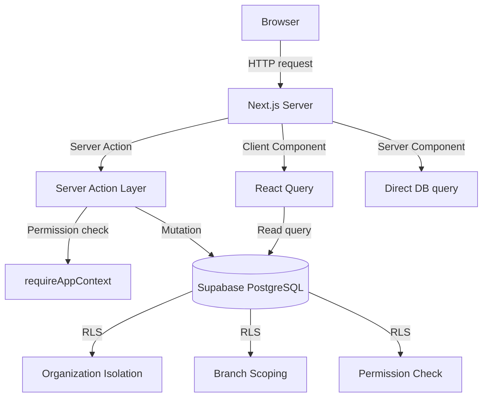
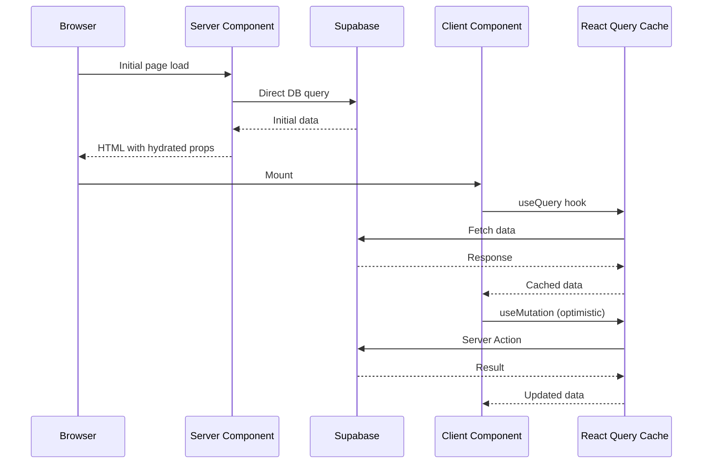

# Architecture

Active contributors: themuuln

## Overview

Zer follows a **Server Component-first** architecture with Next.js App Router. Page shells and initial data fetching happen in Server Components. Client Components handle interactivity via React state, TanStack React Query hooks, and server actions.



## Major Layers

### Server Components (Default)

All page files in `src/app/` are Server Components by default. They:

- Fetch initial data directly from Supabase using `createClient()`
- Check authentication and org context via `requireAppContext()`
- Pass data as props to Client Components
- Use `withBranchFilter()` to apply branch scoping on queries

### Client Components

Marked with `"use client"`. They:

- Handle interactivity (forms, drawers, toggles)
- Use TanStack React Query for subsequent data fetching
- Use React Hook Form + zod for form validation
- Call server actions for mutations
- Display toast notifications via Sonner

### Server Actions

All mutations are server actions in `*/actions.ts` files. They:

- Check authentication and permissions via `requireActionContext()` or `requireWriteAction()`
- Parse and validate form data
- Perform the mutation via Supabase
- Revalidate cache paths via `revalidateEntities()`
- Post to the general ledger (accounting) where applicable
- Return `ActionResult<T>` discriminated union type

### Data Fetching



## Route Groups

| Route Group    | Purpose                                  |
| -------------- | ---------------------------------------- |
| `(auth)`       | Login, register, password reset          |
| `(dashboard)`  | Main ERP application                     |
| `(onboarding)` | New user setup wizard                    |
| `landing`      | Public landing page                      |
| `[slug]`       | Public storefront by org slug            |
| `r`            | Public routes (shared reports, invoices) |

## Feature Gating

Zer uses two mechanisms to hide irrelevant UI:

1. **`enabled_features`** — an array of feature keys selected during onboarding. Controls sidebar navigation items via `featureKey` prop.
2. **`has_*` booleans** — 10+ settings covering suppliers, inventory, variants, brands, categories, multi-branch, email reports, audit log, and customer credit. These gate:
   - Server-side page redirects (e.g., `/suppliers` redirects when `has_suppliers=false`)
   - Form field visibility (e.g., brand combobox hidden when `has_brands=false`)
   - Sidebar visibility via synthetic feature keys

## Branch Scoping

Multi-branch support is a core architectural pattern:

- `branch_id` on all transactional tables (sales, expenses, purchases, returns, invoices, quotations, discounts, stock movements, commissions)
- Users can be org-wide (no branch restriction) or branch-scoped
- RLS function `user_has_branch_access()` controls data visibility
- `withBranchFilter()` helper applies branch filtering to Supabase queries
- Branches have 1:1 linked warehouses and seeded chart of accounts

## Security Architecture

1. **Supabase RLS** — Organization isolation via `get_current_organization()`, permission checks via `has_permission()`, branch access via `user_has_branch_access()`
2. **Server-side permission check** — `checkPermission()` in every server action
3. **Server-only code** — Sensitive code marked with `import "server-only"`
4. **Service client** — `createServiceClient()` bypasses RLS for system operations like brand preset import

See [Authorization](../systems/authorization.md) for details.

## Directory Layout

```
src/
├── app/                    # Next.js App Router pages
│   ├── (auth)/             # Auth routes
│   ├── (dashboard)/        # Main ERP routes
│   ├── (onboarding)/       # Onboarding wizard
│   ├── landing/            # Landing page
│   ├── [slug]/             # Public storefront
│   └── r/                  # Public routes
├── components/             # React components
│   ├── ui/                 # 70+ shadcn/ui + custom components
│   ├── erp/                # Shared ERP components
│   └── .../                # Domain-specific components
├── lib/                    # Business logic, utilities
│   ├── supabase/           # Supabase clients + DB types
│   ├── query/              # React Query hooks + keys
│   └── export/             # Export format handlers
├── hooks/                  # Custom React hooks
└── app/api/                # API routes
```
