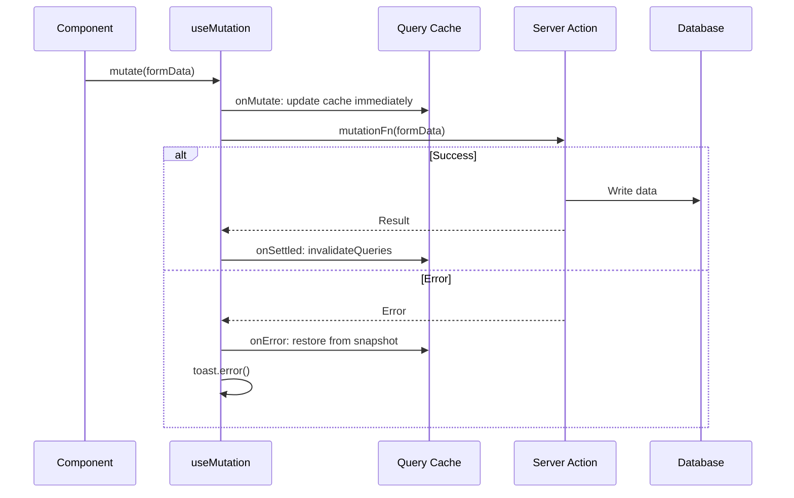

# Data Fetching

Active contributors: themuuln

## Purpose

Data fetching in Zer uses TanStack React Query v5 for server state management. The data-fetching layer provides:

- A factory function for creating simple list query hooks
- A structured query key factory for cache management
- Optimistic mutation hooks for create/update/delete
- Domain-specific hooks for each entity

All queries go through the Supabase browser client (`createClient()` from `src/lib/supabase/client.ts`).

## Key Abstractions

| Abstraction | Source | Purpose |
|-------------|--------|---------|
| `createSimpleQuery()` | `src/lib/query/factory.ts` | Factory that generates a React Query hook for list queries on any table |
| `QueryProvider` | `src/lib/query/provider.tsx` | React Query client provider with 30s stale time and 5min gc time |
| `productKeys`, `saleKeys`, etc. | `src/lib/query/keys.ts` | Query key factory with `all()`, `lists(orgId)`, `detail(id)` methods |
| `useOptimisticCreate()` | `src/lib/query/use-optimistic.ts` | Optimistic mutation hook for creating items |
| `useOptimisticUpdate()` | `src/lib/query/use-optimistic.ts` | Optimistic mutation hook for updating items |
| `useOptimisticDelete()` | `src/lib/query/use-optimistic.ts` | Optimistic mutation hook for deleting items |
| `useProducts`, `useSales`, etc. | `src/lib/query/hooks/` | Domain-specific query hooks |

## How It Works

### Query Client Setup

The `QueryProvider` creates a single `QueryClient` instance with:

```typescript
new QueryClient({
  defaultOptions: {
    queries: {
      staleTime: 30_000,   // 30s before refetch
      gcTime: 300_000,      // 5min garbage collection
    },
  },
})
```

It wraps the app layout and includes React Query Devtools in development mode.

### Query Key Factory

File: `src/lib/query/keys.ts`

Every entity has a structured key factory:

```typescript
export const productKeys = {
  all: () => ["products"] as const,
  lists: (orgId: string) => ["products", "list", orgId] as const,
  detail: (id: string) => ["products", "detail", id] as const,
};
```

Available factories: `productKeys`, `saleKeys`, `contactKeys`, `expenseKeys`, `inventoryKeys`, `categoryKeys`, `movementKeys`, `variantKeys`, `brandKeys`, `commissionKeys`.

### Simple Query Factory

File: `src/lib/query/factory.ts`

`createSimpleQuery()` generates a standard list query hook:

```typescript
export const useProducts = createSimpleQuery({
  keys: productKeys,
  table: "products",
  softDelete: true,   // adds .is("deleted_at", null)
});
```

This produces a hook equivalent to:

```typescript
function useProducts(orgId: string) {
  return useQuery({
    queryKey: productKeys.lists(orgId),
    queryFn: async () => {
      const { data, error } = await supabase
        .from("products")
        .select("*")
        .eq("organization_id", orgId)
        .is("deleted_at", null)
        .order("name");
      if (error) throw error;
      return data;
    },
    enabled: !!orgId,
  });
}
```

Configuration options: `select` (query columns), `orderBy`/`orderDirection`, `filters`, `softDelete`.

### Optimistic Mutation Hooks

File: `src/lib/query/use-optimistic.ts`

Three hooks for Optimistic UI:



**useOptimisticCreate**: Immediately prepends the optimistic item to all active list caches. Requires `buildOptimistic(formData)` to create the fake item.

**useOptimisticUpdate**: Immediately merges a partial update into the cached item matching `getId(formData)`.

**useOptimisticDelete**: Immediately removes the item from all active list caches.

All three roll back on error and show a toast notification, then invalidate the query cache on settle.

### Domain Hooks

| Hook | File | Notes |
|------|------|-------|
| `useProducts` | `src/lib/query/hooks/use-products.ts` | `softDelete: true` |
| `useSales` | `src/lib/query/hooks/use-sales.ts` | Order by `created_at desc` |
| `useContacts` | `src/lib/query/hooks/use-contacts.ts` | |
| `useExpenses` | `src/lib/query/hooks/use-expenses.ts` | |
| `useBrands` | `src/lib/query/hooks/use-brands.ts` | |
| `useInventory` | `src/lib/query/hooks/use-inventory.ts` | |
| `useProductVariants` | `src/lib/query/hooks/use-product-variants.ts` | By product ID |
| `useRealtimeSubscriptions` | `src/lib/query/hooks/use-realtime-subscriptions.ts` | Sets up real-time channels |

## Key Source Files

| File | Purpose |
|------|---------|
| `src/lib/query/provider.tsx` | QueryClient provider with devtools |
| `src/lib/query/factory.ts` | `createSimpleQuery()` hook factory |
| `src/lib/query/keys.ts` | Query key factory for all entities |
| `src/lib/query/use-optimistic.ts` | `useOptimisticCreate`, `useOptimisticUpdate`, `useOptimisticDelete` |
| `src/lib/query/hooks/use-products.ts` | `useProducts` hook |
| `src/lib/query/hooks/use-sales.ts` | `useSales` hook |
| `src/lib/query/hooks/use-contacts.ts` | `useContacts` hook |
| `src/lib/query/hooks/use-expenses.ts` | `useExpenses` hook |
| `src/lib/query/hooks/use-brands.ts` | `useBrands` hook |
| `src/lib/query/hooks/use-inventory.ts` | `useInventory` hook |
| `src/lib/query/hooks/use-product-variants.ts` | `useProductVariants` hook |
