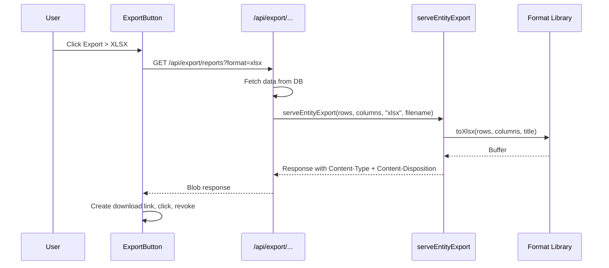

# Export

Active contributors: themuuln

## Purpose

Zer supports exporting tabular data in four formats: CSV, XLSX (Excel), DOCX (Word), and PDF. The export system is built around:

1. **`serveEntityExport()`** — A unified function that generates the appropriate `Response` for any format
2. **API routes** — Endpoints at `/api/export/` that accept a `format` query parameter
3. **`ExportButton`** — A UI component that triggers the export via fetch + download

## Key Abstractions

| Abstraction | Source | Purpose |
|-------------|--------|---------|
| `serveEntityExport()` | `src/lib/export/index.ts` | Generates a Response with the correct Content-Type and Content-Disposition headers |
| `toCsv()` | `src/lib/csv.ts` | Converts rows + columns to CSV string with formula injection protection |
| `toXlsx()` | `src/lib/export/to-xlsx.ts` | Generates XLSX buffer via ExcelJS |
| `toDocx()` | `src/lib/export/to-docx.ts` | Generates DOCX buffer via docx |
| `toPdfAsync()` | `src/lib/export/to-pdf.ts` | Generates PDF buffer via Puppeteer/html-pdf |
| `ExportColumn` | `src/lib/export/types.ts` | Column definition with `header` (string) and `key` (string) |
| `ExportFormat` | `src/lib/export/types.ts` | `"csv" | "xlsx" | "docx" | "pdf"` |
| `ExportButton` | `src/components/erp/export-button.tsx` | Dropdown button for triggering exports |

## How It Works

### Export Flow



### CSV Export

File: `src/lib/csv.ts`

The `toCsv()` function handles:

- Formula injection prevention (prefixes `=`, `+`, `-`, `@` with `'`)
- Proper quoting (wraps values containing commas, quotes, or newlines in double quotes)
- Header row + data rows

### serveEntityExport

File: `src/lib/export/index.ts`

This is the main orchestrator. Given a format, it dispatches to the appropriate library and returns a properly formatted `Response`:

```typescript
export async function serveEntityExport(
  rows: Record<string, unknown>[],
  columns: ExportColumn[],
  format: ExportFormat,
  filename: string,
  title?: string,
): Promise<Response> {
  switch (format) {
    case "csv":
      const csv = toCsv(rows, columns);
      return new Response(csv, {
        headers: {
          "Content-Type": "text/csv; charset=utf-8",
          "Content-Disposition": `attachment; filename="${filename}.csv"`,
        },
      });
    case "xlsx":
      const buffer = await toXlsx(rows, columns, title);
      // ...
  }
}
```

### Multi-Sheet/Export Variants

The export library also provides:
- `toXlsxMultiSheet()` — Multiple sheets in one workbook
- `toDocxMultiSection()` — Multi-section Word documents
- `toPdfMultiSectionAsync()` — Multi-section PDF documents

### ExportButton

File: `src/components/erp/export-button.tsx`

The UI component provides a dropdown with all four format options. It:

1. Fetches the export URL with the format as a query parameter
2. Creates a blob download
3. Sets the filename with the correct extension
4. Shows loading state during export

## Key Source Files

| File | Purpose |
|------|---------|
| `src/lib/export/index.ts` | `serveEntityExport()` function |
| `src/lib/export/types.ts` | `ExportColumn`, `ExportFormat`, `formatExtensions`, `formatMimeTypes` |
| `src/lib/csv.ts` | `toCsv()` CSV generation |
| `src/lib/export/to-xlsx.ts` | `toXlsx()`, `toXlsxMultiSheet()` |
| `src/lib/export/to-docx.ts` | `toDocx()`, `toDocxMultiSection()` |
| `src/lib/export/to-pdf.ts` | `toPdfAsync()`, `toPdfMultiSectionAsync()` |
| `src/components/erp/export-button.tsx` | `ExportButton` UI component |
| `src/app/api/export/reports/route.ts` | API route for report exports |
