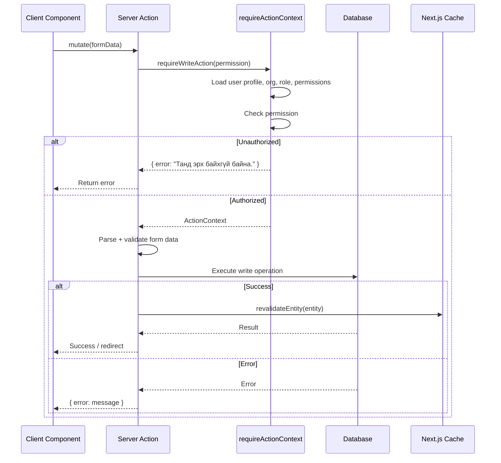

# Server Actions

Active contributors: themuuln

## Purpose

Server actions in Zer follow a consistent pattern:

1. **Guard** — Check authentication, organization membership, permissions, and branch scope
2. **Parse** — Extract and validate form data
3. **Execute** — Perform the database operation
4. **Revalidate** — Invalidate affected page caches

## Key Abstractions

| Abstraction | Source | Purpose |
|-------------|--------|---------|
| `requireActionContext()` | `src/lib/action-utils.ts` | Guard that loads the user context and checks a permission |
| `requireWriteAction()` | `src/lib/action-utils.ts` | Like `requireActionContext()` but also ensures `branchId` is non-null for scoped users |
| `requireBranchScope()` | `src/lib/action-utils.ts` | Returns error if a branch-scoped user has no branch assigned |
| `revalidateEntity()` | `src/lib/revalidate.ts` | Revalidates all paths associated with an entity |
| `revalidateEntities()` | `src/lib/revalidate.ts` | Revalidates multiple entities at once |
| `revalidateEntityTag()` | `src/lib/revalidate.ts` | Tag-based revalidation by entity + org |
| `getString()` | `src/lib/validation.ts` | Safely extracts and trims a string from FormData |
| `sanitizeRedirectPath()` | `src/lib/validation.ts` | Prevents open redirect vulnerabilities |
| `escapeHtml()` | `src/lib/validation.ts` | XSS prevention via HTML entity encoding |

## How It Works

### Action Guard Pattern

Every write server action follows this pattern:

```typescript
export async function createSale(_prevState, formData: FormData) {
  const ctx = await requireWriteAction("sales.create");
  if ("error" in ctx) return ctx;

  // Parse form data
  const contactId = getString(formData, "contact_id");

  // Execute
  const { data, error } = await ctx.supabase.from("sales").insert({
    organization_id: ctx.organizationId,
    branch_id: ctx.branchId,
    // ...
  });

  if (error) return { error: error.message };

  revalidateEntity("sales");
}
```

### ENTITY_PATHS

The centralized path mapping in `src/lib/revalidate.ts`:

```typescript
export const ENTITY_PATHS = {
  sales: ["/", "/sales"],
  shop: ["/shop", "/shop/history"],
  expenses: ["/", "/expenses"],
  purchases: ["/", "/purchases"],
  returns: ["/", "/returns"],
  invoices: ["/invoices"],
  quotations: ["/", "/quotations"],
  discounts: ["/", "/discounts"],
  products: ["/products", "/inventory"],
  inventory: ["/inventory", "/inventory/movements", "/products"],
  categories: ["/inventory/categories"],
  customers: ["/customers", "/suppliers", "/sales/new"],
  suppliers: ["/customers", "/suppliers", "/sales/new"],
  accounting: ["/accounting"],
  commissions: ["/commissions"],
  settings: ["/settings"],
  branding: ["/settings/branding"],
  branches: ["/settings/branches"],
  users: ["/settings/users"],
  roles: ["/settings/roles"],
};
```

### Validation Utilities

File: `src/lib/validation.ts`:

- `getString(formData, key)` — Extracts and trims a string value from FormData
- `requireEmail(email)` — Validates email format
- `requirePassword(password)` — Minimum 8 characters
- `normalizePhone(phone)` — Strips spaces and dashes
- `sanitizeRedirectPath(path)` — Prevents open redirect by ensuring only relative paths starting with `/`
- `escapeHtml(str)` — Replaces HTML special chars with entities (XSS prevention)

### Complete Action Flow



## Key Source Files

| File | Purpose |
|------|---------|
| `src/lib/action-utils.ts` | `requireActionContext()`, `requireWriteAction()`, `requireBranchScope()` |
| `src/lib/revalidate.ts` | `ENTITY_PATHS`, `revalidateEntity()`, `revalidateEntities()`, `revalidateEntityTag()` |
| `src/lib/validation.ts` | `getString()`, `sanitizeRedirectPath()`, `escapeHtml()`, `requireEmail()`, `requirePassword()`, `normalizePhone()` |
