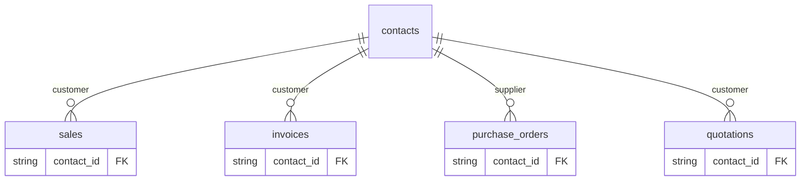

# Contact

Active contributors: themuuln

## Purpose

The `contacts` table stores both customers and suppliers in a single table, discriminated by a `type` column. This unified model simplifies the ERP — a contact can be both a customer and a supplier, and their balance is tracked across all transactions.

## Key Abstractions

| Column | Type | Purpose |
|--------|------|---------|
| `id` | UUID PK | Primary key |
| `organization_id` | UUID | FK → organizations |
| `name` | TEXT | Contact name (company or individual) |
| `type` | TEXT | Discrimination: `"customer"` or `"supplier"` |
| `email` | TEXT | Email address |
| `phone` | TEXT | Phone number |
| `address` | TEXT | Physical address |
| `balance` | NUMERIC | Running balance (positive = they owe you) |
| `created_at` | TIMESTAMPTZ | Creation timestamp |

## How It Works

### Type Discrimination

The `type` column uses a simple string discriminator:

- `"customer"` — Appears in customer lists, can be selected in sales and invoices
- `"supplier"` — Appears in supplier lists, can be selected in purchases

A contact can change type or even have a dual nature (the same contact can be both a customer and a supplier in different contexts — though the schema only stores one type at a time).

### Balance Tracking

The `balance` column tracks the running total owed by/to this contact:

- **For customers**: A positive balance means the customer owes money (accounts receivable)
- **For suppliers**: A positive balance means the supplier is owed money (accounts payable)

Balances are updated via database triggers or application-level calculations when sales, invoices, purchases, or payments are created.

### Usage Across the App

Contacts are referenced by:

- **Sales** → `contact_id` (customer making the purchase)
- **Invoices** → `contact_id` (customer being invoiced)
- **Purchase Orders** → `contact_id` (supplier being purchased from)
- **Quotations** → `contact_id` (customer receiving the quote)

### Relationship to Permissions

Contacts are governed by `contacts.*` permissions:
- `contacts.create` — Create new contacts
- `contacts.read` — View contact list and details
- `contacts.update` — Edit contact information
- `contacts.delete` — Remove contacts

## Key Source Files

| File | Purpose |
|------|---------|
| `src/lib/supabase/types.ts` | TypeScript type for `contacts` table |
| `src/lib/permissions.ts` | Permissions related to contacts |
| `supabase/migrations/20260621000003_add_has_suppliers.sql` | Adds `has_suppliers` feature flag to organizations |
