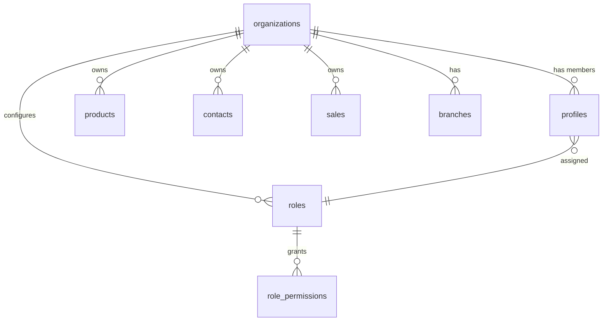

# Organization

Active contributors: themuuln

## Purpose

The `organizations` table is the tenant root for Zer's multi-tenant architecture. Every user belongs to exactly one organization (after onboarding), and every row of every entity table references an `organization_id`. All RLS policies enforce organization isolation via `get_current_organization()`.

## Key Abstractions

| Column | Type | Purpose |
|--------|------|---------|
| `id` | UUID PK | Primary key |
| `name` | TEXT | Organization display name |
| `slug` | TEXT | URL-friendly identifier (unique) |
| `company_type` | TEXT | E.g., `retail`, `wholesale`, `service` |
| `currency` | TEXT | Default currency (e.g., `MNT`) |
| `brand_config` | JSON | Selected brand theme config (stored as JSON from `branding.ts`) |
| `enabled_features` | TEXT[] | Array of feature flags for this org |
| `onboarding_completed` | BOOLEAN | Whether the org has completed setup |
| `has_inventory` | BOOLEAN | Inventory management enabled |
| `has_variants` | BOOLEAN | Product variants enabled |
| `has_multi_branch` | BOOLEAN | Multi-branch mode enabled |
| `has_customer_credit` | BOOLEAN | Customer credit tracking enabled |
| `has_suppliers` | BOOLEAN | Supplier management enabled |
| `has_uom` | BOOLEAN | Unit of measure conversions enabled |
| `has_brands` | BOOLEAN | Brand management enabled |
| `has_categories` | BOOLEAN | Category management enabled |
| `has_email_reports` | BOOLEAN | Email report scheduling enabled |
| `has_audit_log` | BOOLEAN | Audit logging enabled |
| `report_email_enabled` | BOOLEAN | Automated report emails on/off |
| `report_email_recipient` | TEXT | Email address for scheduled reports |
| `report_email_time` | TEXT | Time of day for report delivery |

## How It Works

### Tenant Model



Every table uses a consistent pattern:

```sql
organization_id UUID REFERENCES public.organizations(id) ON DELETE CASCADE NOT NULL
```

And every RLS policy checks:

```sql
organization_id = (SELECT get_current_organization())
```

### Onboarding Flow

When a user registers and creates their first organization via `create_organization()`:

1. Creates a row in `organizations` with the provided name, slug, and company_type
2. Creates default roles (owner, admin, staff) with pre-configured permissions
3. Updates the creating user's profile to link them as the owner
4. Creates a default branch ("Үндсэн салбар") and linked warehouse

The `onboarding_completed` flag can be set to `false` for guided setup flows.

### Feature Flags

The `has_*` booleans and `enabled_features` array control which features are shown in the UI. For example:

- If `has_variants` is false, the variant creation UI is hidden
- If `has_multi_branch` is false, the branch selector in the sidebar is hidden

These can be toggled in organization settings.

### Brand Theming

File: `src/lib/branding.ts`

The `brand_config` column stores a selected theme from the `BRAND_THEMES` array. Each theme defines CSS variable overrides for both light and dark modes:

```typescript
export const BRAND_THEMES: BrandTheme[] = [
  {
    name: "neutral",
    label: "Стандарт",
    light: {
      "--background": "oklch(0.98 0.01 95)",
      "--primary": "oklch(0.43 0.11 215)",
      // ... 25+ CSS variables
    },
    dark: {
      "--background": "oklch(0.145 0 0)",
      "--primary": "oklch(0.922 0 0)",
      // ...
    },
  },
  // More themes...
];
```

The selected theme is applied at the document root via CSS variables, allowing each organization to have its own color scheme.

## Key Source Files

| File | Purpose |
|------|---------|
| `src/lib/supabase/types.ts` | TypeScript type for `organizations` table |
| `supabase/migrations/20260620000001_add_onboarding_columns.sql` | Adds `enabled_features` and `onboarding_completed` |
| `supabase/migrations/20260621000004_add_org_settings.sql` | Adds `has_*` boolean feature flags |
| `supabase/migrations/20260621000005_add_more_org_settings.sql` | Additional org settings |
| `supabase/migrations/20260614000000_add_get_current_organization_function.sql` | `get_current_organization()` function |
| `src/lib/branding.ts` | Brand theme definitions for CSS variable theming |
| `supabase/migrations/20260617000300_add_brand_config.sql` | Adds `brand_config` column |
