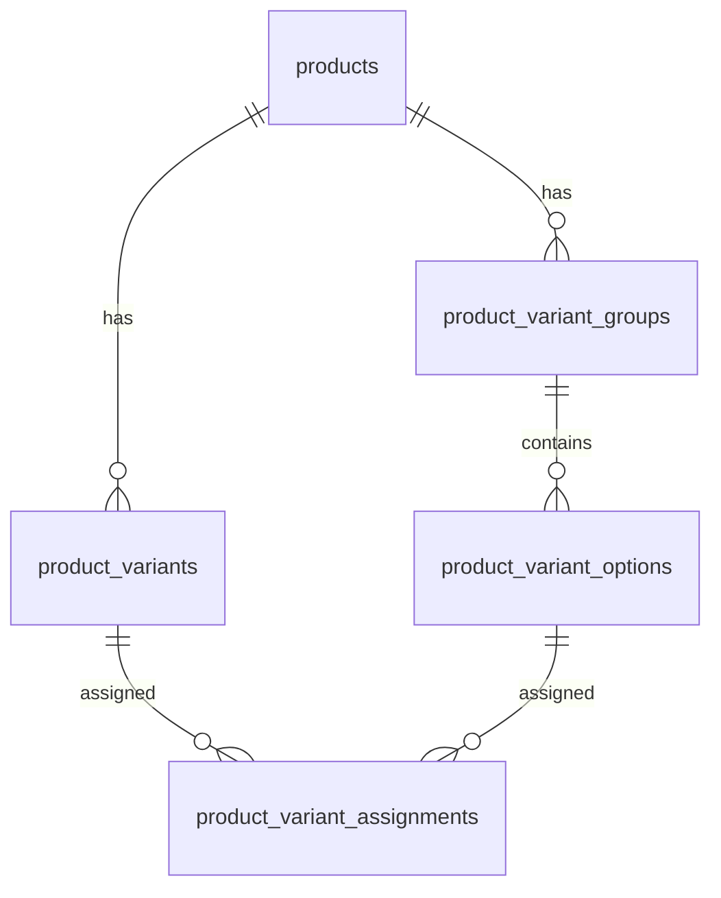
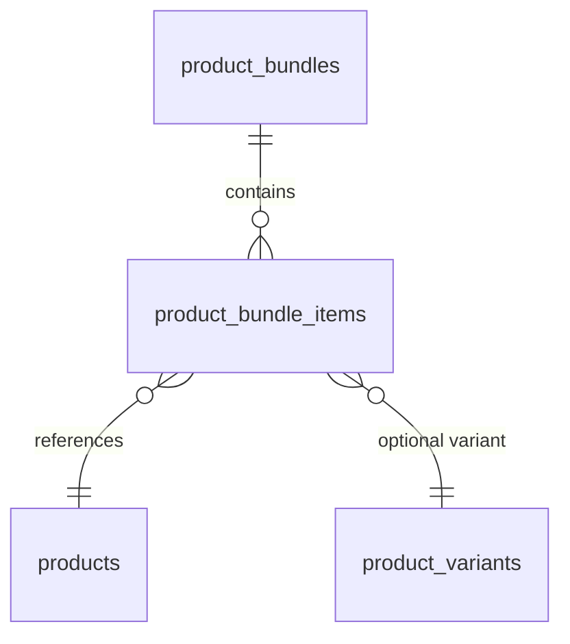

# Product

Active contributors: themuuln

## Purpose

The Product model is the core of inventory management in Zer. Products can be simple standalone items, compound items with variants (size, color, etc.), or bundles (kits of multiple products). Every product belongs to an organization and can be categorized and branded.

## Key Abstractions

| Abstraction | Table | Purpose |
|-------------|-------|---------|
| `products` | Main table | Core product record with name, SKU, barcode, prices, stock, and soft-delete support |
| `categories` | Lookup | Product categorization (e.g., "Хүнс", "Ундаа") |
| `brands` | Lookup | Product brands with optional logo URL |
| `product_variants` | Variant | SKU-level variant with own price, stock, barcode, and images |
| `product_variant_groups` | Variant | Group labels for variant dimensions (e.g., "Хэмжээ", "Өнгө") |
| `product_variant_options` | Variant | Specific values within a group (e.g., "S", "M", "L") |
| `product_variant_assignments` | Variant | Which options constitute a variant (many-to-many) |
| `product_bundles` | Bundle | Bundle/kit header record |
| `product_bundle_items` | Bundle | Individual products within a bundle with quantities |

## How It Works

### Product Table

The `products` table schema:

```typescript
{
  id: UUID;
  organization_id: UUID;
  name: string;
  sku: string | null;
  barcode: string | null;
  sale_price: number | null;
  cost_price: number | null;
  current_stock: number | null;
  min_stock: number | null;
  unit: string | null;
  category_id: UUID | null;       // FK → categories
  brand_id: UUID | null;          // FK → brands
  image_url: string | null;
  image_urls: string[] | null;
  deleted_at: string | null;      // Soft delete
  created_at: string | null;
}
```

Products support soft-delete via `deleted_at`. All list queries filter with `.is("deleted_at", null)` when `softDelete: true` is configured.

### Variant System



The variant system uses a flexible group/option/assignment model:

1. **Variant Groups** define dimensions (e.g., "Хэмжээ" = Size, "Өнгө" = Color)
2. **Variant Options** are the values within each group (e.g., "S", "M", "L")
3. **Variants** are concrete SKU-level records with their own price, stock, and barcode
4. **Variant Assignments** link a variant to one option from each group (e.g., Variant #1 = Size:M + Color:Цагаан)

Each variant has its own `sale_price`, `cost_price`, `current_stock`, `min_stock`, `barcode`, and `image_urls`, allowing fine-grained inventory tracking.

### Bundle System



Bundles (kits) allow grouping multiple products for sale as a single item:

- **Bundle** has its own name, SKU, sale price, and cost price
- **Bundle Items** reference products (and optionally variants) with a quantity
- Bundles are sold as single line items in sales

### Categories

Simple lookup table:
- `id`, `organization_id`, `name`, `created_at`
- Each product can have one category
- Categories are org-scoped

### Brands

Simple lookup table with optional logo:
- `id`, `organization_id`, `name`, `logo_url`, `created_at`
- Each product can have one brand
- Brands are org-scoped

## Key Source Files

| File | Purpose |
|------|---------|
| `src/lib/supabase/types.ts` | TypeScript types for `products`, `categories`, `brands`, `product_variants`, `product_bundles` |
| `supabase/migrations/20260618000002_create_product_variants.sql` | Creates the variant system tables and RLS policies |
| `supabase/migrations/20260621000002_create_product_bundles.sql` | Creates the bundle system tables and RLS policies |
| `supabase/migrations/20260619050000_add_product_soft_delete.sql` | Adds `deleted_at` column for soft delete |
| `supabase/migrations/20260615000001_create_brands.sql` | Creates brands table |
