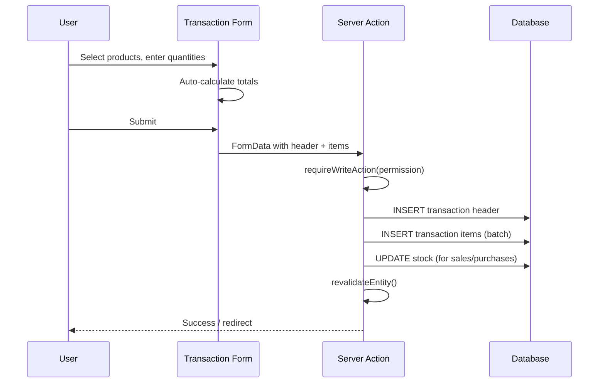

# Transaction

Active contributors: themuuln

## Purpose

Zer uses a consistent line-item pattern across five transaction types: **sales**, **purchases**, **returns**, **invoices**, and **quotations**. Each has a header table (the transaction itself) and a child items table (the line items), sharing a common structural pattern.

## Key Abstractions

| Transaction Type | Header Table | Items Table | Purpose |
|-----------------|--------------|-------------|---------|
| Sales | `sales` | `sale_items` | Point-of-sale and retail sales |
| Purchases | `purchase_orders` | `purchase_order_items` | Supplier purchase orders |
| Returns | `returns` | `return_items` | Customer returns |
| Invoices | `invoices` | `invoice_items` | Billing/invoicing |
| Quotations | `quotations` | `quotation_items` | Price quotes/estimates |

## Common Header Pattern

All transaction headers share these common fields:

```typescript
{
  id: UUID;
  organization_id: UUID;
  branch_id: UUID;                  // FK → branches (NOT NULL)
  contact_id: UUID | null;          // FK → contacts
  total_amount: number;             // Computed total
  notes: string | null;
  created_at: string | null;
  created_by: string | null;        // FK → profiles
}
```

### Sales-Specific Fields

```typescript
{
  sale_date: string;
  status: string | null;            // e.g., "completed", "refunded"
  payment_method: string | null;
  paid_amount: number | null;
  salesperson_id: string | null;    // FK → profiles
}
```

### Invoice-Specific Fields

```typescript
{
  invoice_date: string;
  due_date: string;
  status: string;                   // e.g., "sent", "paid", "overdue"
  token: string | null;             // For public share links
}
```

## Common Line-Item Pattern

All items tables share these common fields:

```typescript
{
  id: UUID;
  <parent>_id: UUID;               // FK to parent transaction
  product_id: UUID | null;          // FK → products
  variant_id: UUID | null;          // FK → product_variants (optional)
  quantity: number;
  unit_price: number;
  total_price: number;
  description: string | null;
}
```

Some item tables also track cost for margin calculations.

## How It Works

### Line-Item Form Pattern

Transaction forms in the UI use `useFieldArray` from react-hook-form for the line items:

```typescript
const { fields, append, remove } = useFieldArray({
  control,
  name: "items",
});
```

Each item row includes:
- Product selector (Combobox with search)
- Quantity input
- Unit price input
- Total (auto-calculated)
- Remove button
- A way to add new rows

### Total Calculation

The `total_amount` on the header is computed from the line items:

```typescript
const total = items.reduce(
  (sum, item) => sum + item.quantity * item.unit_price,
  0
);
```

This is kept in sync via `watch` in react-hook-form, and submitted as part of the form data.

### Transaction Flow



### Branch & Contact Linking

All transaction types:
- Are branch-scoped via `branch_id` (NOT NULL)
- Can optionally link to a contact via `contact_id`
- Follow the same RLS pattern: `organization_id` + `has_permission()` + `user_has_branch_access()`

### Complete List of Transaction Tables

| Table | Migration |
|-------|-----------|
| `sales` / `sale_items` | Initial schema |
| `purchase_orders` / `purchase_order_items` | `20260617000001_create_purchases_quotations_returns_accounting_discounts.sql` |
| `returns` / `return_items` | Same as above |
| `quotations` / `quotation_items` | Same as above |
| `invoices` / `invoice_items` | `20260616000002_create_invoices.sql` |

## Key Source Files

| File | Purpose |
|------|---------|
| `src/lib/supabase/types.ts` | TypeScript types for all transaction tables |
| `supabase/migrations/20260617000001_create_purchases_quotations_returns_accounting_discounts.sql` | Creates purchase_orders, quotations, returns tables + items |
| `supabase/migrations/20260616000002_create_invoices.sql` | Creates invoices + invoice_items tables |
| `supabase/migrations/20260618000004_add_variant_id_to_line_items.sql` | Adds `variant_id` to transaction line items |
