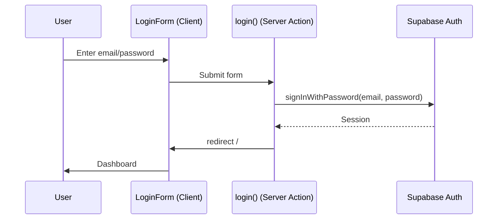
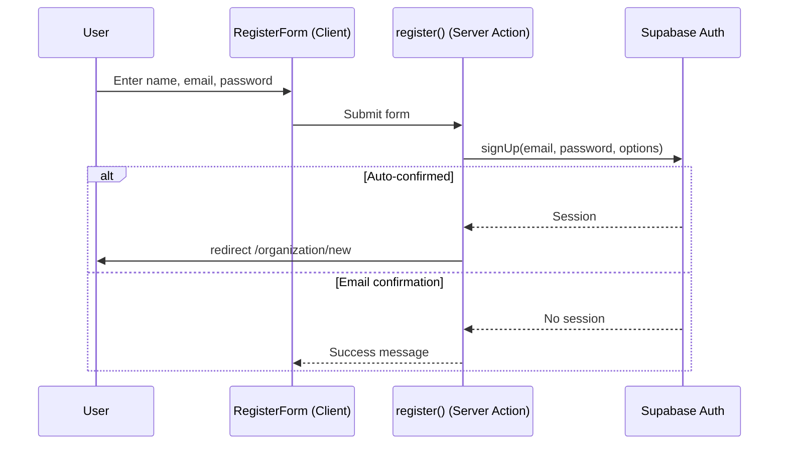

# Authentication

Active contributors: themuuln

## Purpose

Authentication in Zer uses Supabase Auth (built on GoTrue) with a standard email/password flow. The system handles:

- User login and session management via Supabase SSR cookies
- Registration with email confirmation and auto-redirect to organization creation
- Password reset via email link
- Session refresh via a Next.js middleware proxy

All authentication UI is built with react-hook-form + zod validation using server actions, and the UI is entirely in Mongolian.

## Key Abstractions

| Abstraction | File | Purpose |
|-------------|------|---------|
| `createClient()` | `src/lib/supabase/server.ts` | Creates a Supabase SSR server client with cookie-based auth |
| `updateSession()` | `src/lib/supabase/proxy.ts` | Next.js middleware that refreshes the session and enforces route protection |
| `login()` | `src/app/(auth)/login/actions.ts` | Server action for email/password sign-in |
| `register()` | `src/app/(auth)/register/actions.ts` | Server action for new user registration |
| `requestPasswordReset()` | `src/app/(auth)/forgot-password/actions.ts` | Server action for password reset email |
| `updatePassword()` | `src/app/(auth)/reset-password/actions.ts` | Server action for new password submission |
| `AuthCard` | `src/components/ui/auth-card.tsx` | Shared layout wrapper for all auth pages |

## How It Works

### Login Flow

1. User visits `/login` — the `LoginForm` client component renders
2. On submit, `login()` server action calls `createClient()` then `supabase.auth.signInWithPassword()`
3. On success, redirects to the `next` parameter (default `/`)
4. On error, returns a `{ error }` object that `useActionState` displays via `ErrorBanner`

The middleware (`proxy.ts`) intercepts the response, refreshes cookies, and enforces route protection.



### Registration Flow

1. User fills the registration form at `/register`
2. `register()` validates input via `validateRegistrationInput()`, then calls `supabase.auth.signUp()`
3. If a session is returned immediately (auto-confirm enabled), redirects to `/organization/new`
4. Otherwise, shows a success message asking the user to check their email



### Password Reset

Two-step flow:

1. **Request**: User enters email at `/forgot-password`, which calls `supabase.auth.resetPasswordForEmail()` with a redirect to `/auth/callback?next=/reset-password`
2. **Reset**: User clicks the link, is redirected to `/reset-password`, and submits new password via `supabase.auth.updateUser({ password })`

### SSR Client (`src/lib/supabase/server.ts`)

```ts
export async function createClient() {
  const cookieStore = await cookies();
  const { anonKey, url } = getSupabaseEnv();
  return createServerClient<Database>(url, anonKey, {
    cookies: {
      getAll() { return cookieStore.getAll(); },
      setAll(cookiesToSet) {
        try {
          cookiesToSet.forEach(({ name, value, options }) => {
            cookieStore.set(name, value, options);
          });
        } catch {
          // Called from Server Component — ignore
        }
      },
    },
  });
}
```

Uses `@supabase/ssr` `createServerClient` which stores the session in Next.js cookies. The `setAll` catch block silently handles the case where Server Components try to set cookies (Next.js throws, but the response cookie is already set via middleware).

### Proxy Middleware (`src/lib/supabase/proxy.ts`)

The `updateSession()` function runs as Next.js middleware. It:

1. Creates a Supabase client from the incoming request cookies
2. Calls `supabase.auth.getClaims()` to check if a session exists
3. Allows public routes (`/login`, `/register`, `/forgot-password`, `/reset-password`), share routes (`/r/[token]`), public org product pages (`/{slug}/products`), and cron routes (`/api/cron/`)
4. Redirects unauthenticated users to `/login` with a `next` parameter
5. Redirects authenticated users away from `/login` and `/register`
6. Returns the response with refreshed cookies

**Important**: The middleware catches all routes by matching `/(.*)` in `middleware.ts`.

## Route Protection Summary

| Route Type | Pattern | Auth Required? |
|------------|---------|----------------|
| Auth pages | `/login`, `/register`, `/forgot-password`, `/reset-password` | No (redirect to `/` if logged in) |
| Organization setup | `/organization/new` | Yes |
| Dashboard | `/` | Yes |
| Share links | `/r/[token]` | No (token-based access) |
| Public products | `/{slug}/products` | No (SECURITY DEFINER RPC) |
| Cron jobs | `/api/cron/` | No (CRON_SECRET Bearer token) |

## Key Source Files

| File | Purpose |
|------|---------|
| `src/app/(auth)/login/page.tsx` | Login page server component |
| `src/app/(auth)/login/login-form.tsx` | Login form client component |
| `src/app/(auth)/login/actions.ts` | Login server action |
| `src/app/(auth)/register/page.tsx` | Registration page |
| `src/app/(auth)/register/actions.ts` | Registration server action |
| `src/app/(auth)/forgot-password/page.tsx` | Password reset request page |
| `src/app/(auth)/forgot-password/actions.ts` | Password reset request action |
| `src/app/(auth)/reset-password/page.tsx` | New password page |
| `src/app/(auth)/reset-password/actions.ts` | New password action |
| `src/lib/supabase/server.ts` | SSR Supabase client for server components |
| `src/lib/supabase/proxy.ts` | Middleware for session refresh and route protection |
| `src/lib/supabase/env.ts` | Supabase environment variables |
| `src/lib/validation.ts` | Form data parsing utilities (`getString`, `sanitizeRedirectPath`) |
| `src/lib/domain-rules.ts` | Input validation rules |
| `src/components/ui/auth-card.tsx` | Shared auth page layout |
