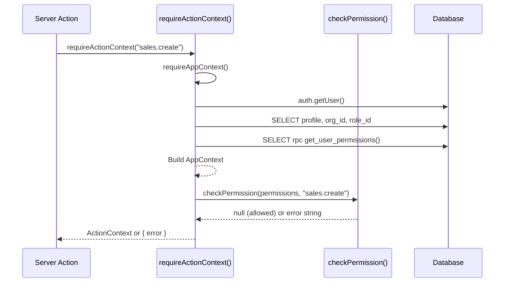

# Authorization

Active contributors: themuuln

## Purpose

Zer uses a role-based access control (RBAC) system on top of row-level security (RLS) in PostgreSQL. Every action in the app is gated by two layers:

1. **Application layer** — Server-side permission checks in server actions via `requireActionContext()` and `checkPermission()`
2. **Database layer** — RLS policies that call `has_permission()` and `get_current_organization()` on every query

This dual-layer approach ensures that even if a client bypasses the UI, the database enforces the same rules.

## Key Abstractions

| Abstraction | Source | Purpose |
|-------------|--------|---------|
| `app_permission` enum | `supabase/migrations/20260616000006_create_roles_and_permissions.sql` | PostgreSQL enum of all 60+ granular permissions (e.g. `products.create`, `sales.read`) |
| `APP_PERMISSIONS` | `src/lib/permissions.ts` | TypeScript constant mirroring the DB enum, auto-generated from `Constants.public.Enums.app_permission` |
| `PERMISSION_GROUPS` | `src/lib/permissions.ts` | Grouped permissions for UI display (permission management screens) |
| `requireAppContext()` | `src/lib/erp.ts` | Loads the user's profile, org ID, role ID, permissions, and branch info. Redirects to `/login` or `/organization/new` if missing |
| `requireActionContext()` | `src/lib/action-utils.ts` | Wraps `requireAppContext()` + `checkPermission()` into a single call for server actions |
| `requireWriteAction()` | `src/lib/action-utils.ts` | Like `requireActionContext()` but also ensures `branchId` is non-null for branch-scoped users |
| `checkPermission()` | `src/lib/erp.ts` | Returns `null` if the user has the required permission, or an error string |
| `has_permission()` | SQL function | SECURITY DEFINER function used in RLS policies to check if the current user has a specific permission |
| `get_current_organization()` | SQL function | Returns the current user's organization_id, used in every RLS policy for multi-tenancy |
| `get_user_permissions()` | SQL function | Returns the set of permission strings for the current user (used at app startup) |
| `user_has_branch_access()` | SQL function | Checks whether a user can access a given branch (org-wide or assigned branch) |
| `roles` table | SQL | Each org has customizable roles (owner, admin, staff) with `hierarchy_level` for ordering |
| `role_permissions` table | SQL | Many-to-many join between roles and permissions |
| `set_role_permissions()` | SQL function | Atomically replaces all permissions for a role (transactional delete + insert) |

## How It Works

### Role Hierarchy

Every organization gets three system roles on creation:

| Role | Hierarchy Level | Permissions |
|------|----------------|-------------|
| `owner` | 0 (highest) | All permissions |
| `admin` | 1 | All except `roles.manage` |
| `staff` | 2 | Read + create for core entities, no delete/update on most |

Additional custom roles can be created by users with `roles.manage` permission.

### Permission Enum

The `app_permission` PostgreSQL enum defines granular, CRUD-style permissions for every entity:

```
products.*, categories.*, brands.*, contacts.*, sales.*, expenses.*,
invoices.*, purchases.*, quotations.*, returns.*, warehouses.*,
stock_movements.*, uom_conversions.*, members.*, roles.manage,
settings.manage, reports.manage, notifications.manage, audit_log.read,
emails.manage, accounting.manage, discounts.*
```

Each entity has `.create`, `.read`, `.update`, `.delete` variants (except `members` which has `.read`, `.invite`, `.remove`, `.manage_role`).

### Application Layer Flow



### RLS Policy Pattern

Every entity table uses this standard RLS pattern:

```sql
CREATE POLICY "products_select" ON public.products
  FOR SELECT USING (
    organization_id = (SELECT get_current_organization())
    AND public.has_permission('products.read')
  );
```

The `has_permission()` function is SECURITY DEFINER (runs as the table owner) and does an inner join through profiles → role_permissions:

```sql
SELECT p.role_id INTO v_role_id
FROM public.profiles p WHERE p.id = auth.uid();

RETURN EXISTS (
  SELECT 1 FROM public.role_permissions rp
  WHERE rp.role_id = v_role_id
    AND rp.permission = p_permission
);
```

Branch-aware policies (added in the multi-branch migration) also include:

```sql
AND public.user_has_branch_access(branch_id)
```

### AppContext Shape

The `requireAppContext()` function returns a rich context object:

```typescript
{
  supabase: SupabaseClient,       // Authenticated client
  organizationId: string,          // Current org UUID
  user: User,                      // Supabase auth user
  userId: string,                  // User UUID
  roleId: string | null,           // Role UUID
  permissions: AppPermission[],    // Array of permission strings
  branchId: string | null,         // User's assigned branch (null = org-wide)
  isBranchScoped: boolean,         // true when branchId !== null
}
```

### Server Action Guards

Server actions use one of three guards:

```typescript
// Read-only action — checks permission only
const ctx = await requireActionContext("sales.read");
if ("error" in ctx) return ctx;

// Write action — ensures branch scope is valid
const ctx = await requireWriteAction("sales.create");
if ("error" in ctx) return ctx;
// ctx.branchId is guaranteed non-null for scoped users
```

## Key Source Files

| File | Purpose |
|------|---------|
| `supabase/migrations/20260616000006_create_roles_and_permissions.sql` | Creates `app_permission` enum, `roles` table, `role_permissions` table, all helper functions, and seed data |
| `src/lib/erp.ts` | `requireAppContext()`, `checkPermission()`, `AppContext` type, `parseAmount()` |
| `src/lib/permissions.ts` | `APP_PERMISSIONS` constant, `PERMISSION_GROUPS`, `PERMISSION_LABELS` (Mongolian) |
| `src/lib/action-utils.ts` | `requireActionContext()`, `requireWriteAction()`, `requireBranchScope()`, `ActionContext` type |
| `supabase/migrations/20260617000002_add_set_role_permissions_function.sql` | `set_role_permissions()` function |
| `src/lib/supabase/types.ts` | TypeScript types mirroring the database schema |
