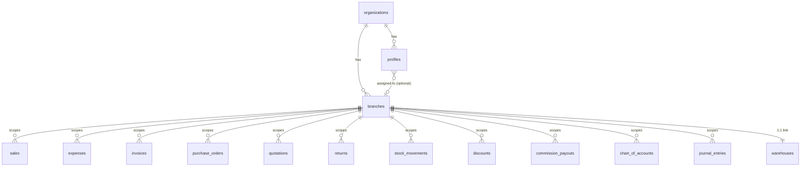

# Multi-Branch

Active contributors: themuuln

## Purpose

The multi-branch system allows a single organization to operate multiple physical or virtual locations (branches) with data isolation. Each branch has its own sales, expenses, invoices, purchases, quotations, returns, stock movements, discounts, chart of accounts, journal entries, and commission payouts.

Users can be either org-wide (access all branches) or branch-scoped (access only their assigned branch).

## Key Abstractions

| Abstraction | Source | Purpose |
|-------------|--------|---------|
| `branches` table | `supabase/migrations/20260618133041_add_branches.sql` | Stores branch name, slug, address, phone, email, and default flag |
| `profile.branch_id` | Profiles table | Nullable column — `NULL` means org-wide access, a UUID means scoped to that branch |
| `user_has_branch_access()` | SQL function | RLS helper that returns `true` if the user is org-wide or assigned to the target branch |
| `BranchProvider` | `src/lib/branch-context.tsx` | React context providing the selected branch, branch list, and selection setter |
| `useBranchContext()` | `src/lib/branch-context.tsx` | Hook to read the current branch context in any client component |
| `getUserBranches()` | `src/lib/branches.ts` | Returns all branches accessible to a user |
| `getEffectiveBranchId()` | `src/lib/branches.ts` | Resolves the effective branch ID for filtering |
| `withBranchFilter()` | `src/lib/branches.ts` | Adds `.eq("branch_id", ...)` to a Supabase query when a branch is selected |
| `enforceBranchAccess()` | `src/lib/branches.ts` | Redirects to 404 if a scoped user tries to access a record from another branch |
| `canAccessBranch()` | `src/lib/branches.ts` | Simple boolean check for branch access |

## How It Works

### Branch Isolation Model



Every branch-scoped entity table has a `branch_id` foreign key (NOT NULL after the seed migration). The `shared_reports` table allows NULL for org-wide reports.

### User Branch Assignment

Users are assigned to branches through `profiles.branch_id`:

- **Org-wide users** — `branch_id IS NULL` — can see data across all branches
- **Branch-scoped users** — `branch_id` is set to a specific branch UUID — only see data for that branch

### RLS Enforcement

All branch-scoped RLS policies include the `user_has_branch_access()` check:

```sql
CREATE POLICY "sales_select" ON public.sales
  FOR SELECT USING (
    organization_id = (SELECT get_current_organization())
    AND public.has_permission('sales.read')
    AND public.user_has_branch_access(branch_id)
  );
```

The `user_has_branch_access()` function:

```sql
SELECT p.branch_id INTO v_branch_id
FROM public.profiles p WHERE p.id = auth.uid();

RETURN v_branch_id IS NULL OR v_branch_id = target_branch_id;
```

If the profile's `branch_id` is NULL (org-wide), the function returns true for any branch. If it's set, only matching branch IDs pass.

### Application-Layer Branch Filtering

For data that doesn't go through RLS (e.g., server-side queries in actions), the `withBranchFilter()` helper provides equivalent filtering:

```typescript
let query = supabase.from("sales").select("*");
query = withBranchFilter(query, branchId, isBranchScoped, searchParamsBranch);
```

Admin users can optionally filter by branch via URL search params (stored in `localStorage` under `zer-selected-branch`).

### Branch Context Provider

The `BranchProvider` wraps all branch-aware UI and provides:

- **`selectedBranchId`** — Currently selected branch (null = all branches)
- **`branches`** — Array of all accessible branches
- **`setSelectedBranchId()`** — Selector function (preserved in localStorage)
- **`isBranchScoped`** — Whether the user is scoped to a single branch
- **`userBranchId`** — The user's profile branch_id

For scoped users, the selector is locked to their assigned branch. For admins, the selection persists across page reloads via `localStorage`.

### 1:1 Warehouse-Branch Linking

Each branch has exactly one linked warehouse via `warehouses.branch_id`. The constraint ensures a one-to-one relationship:

```sql
ALTER TABLE public.warehouses
  ADD CONSTRAINT warehouses_branch_id_key UNIQUE (branch_id);
```

This means inventory is inherently branch-aware — each branch has its own warehouse, and stock movements are tracked per branch.

### Seed Migration

When branches were added, existing organizations got a default branch named "Үндсэн салбар" (Main Branch), and all existing data was assigned to it. A default warehouse was also created and linked to the default branch.

## Key Source Files

| File | Purpose |
|------|---------|
| `supabase/migrations/20260618133041_add_branches.sql` | Creates `branches` table, adds `branch_id` to all scoped tables, creates `user_has_branch_access()`, updates RLS policies, seeds default branches |
| `src/lib/branches.ts` | `getUserBranches()`, `getAccessibleBranches()`, `getEffectiveBranchId()`, `withBranchFilter()`, `enforceBranchAccess()`, `canAccessBranch()` |
| `src/lib/branch-context.tsx` | `BranchProvider` context, `useBranchContext()` hook, branch selector with localStorage persistence |
| `supabase/migrations/20260619042304_update_trial_balance_branch_filter.sql` | Per-branch trial balance support |
