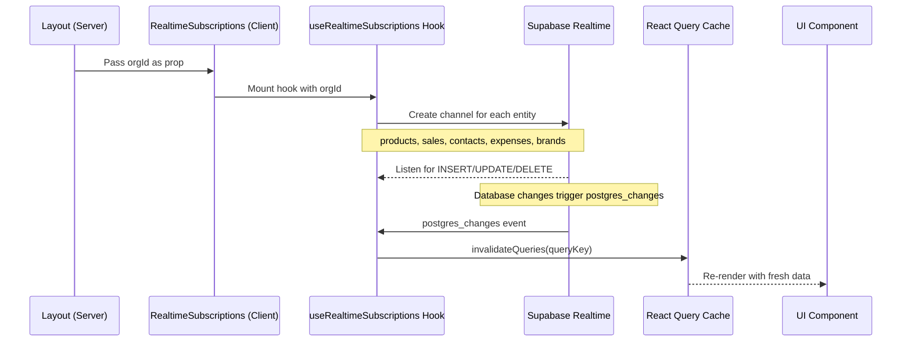

# Real-Time

Active contributors: themuuln

## Purpose

Zer uses Supabase Realtime (WebSocket-based) subscriptions to push live data updates to the frontend. When a table row is inserted, updated, or deleted, the React Query cache is invalidated and the UI re-renders automatically.

Currently used in:

- **Dashboard** — Live updates to sales metrics, expense totals, and inventory counts
- **Shop/POS** — Real-time product availability and sale status updates

## Key Abstractions

| Abstraction | Source | Purpose |
|-------------|--------|---------|
| `RealtimeSubscriptions` | `src/lib/query/realtime-subscriptions.tsx` | Client component that mounts the real-time hook in a server-rendered layout |
| `useRealtimeSubscriptions()` | `src/lib/query/hooks/use-realtime-subscriptions.ts` | Hook that creates Supabase Realtime channels and invalidates React Query caches on changes |
| `QueryProvider` | `src/lib/query/provider.tsx` | React Query provider with `QueryClient` configured with 30s stale time |

## How It Works

### Architecture



### Channel Setup

The `useRealtimeSubscriptions` hook creates one Supabase Realtime channel per entity:

```typescript
const channels = [
  { name: `products:${orgId}`, table: "products", keyAll: productKeys.all },
  { name: `sales:${orgId}`, table: "sales", keyAll: saleKeys.all },
  { name: `contacts:${orgId}`, table: "contacts", keyAll: contactKeys.all },
  { name: `expenses:${orgId}`, table: "expenses", keyAll: expenseKeys.all },
  { name: `brands:${orgId}`, table: "brands", keyAll: brandKeys.all },
];
```

Each channel listens for all events (`*`) on the specified table, filtered by `organization_id`:

```typescript
channel.on("postgres_changes", {
  event: "*",
  schema: "public",
  table,
  filter: `organization_id=eq.${orgId}`,
}, () => {
  queryClient.invalidateQueries({ queryKey: keyAll() });
});
```

### Sales-Specific Behavior

Sales changes also invalidate the inventory/stock cache, since a sale affects stock levels:

```typescript
const keyFactories =
  table === "sales" ? [keyAll, inventoryKeys.all] : [keyAll];
```

### Mounting in the Layout

The `RealtimeSubscriptions` component is a thin client wrapper that renders nothing:

```typescript
export function RealtimeSubscriptions({ orgId }) {
  useRealtimeSubscriptions(orgId);
  return null;
}
```

It's mounted inside a server-rendered layout that fetches the `orgId` from the session:

```tsx
// Inside a layout:
<RealtimeSubscriptions orgId={orgId} />
```

### Cleanup

Channels are automatically cleaned up on unmount or when `orgId` changes:

```typescript
useEffect(() => {
  if (!orgId) return;
  const supabase = createClient();
  // ... channel setup ...
  return () => {
    supabase.removeAllChannels();
  };
}, [orgId]);
```

## Key Source Files

| File | Purpose |
|------|---------|
| `src/lib/query/realtime-subscriptions.tsx` | Client component that wraps the hook for server layout mounting |
| `src/lib/query/hooks/use-realtime-subscriptions.ts` | Core hook — creates Supabase Realtime channels per entity, invalidates React Query caches |
| `src/lib/query/keys.ts` | Query key factory with `all()` methods used for cache invalidation |
| `src/lib/supabase/client.ts` | Browser-side Supabase client for Realtime connections |
