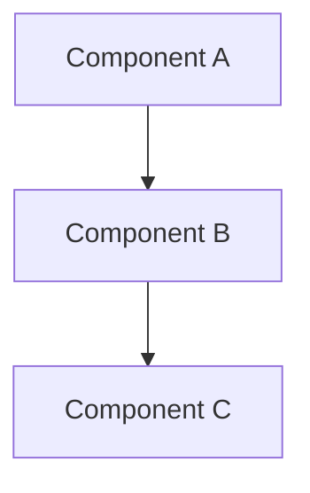
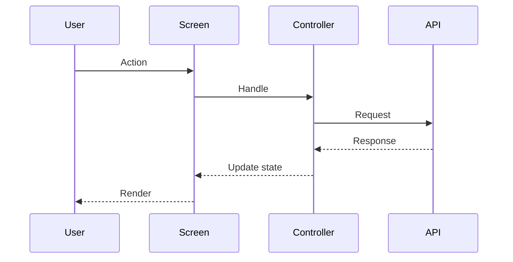

# {{FEATURE_NAME}}

{{ONE_PARAGRAPH_SUMMARY}}

## Overview

{{WHAT_IT_DOES_AND_WHY}}

## Architecture



## Key Components

| File | Purpose |
|------|---------|
| `src/{{feature}}/controller.ts` | Business logic |
| `src/{{feature}}/page.tsx` | UI layer |
| `src/{{feature}}/model.ts` | Data models |

::: info
Adjust paths to match your project structure:
- **Flutter**: `lib/{{feature}}/controller.dart`, `lib/{{feature}}/screen.dart`
- **Next.js**: `src/{{feature}}/page.tsx`, `src/{{feature}}/actions.ts`
- **React**: `src/components/{{feature}}/index.tsx`
- **Go**: `internal/{{feature}}/handler.go`
- **Rust**: `src/{{feature}}/mod.rs`
:::

## How It Works

### {{STEP_1_NAME}}

{{DESCRIPTION}}

```typescript
// Example from actual code
{{CODE_EXAMPLE}}
```

## State Management



## Edge Cases

- **Offline behavior**: {{OFFLINE_DESCRIPTION}}
- **Error handling**: {{ERROR_DESCRIPTION}}
- **Loading states**: {{LOADING_DESCRIPTION}}

## Related

- [Architecture](/architecture.html)
- [API Reference](/api/index.html)
