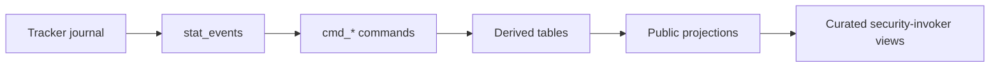

# Оноо-ийн итгэлтэй тоглолтын бүртгэлийн архитектур

## Зорилго ба хамрах хүрээ

Энэ баримт нь Оноо-ийн одоогийн лиг-эхлэлтэй web pilot-д ашиглагдаж буй trusted-game-record bounded context-ийг тодорхойлно. Энэ нь [бүтээгдэхүүний алсын хараа](VISION.md)-д тодорхойлсон сагсан бөмбөгийн бүрэн operating system-ийн нэг архитектурын хэсэг юм.

Энэ trusted-record context нь browser state, шууд table write, эсвэл derived statistics-ийг эрх мэдэлтэй гэж үзэхгүй.

## Эрх мэдэлтэй өгөгдлийн урсгал

## Бүртгэлийн давхаргууд

| Давхарга | Эрх мэдэлтэй агуулга | Mutation дүрэм |
| --- | --- | --- |
| Journal | tracker-с оруулсан анхны үйлдэл | Append-only |
| Event store | `stat_events` | үйлдэл бүр нэг мөр |
| Command layer | `cmd_*` процедурууд | зөвшөөрөгдсөн write |
| Projection | box score, standings, leaders | зөвшөөрөгдсөн revision-ээс дахин бүтээгдэнэ |
| Publication | curated public views | `final_pending_review` snapshot дээр provisional байдлаар эсвэл баталгаажсан revision-ээс public болно |

## Authorization

- Бүх public table дээр RLS идэвхтэй.
- Public хэрэглэгчид зөвхөн curated, approved мэдээлэл уншина.
- Browser, API route, Edge Function code нь command ашиглах ёстой; event, game status, projection table-ийг шууд өөрчлөх ёсгүй.
- `SECURITY DEFINER` command-ууд хоосон search path, тодорхой authorization, зөвхөн `authenticated` role-д зориулсан grant ашиглана.

## Тогтвортой байдал

Tracker нь network руу илгээхээсээ өмнө үйлдэл бүрийг IndexedDB-д хадгална. Үйлдэл бүр UUID idempotency key ба session sequence number-тай. Server нь receipt ack буцаана; reload нь баталгаажуулаагүй үйлдлүүдийг л дахин тоглуулна. Нэг тоглолтод нэг л идэвхтэй writer session байна. Handoff нь хуучин session-ийг хаагаад дараагийнхыг нээнэ.

## Publication ба засвар

Provisional public game нь closed-snapshot contract-аас ирэх ёстой, `final_pending_review` төлөв, source ба revision identity-г харуулах ёстой, мөн тодорхой provisional шошготой байх ёстой. Лигийн verification нь тогтвортой public URL-г өөрчлөхгүйгээр revision-ийг verified эсвэл official болгоно. Curated view-үүд нь status, revision number, source type, review timestamp, projection-ийн тохирох хувилбарыг харуулна. Засвар нь түүхийг дахин бичихийн оронд шинэ нотолгоо ба шинэ revision үүсгэнэ.

## Лигийн pilot-ийн үед хийхгүй зүйл

Багийн ажиллагаа, академийн ажиллагаа, commerce, guardian self-service, mobile rollout, push/follows, athlete claims, өргөн consumer analytics, review хийгдээгүй historical import нь энэ архитектурын хүрээнээс гадуур байна. Эдгээр нь roadmap дээрх өөрийн босгыг давсны дараа л орж ирнэ.
