# Onoo trusted-game-record architecture

## Purpose and scope

This document defines the trusted-game-record bounded context used by Onoo’s current league-first web pilot. It is one architecture slice inside the complete basketball operating system described in [the product vision](VISION.md).

This context owns game journals, evidence, revisions, official statistics, standings, and their curated publication projections. It does not own canonical organizations and athlete identity, team operating rosters, academy enrollment, guardians, consent, or commerce. Those domains integrate through reviewed commands, events, and projections.

The trusted-record context does not treat browser state, direct table writes, or derived statistics as authoritative.

## Authoritative data flow

```mermaid
flowchart LR
  Scorer[Assigned scorer] --> Journal[Durable per-game journal]
  Journal --> Command[Scoped Supabase command]
  Command --> Events[Immutable event record]
  Events --> Source[Evidence-backed source submission]
  Source --> Review[Official review]
  Review --> Revision[Approved game revision]
  Revision --> Projection[Rebuildable projections]
  Projection --> Public[Curated security-invoker views]
```

## Record layers

| Layer | Authoritative content | Mutation rule |
| --- | --- | --- |
| Competition snapshot | league, season, official roster snapshot, ruleset, assignments | league operations submit through reviewed commands; the game stores the accepted snapshot |
| Journal | ordered scorer operations and acknowledgement receipts | command-only, idempotent |
| Source | tracker journal, official sheet, import, or manual evidence | submit then review |
| Revision | normalized input, journal, projection, warnings | create then approve |
| Projection | box score, standings, leaders | rebuilt from an approved revision only |
| Publication | curated public views | provisional only from a closed `final_pending_review` snapshot with explicit labeling; verified/official only from an approved revision |

## Authorization

- RLS is enabled on every public table.
- Public users can read only curated approved information.
- Assigned scorers can operate only their assigned game and active tracker session.
- Approving officials and league operators review sources, revisions, and corrections.
- Browser, API route, and Edge Function code must call commands; they must never directly mutate events, game status, or projection tables.
- `SECURITY DEFINER` commands use empty search paths, explicit authorization, and grants only to `authenticated`.

## Durability

The tracker persists every operation in IndexedDB before network delivery. Each operation has a UUID idempotency key and session sequence number. The server acknowledges receipts; reloads replay only unacknowledged operations. A game has exactly one active writer session. Handoff closes the old session before opening the replacement.

## Publication and corrections

A provisional public game must come from the closed-snapshot contract, expose `final_pending_review`, source and revision identity, and display an explicit provisional label. League verification promotes an approved revision to verified or official without changing the stable public URL. Curated views expose status, revision number, source type, review timestamp, and the appropriate projection. Corrections create new evidence and revisions rather than rewriting history.

## Non-goals during the league pilot

Team operations, academy operations, commerce, guardian self-service, mobile rollout, push and follows, athlete claims, broad consumer analytics, and unreviewed historical imports remain outside this architecture slice until their roadmap gates pass.
