# Onoo V2 Architecture

## Purpose

Onoo V2 produces a trusted, reviewable basketball record for a contracted web-first pilot. It does not treat browser state, direct table writes, or derived statistics as authoritative.

## Authoritative data flow

```mermaid
flowchart LR
  Scorer[Assigned scorer] --> Journal[Durable per-game journal]
  Journal --> Command[Scoped Supabase command]
  Command --> Events[Immutable event record]
  Events --> Source[Evidence-backed source submission]
  Source --> Review[Official review]
  Review --> Revision[Approved game revision]
  Revision --> Projection[Rebuildable projections]
  Projection --> Public[Curated security-invoker views]
```

## Record layers

| Layer | Authoritative content | Mutation rule |
| --- | --- | --- |
| Setup | league, season, roster, ruleset, assignments | authorized operations only |
| Journal | ordered scorer operations and acknowledgement receipts | command-only, idempotent |
| Source | tracker journal, official sheet, import, or manual evidence | submit then review |
| Revision | normalized input, journal, projection, warnings | create then approve |
| Projection | box score, standings, leaders | rebuilt from an approved revision only |
| Publication | curated public views | verified/official and approved only |

## Authorization

- RLS is enabled on every public table.
- Public users can read only curated approved information.
- Assigned scorers can operate only their assigned game and active tracker session.
- Approving officials and league operators review sources, revisions, and corrections.
- Browser, API route, and Edge Function code must call commands; they must never directly mutate events, game status, or projection tables.
- `SECURITY DEFINER` commands use empty search paths, explicit authorization, and grants only to `authenticated`.

## Durability

The tracker persists every operation in IndexedDB before network delivery. Each operation has a UUID idempotency key and session sequence number. The server acknowledges receipts; reloads replay only unacknowledged operations. A game has exactly one active writer session. Handoff closes the old session before opening the replacement.

## Publication and corrections

A public game must have a reviewed source and approved revision. Curated views expose the revision number, source type, review timestamp, and approved projection. Corrections create new evidence and revisions rather than rewriting history.

## Non-goals during the pilot

Mobile rollout, push/follows, athlete claims, broad consumer analytics, and unreviewed historical imports are frozen until paid-proof gates are met.
