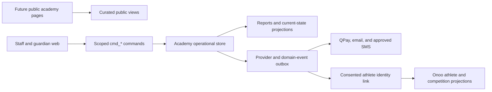

# Academy management within the Onoo basketball operating system

> **Status:** Product direction approved. Sequencing, architecture, and pilot scope proposed.
>
> **Document type:** Product architecture and phased delivery plan
>
> **Audience:** Product owners, engineering leads, league and team operators, academy operators, and pilot partners
>
> **Last updated:** 2026-07-22

Onoo is the complete technology solution for basketball leagues, clubs, teams, academies, athletes, and families. Academy management is a first-class Onoo bounded context, not a separate Zuiio product. This plan defines its role in that platform and a safe delivery sequence. It does not authorize production implementation or displace the unfinished trusted-record roadmap.

## Delivery decisions

The complete basketball-platform direction is fixed in [the product vision](../VISION.md). This plan requests approval for four delivery decisions:

1. **Sequencing:** Finish Onoo’s trusted-record foundation while validating the academy workflow and buyer
2. **Pilot scope:** Start academy operations with roster, enrollment, scheduling, attendance, consent, and payment reconciliation
3. **Architecture:** Share canonical identity and organization records while isolating private operational data behind bounded-context commands
4. **Expansion:** Add the remaining team, league, guardian, competition, and federation modules through measured delivery gates

A product owner must record each approved delivery decision in a dated decision log before executable tasks enter Onoo’s task queue. The log names the decision owner, approver, date, rationale, and review trigger.

## Recommendation

**Recommendation: approve the phased academy delivery sequence.** Academy operations are already part of Onoo’s product direction. The remaining questions are which workflow, buyer, storage boundary, and commercial gate should ship first without weakening the trusted-record foundation.

Onoo’s current web-first paid pilot remains the critical first phase because reliable games, statistics, standings, and player identity are shared foundations for leagues and teams. Academy discovery can run in parallel without committing engineering capacity. Production academy work starts only after paid intent, privacy approval, and the current trusted-record gates pass.

The current academy research contains no operator interviews, signed pilot intent, or validated price. That limits schedule and commercial decisions, not the product direction.

## Platform position

Academy management is Onoo’s training and development operations module. It connects the player’s daily development record to the same basketball identity used by teams, competitions, and public profiles.

### Onoo product domains

| Domain | Primary users | Core responsibility |
| --- | --- | --- |
| Identity and organizations | All actors | Users, organizations, memberships, roles, teams, and canonical athlete identity |
| League operations | League and federation staff | Seasons, competitions, schedules, eligibility, officials, standings, and governance |
| Trusted game records | Scorekeepers and league reviewers | Tracker journal, box scores, corrections, verification, and derived statistics |
| Team operations | Club and team staff | Rosters, staff, availability, training schedule, and logistics |
| Academy operations | Academy staff, coaches, guardians | Programs, enrollment, consent, attendance, and development |
| Commerce | Organization staff and guardians | Subscriptions, prices, invoices, payments, refunds, and reconciliation |
| Athlete experience | Players, families, scouts | Unified development and competition timeline, profiles, exports, and sharing |
| Public and audience surfaces | Fans, sponsors, customers | Public discovery, content, audience proof, and sponsor inventory |

### Shared platform contract

Onoo should provide one product identity and organization graph, with bounded contexts rather than a single unrestricted data model.

| Record or decision | Authoritative domain |
| --- | --- |
| User, organization, team, and canonical athlete identity | Identity and organizations |
| Competition entry, eligibility, official roster snapshot, and schedule | League operations |
| Team staff, operating roster intent, availability, training, and logistics | Team operations |
| Programs, enrollment, guardians, consent, and training attendance | Academy operations |
| Invoice, payment event, refund, settlement, and provider reconciliation | Commerce |
| Official game event, revision, box score, standing, and statistic | Trusted game records |
| Combined athlete timeline and public pages | Read-only composed projections |

Shared capabilities:

- Canonical user, organization, team, and athlete identifiers
- Basketball-specific role and membership primitives
- Design system, localization, observability, audit, and provider adapters
- Curated cross-domain projections for authorized internal and public use
- One coherent navigation and account experience

Required boundaries:

- League operations remain authoritative for competition entry, eligibility, official roster snapshots, games, and standings
- Team operations remain authoritative for staff, roster intent, availability, training, and logistics
- Academy operations remain authoritative for programs, enrollment, guardians, consent, and training attendance
- Commerce remains authoritative for invoices, payment events, refunds, settlement, and provider reconciliation
- Medical, guardian, and payment data remain private and least-privilege
- Cross-domain writes use reviewed commands or events, never direct table shortcuts
- Academy enrollment never auto-creates or fuzzy-confirms an official player identity
- Deployment separation may be used for security or availability, but it remains one Onoo product and contract

## Evidence and validation plan

The first release decision depends on evidence, not feature coverage.

### Current evidence

| Evidence | Confidence | What it supports |
| --- | --- | --- |
| Bodons operates a large academy and a production system | Medium | One academy has enough operational complexity to justify software |
| Existing Onoo league relationships may include clubs with academies | Medium | Onoo may have a lower-cost sales channel |
| International products cover registration, billing, and attendance | Medium | The category exists outside Mongolia |
| Mongolian language and local payments are absent from reviewed competitors | Low | Localization may differentiate the product |
| Other Mongolian academies use chat, paper, and cash | Low | The problem needs interviews and workflow observation |
| Academies will pay ₮100,000 to ₮300,000 per month | Speculative | The proposed price needs direct validation |

Competitor claims in the earlier draft were desk research. Recheck pricing, features, and terms before using them in a sales or investment decision.

### Discovery participants

Interview at least:

- 8 academy owners or directors across different student counts
- 6 coaches who record attendance
- 6 parents who register children and pay tuition
- 2 league operators who also work with academies

Observe at least two real registration, attendance, and payment-reconciliation workflows. Do not rely only on interview descriptions.

### Questions discovery must answer

1. Which workflow causes the most weekly staff time or payment leakage?
2. How many active students, coaches, locations, and monthly invoices does each academy manage?
3. Who records attendance, on which device, and under what connectivity conditions?
4. How do parents prove payments made through QPay, bank transfer, or cash?
5. Which medical and consent fields are operationally required?
6. Who may view a child’s data, and when must access end?
7. What price would the academy approve without a custom procurement process?
8. Does academy-to-league linking affect the buying decision?
9. Will one academy sign a paid design-partner agreement and name an internal operator?

### Discovery gate

Proceed to architecture implementation only when all conditions pass:

- A product owner, budget approver, and operational support owner accept named accountability
- The dated decision log records all four delivery decisions in this plan
- At least one academy signs a paid design-partner agreement
- At least two additional academies sign written pilot intent at a stated price
- The design partner provides a real roster, schedule, and payment workflow for testing
- A named operator commits to weekly feedback during the pilot
- Product and legal owners approve the minor-data, consent, and retention approach
- Engineering approves the bounded-context architecture, identity contract, and data-isolation model

A waitlist count alone does not pass this gate.

## Paid-pilot outcome

The pilot should prove one operational loop:

> An academy opens an offering for staff-assisted enrollment, enrolls a child with guardian consent, schedules sessions, records attendance offline, reconciles payment, and exports an auditable record.

The pilot does not need public rankings, tournaments, camps, federation tools, or a parent social experience.

### Pilot users and jobs

| Persona | Primary job in the pilot |
| --- | --- |
| Academy owner | Configure the academy, assign staff, and review operating health |
| Academy manager | Manage students, offerings, enrollments, schedules, and corrections |
| Coach | View assigned rosters and record session attendance on a phone |
| Finance operator | Issue invoices and reconcile bank transfer and cash payments in Gate 2, then QPay in Gate 3 |
| Guardian | Review submitted details, sign consent, and view payment status through a secure link |
| Platform support | Diagnose service health without unrestricted tenant-data access |

Student accounts are deferred. Guardians act for minors during the pilot.

## Pilot scope

The pilot must deliver complete workflows rather than partial modules.

### Academy and staff administration

- Academy profile, timezone, contact details, and branding
- Academy-scoped staff memberships
- Roles for owner, manager, coach, and finance operator
- Invite, suspend, and remove staff access
- Audit history for role and permission changes

### Student and guardian records

- Student identity, date of birth, photo, status, and school name when required
- Multiple guardians per student and multiple children per guardian
- Emergency contact, allergies, and conditions needed during a session
- Data-minimizing intake that omits insurance details unless the pilot proves a need
- CSV roster import and export with validation and error reporting

### Programs, offerings, and sessions

The domain must separate reusable curriculum from a sellable class.

- **Program:** Reusable curriculum, age guidance, and learning outcomes
- **Program version:** Immutable curriculum revision used by an enrollment
- **Offering:** Program version, location, date range, capacity, schedule, and price version
- **Session:** One scheduled occurrence of an offering
- **Enrollment:** One student’s lifecycle within an offering

This separation preserves historical curriculum, schedule, and price records.

### Enrollment and capacity

- Staff-assisted enrollment for the operational pilot
- Single-purpose, time-limited guardian review and consent link
- Eligibility checks based on age and offering rules
- Transactional seat reservation
- Ordered waitlist with promotion and expiry rules
- Enrollment cancellation with an audit reason
- Duplicate prevention for the same student and offering

The Gate 2 guardian link allows only review, correction, and signature for one enrollment. Gate 1 must define link expiry, replay prevention, delivery, recovery, and guardian-dispute handling. Guardian account history and reusable self-service begin in Gate 3.

Phone one-time password authentication requires a separate provider, abuse, cost, and recovery decision. Do not hand-roll an SMS service.

### Attendance

- Coach roster for assigned sessions
- Present, absent, late, and excused states
- IndexedDB persistence before network delivery
- Idempotent replay after reconnect or reload
- Audited corrections after a session closes
- Attendance reports by student, offering, coach, location, and date range

QR check-in is deferred until coach-led attendance proves too slow.

### Consent and publication

- Versioned liability, medical, and optional academy media-release templates
- Immutable signed text, signer, timestamp, and template version
- Separate operational and media-release consent scopes
- Consent withdrawal and internal access-revocation workflow
- Private student identity and photo

Gate 2 has no public student surface. Do not collect Onoo-link or public-profile consent until a later gate has an approved use, field allowlist, and withdrawal process.

### Billing and payment reconciliation

Gate 2 supports invoices plus audited bank-transfer and cash reconciliation. Verified QPay and reusable guardian payment history enter only in Gate 3.

- Versioned prices attached to offerings
- Invoice, line item, due date, and balance
- QPay invoice creation in Gate 3 after production verification
- Manual bank-transfer and cash evidence with actor attribution
- Idempotent payment events and reconciliation history
- Receipt generation only after authorized settlement confirmation
- Refund and void commands that preserve the ledger

Gate 1 must define acceptable manual settlement evidence. At minimum, a bank transfer matches a statement transaction ID, amount, date, payer reference, invoice, and academy. Cash confirmation requires a numbered receipt, receiving actor, timestamp, invoice, and end-of-day cash reconciliation. Only an owner or finance operator may confirm or reverse manual settlement. Duplicate matching and reversals create reviewable events.

The client must never mark an invoice paid. In Gate 2, the server accepts only authorized manual evidence. In Gate 3, the server verifies QPay status, amount, currency, merchant invoice, and academy scope.

### Pilot reporting

- Active students and enrollment counts
- Upcoming sessions and missing attendance
- Attendance completion rate
- Paid, pending, overdue, and unreconciled invoice totals
- CSV exports with academy, date range, and actor context

BDI rankings and revenue charts are not pilot dashboard requirements.

## Later platform modules

These capabilities belong in the complete Onoo solution but remain outside the first academy pilot until the preceding foundations and measured-demand gates pass:

| Capability | Reason for deferral | Reconsideration signal |
| --- | --- | --- |
| Public BDI leaderboard | Ranking minors creates fairness, consent, and gaming risks | Coaches and guardians validate a private development model |
| Skill assessments and auto-promotion | Requires rubric design and bias controls | Pilot academies use a shared assessment rubric |
| Tournament management | Separate competition domain and capacity workflow | Two paying academies request it |
| Summer camps and tribe awards | Seasonal event product, not core tuition operations | Pilot proves reusable offering workflow |
| Full parent dashboard and push notifications | Consumer surface is frozen in Onoo and increases support scope | Pilot renewal and notification consent design |
| Direct coach-parent messaging | Moderation, retention, and child-safety burden | Customers reject announcements and external channels |
| Public academy pages, student profiles, and court directory | Public surfaces do not prove the staff operations loop and increase consent scope | A separate launch gate defines publication fields, takedown, cache removal, and acquisition value |
| Federation portal | Cross-tenant identity and governance complexity | Three active academy customers request shared events |
| Donations and sponsorship | Separate accounting and transparency requirements | A contracted customer funds implementation |
| Coach education library | Content business outside the pilot loop | Academy operators commit content and ownership |
| Native mobile app | Web-first principle | PWA measurements show a browser limitation |

A deferred capability requires a new product decision, threat review, and task specification. It must not enter the pilot through an “admin can edit everything” shortcut.

## Architecture proposal

The architecture must connect academy operations to Onoo’s shared identity and organization foundation while isolating sensitive data and mutation authority.



### Deployment boundary

Required product contract:

- One Onoo account, organization graph, and canonical athlete identity
- One coherent web product, even if modules use separate runtime deployments
- Private academy storage and credentials separated from public content delivery
- Independent backup, restore, migration, and incident-recovery procedures for sensitive data
- Cross-domain access through versioned commands, events, or curated projections
- Offline attendance remains usable during temporary network or public-surface outages

Gate 1 must decide whether the first academy bounded context uses a private schema in Onoo’s Supabase project or a separate project behind an internal service contract. The decision must compare authorization complexity, transaction needs, breach radius, availability, backup, cost, and operational burden. Product unity does not permit shared service-role credentials or direct public access to private base tables.

### Current repository facts

The implementation plan must account for these verified facts:

- Onoo uses `public.organizations`, not the draft `orgs` table
- Existing memberships cover Onoo organization, league, and team scopes; they do not define academy guardian or finance roles
- Onoo mutations use reviewed `cmd_*` PostgreSQL functions
- Public Onoo pages read curated `v_public_*` views
- The shop contains a QPay adapter, but its order and callback routes still include development placeholders

Relevant sources:

- [Onoo baseline schema](../../supabase/migrations/20260709201906_v2_baseline.sql)
- [Onoo authorization rules](../plans/00-conventions.md)
- [Onoo architecture](../ARCHITECTURE.md)
- [QPay adapter](../../src/lib/shop/qpay.ts)
- [Shop order route](../../src/app/api/shop/orders/route.ts)
- [Shop callback route](../../src/app/api/shop/qpay/callback/route.ts)

Do not treat the current shop payment flow as production-ready shared infrastructure until its provider verification tests pass.

## Identity and authorization

Authorization must start with named actors and tenant-scoped memberships.

### Identity rules

- Every staff or guardian account links to an authenticated user ID
- A guardian relationship does not grant staff access
- A coach sees only assigned offerings, sessions, and students
- A finance operator does not see medical notes
- A suspended membership loses access immediately
- Platform support has no default access to tenant content
- Break-glass support access requires approval, expiration, reason, and audit logging

### Role matrix

| Resource | Owner | Manager | Coach | Finance | Guardian | Public |
| --- | --- | --- | --- | --- | --- | --- |
| Academy settings | Manage | Read | Read | Read | None | Published fields |
| Staff memberships | Manage | Limited manage | None | None | None | None |
| Student identity | Manage | Manage | Assigned read | Billing identity | Own children | Consented fields only |
| Medical details | Read | Read | Assigned emergency summary | None | Own children | None |
| Programs and offerings | Manage | Manage | Assigned read | Price read | Enrolled read | Published fields |
| Attendance | Read | Manage and correct | Assigned record | None | Own children read | None |
| Invoices and payments | Read | Read | None | Manage | Own children read | None |
| Consent records | Read | Manage workflow | Status only | Status only | Own children sign | None |
| Onoo links | Approve | Propose | None | None | Consent or withdraw | Consented projection only |

The database must enforce this matrix through row-level security and narrow command grants. UI hiding is not authorization.

## Data model and invariants

The final schema belongs in reviewed migrations, not in this product plan. The earlier draft SQL was removed because it referenced nonexistent and not-yet-created tables, omitted actor identities, and allowed cross-academy links.

### Proposed table families

| Domain | Tables or equivalent records |
| --- | --- |
| Shared identity | Existing `organizations`, teams, users, memberships, and canonical player records |
| Academy tenancy | Academy capabilities or units, scoped memberships, and membership invites |
| People | Academy students, guardian accounts, student-guardian links, and medical profiles |
| Catalog | `programs`, `program_versions`, `locations`, `offerings`, `offering_trainers` |
| Operations | `enrollments`, `sessions`, `attendance_operations`, `attendance_projections` |
| Consent | `waiver_templates`, `waiver_versions`, `signed_consents`, `publication_preferences` |
| Shared commerce | `price_versions`, `invoices`, `invoice_lines`, `payment_events`, `refund_events` |
| Integration | `academy_athlete_links`, `integration_outbox`, `provider_receipts` |
| Accountability | `audit_events`, `data_access_events`, `retention_actions` |

### Required invariants

1. Every tenant-owned record carries the owning `organization_id`; academy-specific records also carry the approved academy-unit key when needed
2. Composite foreign keys prevent links between records from different organizations or academy units
3. Every privileged command verifies actor membership and academy scope
4. Curriculum, price, waiver, and consent versions remain immutable after use
5. Enrollment points to the exact program and price versions accepted at enrollment
6. Payment and signed-consent records are append-only; corrections create new events
7. Attendance operations have idempotency keys, actor IDs, device-session IDs, and monotonic local sequences
8. Public data is exposed only through curated security-invoker views
9. Medical fields and private files never appear in public storage or public views
10. Retention and anonymization preserve required financial and consent evidence without retaining unnecessary personal data
11. Polymorphic `entity_type` and `entity_id` references do not replace enforceable foreign keys in the payment domain
12. Timestamps use `timestamptz`; academy display uses `Asia/Ulaanbaatar`

### Data classification

| Class | Examples | Access and storage rule |
| --- | --- | --- |
| Public | Published academy name, program summary, location | Curated public view only |
| Internal | Staff schedule, aggregate attendance | Academy membership required |
| Restricted | Guardian contact, child identity, invoice | Least-privilege role and audited mutations |
| Sensitive | Medical notes, signed waivers, private documents | Private storage, narrow read policy, retention rule |
| Financial | Payment events, refunds, reconciliation evidence | Append-only ledger and finance authorization |

Legal and product owners must approve retention periods before the pilot imports real children’s data.

## State and concurrency contracts

Critical workflows need explicit state machines and server-side concurrency controls.

### Enrollment lifecycle

```text
draft -> pending_consent -> pending_payment -> active -> completed
                         -> waitlisted      -> active
                         -> cancelled
```

Rules:

- A server command allocates the final seat and waitlist position in one transaction
- A temporary seat hold has an expiration time
- A unique constraint prevents duplicate active enrollment in one offering
- Waitlist promotion records the actor or automated rule
- Cancellation never deletes the enrollment history

### Payment lifecycle

Invoice and payment events have separate states:

```text
invoice: draft -> issued -> partially_paid -> paid -> void
                           -> overdue
payment: pending -> confirmed -> partially_refunded -> refunded
                 -> failed
                 -> expired
```

Overpayments create an unapplied balance or refund event according to the Gate 3 accounting decision. They do not rewrite an invoice total.

Rules:

- Provider callbacks are idempotent and replay-safe
- The server fetches or verifies provider status before recording payment
- Amount, currency, merchant invoice, and academy scope must match
- Manual bank and cash confirmation records actor, timestamp, method, and evidence
- QPay failure does not automatically switch payment methods or create a second invoice
- Reconciliation reports unresolved provider and ledger differences

### Attendance delivery

Each offline attendance operation includes:

- Operation UUID
- Academy, session, and student IDs
- Authenticated actor ID
- Device-session ID and local sequence
- New attendance state and optional reason
- Client-recorded timestamp
- Server acknowledgement and accepted timestamp

The client writes the operation to IndexedDB before showing success. The server deduplicates by operation UUID and rejects cross-tenant or unassigned writes. Corrections remain visible in the audit history.

## Privacy, consent, and child safety

The pilot handles minors, so privacy is a launch gate rather than a backlog item.

### Minimum controls

- Collect only fields needed for the paid pilot
- Keep student profiles private by default
- Separate operational consent, photo consent, and Onoo-link consent
- Let a guardian withdraw future publication without rewriting historical financial evidence
- Provide academy-run correction, export, takedown, and anonymization workflows
- Restrict coach access when an assignment or membership ends
- Record access to medical details and private files
- Define incident response and guardian notification ownership
- Review all Mongolian waiver and privacy copy with qualified counsel

### Public development metrics

Do not launch a public Basketball Development Index (BDI) during the pilot.

If customers later validate a development metric, the specification must define:

- Purpose and eligible cohort
- Versioned formula and effective dates
- Minimum participation threshold
- Treatment of absences, injuries, and excused sessions
- Coach-assessment rubric and reviewer calibration
- Appeal and correction process
- Private versus public visibility
- Guardian consent and child-impact review

Attendance alone must not become a public measure of a child’s ability or commitment.

## Unified athlete identity

Academy enrollment must not auto-create or silently merge an official Onoo player.

### Linking contract

1. A manager proposes a link to an existing Onoo player
2. The guardian grants development-to-athlete-profile sharing consent for a minor
3. An authorized identity reviewer confirms the player match
4. The identity link stores both domain IDs, consent version, actors, and timestamps
5. Athlete and public surfaces read an approved, consent-filtered projection
6. Consent withdrawal disables future academy publication without deleting official league records

Suggestions may use normalized name and date of birth. Phone matching is unavailable because Onoo player records do not contain guardian phone numbers. Fuzzy matches must never confirm a link automatically.

Cross-domain projections expose only academy fields approved for the use case, such as program name or attendance summary. The trusted-record domain remains authoritative for official league games and statistics. The academy domain remains authoritative for enrollment, training, and consent. The athlete profile composes approved projections without becoming a second source of truth.

## Delivery gates

Calendar estimates start only after the preceding gate passes.

### Gate 0: Discovery

**Entry:** Product owner approves research.

**Deliverables:** Interview notes, workflow maps, price evidence, data inventory, and a paid design-partner agreement.

**Exit:** Every condition in the discovery gate passes.

### Gate 1: Architecture and risk approval

**Entry:** Paid design partner confirmed.

**Deliverables:**

- Dated decision log plus bounded-context architecture decision record
- Named product, budget, security, legal, and operational support owners
- Separately funded capacity and roadmap that does not delay Onoo Phase 1 work
- Identity, guardian-authority, account-recovery, and conflicting-guardian decisions
- Age-of-majority transition and access-revocation rules
- Role and row-level security matrix
- Data classification, legal basis, field-level retention schedule, and incident plan
- Public takedown design for caches, search indexes, and stored media, with a removal target
- Database-isolation acceptance criteria and threat model
- QPay, email, and optional SMS provider contracts
- Migration, backup, restore, rollback, and breach-response plan
- Academy-module task specifications, status-ledger entries, and deterministic verification command
- Test strategy and pilot support runbook

**Exit:** Product, engineering, security, and legal owners approve the design, named owners accept their obligations, the academy verification gate is executable, and academy delivery consumes no capacity committed to Onoo’s unfinished trusted-record milestones.

### Gate 2: Operational pilot

**Entry:** Onoo’s Horizon A league paid-proof gate, Roadmap Phase 8 shared foundations, and Academy Gate 1 all pass. The academy verification gate passes against an empty test environment before any real child data is imported. Discovery and architecture may run in parallel with Horizon A, but academy production implementation may not begin before league paid proof. Passing tests must cover the role matrix, cross-tenant denial, private storage, guardian-link scope and replay protection, consent immutability, medical-access audit, retention, anonymization, break-glass access, and backup restore.

**Scope:** Staff administration, roster, program versions, offerings, enrollment, sessions, offline attendance, consent, and invoice ledger.

**Exit:**

- One design partner runs four consecutive weeks on real schedules
- At least 70% of scheduled sessions receive attendance within 24 hours
- No cross-tenant access, unauthorized medical access, or unrecoverable attendance operations occur
- Every consent, guardian link, manual settlement, and break-glass action remains attributable and auditable
- Staff can reconcile every confirmed manual payment to one invoice and one academy
- Retention, anonymization, and backup-restore drills pass on pilot-shaped data
- The named operator rates the core workflow at least 8 out of 10

### Gate 3: Parent self-service and verified QPay

**Entry:** Operational pilot exit criteria pass.

**Scope:** Reusable guardian authentication, registration, payment history, verified QPay, and receipts.

**Deliverables:** Provider authentication and callback-verification contract, settlement source of truth, overpayment and partial-payment rules, refund ownership, reconciliation runbook, and guardian account-recovery flow.

**Exit:**

- Forged and replayed callbacks fail safely
- Confirmed amount, currency, merchant invoice, and academy scope always match
- Timeout, expiry, duplicate, partial payment, overpayment, refund, and reconciliation tests pass
- A provider failure neither changes payment method nor creates a duplicate invoice
- Guardian support volume remains within the pilot support budget

### Gate 4: Unified athlete experience

**Roadmap mapping:** This gate is part of Roadmap Phase 12 in Horizon C, not Academy Phase 10 in Horizon B. Phase 10 may create only a private identity-link record.

**Entry:** Horizon C entry criteria pass and the academy renews or signs an extension that values a unified athlete record. Onoo’s authorization cutover and consent-and-takedown tasks are complete and verified in `docs/tasks/INDEX.md`, `docs/ROADMAP.md`, `docs/plans/EXECUTION-STATUS.md`, and `docs/pm-manifest.yaml`. The cross-domain identity and profile work receives its own task specification before code changes begin.

**Scope:** Explicit identity linking and a consent-filtered athlete profile that composes development and competition records.

**Deliverables:**

- Versioned public-field allowlist approved by product, privacy, academy, and Onoo owners
- Named Onoo role authorized to confirm identity
- Cross-domain contract decision covering transport, authentication, replay protection, versioning, retries, and failure handling
- Consent-withdrawal propagation target and cache-removal procedure
- Identity-dispute owner, escalation path, correction authority, and response target

**Exit:**

- Every link has guardian consent and confirmation from the named Onoo role
- Takedown and unlinking preserve official league records
- Public views expose only fields in the approved allowlist
- Automated tests prove consent withdrawal meets the approved removal target

### Gate 5: Expansion

**Entry:** At least three contracted academy customers or equivalent committed revenue.

Prioritize deferred capabilities from measured demand. Do not release all deferred modules as one phase.

## Success measures

### Commercial

- One paid design partner before production implementation
- Two additional written pilot commitments at a validated price
- Three contracted academy customers within six months of the first successful pilot
- Pilot renewal or extension tied to measured workflow value

### Operational

- At least 70% of scheduled sessions have attendance recorded within 24 hours
- At least 95% of offline operations sync within five minutes after connectivity returns
- Every confirmed payment reconciles to one invoice and one tenant
- Academy staff can export roster, attendance, consent status, and payment history without engineering help

### Safety and reliability

- Zero cross-tenant data disclosures
- Zero unrecoverable attendance operations
- Zero public minor profiles during Gate 2
- Staff attendance and guardian action links pass the defined 360 px mobile profile
- Registration and payment availability is measured before adopting a 99.5% service-level objective

Targets may change after discovery, but changes require a dated decision and rationale.

## Acceptance scenarios

### Tenant isolation

```gherkin
Scenario: A coach attempts to access another academy
  Given the coach belongs only to Academy A
  When the coach requests a student, session, or file from Academy B
  Then the database returns no protected record
  And the attempt creates a security audit event
```

### Concurrent enrollment

```gherkin
Scenario: Two students request the final seat
  Given an offering has one remaining seat
  When two enrollment commands run concurrently
  Then exactly one enrollment becomes active or pending payment
  And the other enrollment receives the first valid waitlist position
  And replaying either command creates no duplicate enrollment
```

### Offline attendance

```gherkin
Scenario: A coach records attendance without connectivity
  Given the assigned session roster is available on the device
  When the coach marks attendance offline
  Then each operation persists before the UI reports success
  When connectivity returns
  Then the server acknowledges each operation once
  And reload does not lose or duplicate an operation
```

### Signed consent version

```gherkin
Scenario: An academy updates a waiver
  Given a guardian signed waiver version 2
  When the academy publishes version 3
  Then the existing signature still contains version 2 text and metadata
  And new enrollments receive version 3
```

### Payment verification

```gherkin
Scenario: A forged QPay callback reports success
  Given an invoice remains unpaid at the provider
  When a callback claims the invoice is paid
  Then the server does not mark the invoice paid
  And the mismatch enters reconciliation review
```

### Curriculum history

```gherkin
Scenario: A program curriculum changes
  Given a student enrolled in program version 4
  When a manager publishes version 5
  Then the enrollment still references version 4
  And new offerings may select version 5
```

### Consented Onoo link

```gherkin
Scenario: A manager links an academy student to Onoo
  Given the guardian approved the current sharing scope
  And an Onoo operator confirmed the player identity
  When the link activates
  Then the combined profile shows only approved academy fields
  And withdrawing consent removes academy fields without altering league stats
```

## Verification strategy

Implementation tasks must inherit the nearest project verification contract and add tests for this domain.

### Database and authorization

- Clean migration reset and generated-type diff
- Schema-introspection tests proving every tenant-owned table has non-null `organization_id` and required composite scope keys
- Role-by-resource row-level security matrix for every persona
- Cross-academy composite foreign-key failures
- Negative command grants and unauthenticated access
- Schema-introspection tests proving curated public views use `security_invoker` and public roles have no base-table grants
- Gate 2 denies anonymous student access; later public views require consent-filter tests
- Signed-consent update and delete rejection, plus superseding-correction event tests
- Break-glass denial, approval, expiry, mandatory-reason, and audit-event tests
- Anonymous and unauthorized private-storage tests for listing, object read, upload, and signed-URL creation
- Concrete payment foreign-key contract tests that reject polymorphic entity references
- Schema checks for `timestamptz` and UI boundary tests in `Asia/Ulaanbaatar`
- Retention and anonymization tests

### Workflow integrity

- Concurrent final-seat and waitlist promotion tests
- Seat-hold expiry, transactional release, and replay-safe promotion tests
- Duplicate enrollment and idempotent replay tests
- Enrollment cancellation tests that preserve prior states, actor, reason, and history
- Guardian action-link tests for enrollment scope, expiration, replay, recovery, delivery failure, and cross-enrollment denial
- Curriculum, price, and waiver version tests
- Attendance kill, reload, reorder, duplicate, and correction tests
- Offline replay tests that preserve the client-recorded timestamp and one stable server-accepted timestamp
- Staff suspension during an active session

### Payments

- Provider amount, currency, merchant-invoice, and academy-scope mismatch tests
- Forged, delayed, duplicated, and replayed callback tests
- Invoice expiry, retry, partial payment, overpayment, refund, and reconciliation tests
- Provider failure tests proving no automatic method change or duplicate invoice
- Manual bank and cash authority, evidence, duplicate-match, reversal, receipt, and end-of-day reconciliation tests
- Payment and refund event update/delete rejection tests, with corrections recorded only as new events

### User interface

- 360 px registration and attendance flows
- Keyboard and screen-reader coverage for forms and dialogs
- Offline, empty, error, retry, and conflict states
- Mongolian-first copy and locale-aware money, date, and time formatting
- Measured mobile performance on the agreed Android and network profile
- Canary-secret tests that exercise email and SMS failures and prove logs contain no credentials, tokens, private message bodies, or signed links

Before any cross-domain Onoo change is marked complete, run the gate documented in [the app instructions](../../AGENTS.md) and the task-specific tests. Academy module tasks must be added to Onoo’s task queue, roadmap, execution ledger, and manifest before implementation begins.

## Observability and operations

The pilot must expose failures before staff discover them through parent complaints.

Track:

- Enrollment command failures and capacity conflicts
- Offline attendance queue age, replay count, and rejected operations
- Missing attendance by session
- QPay invoice creation, callback verification, and reconciliation mismatches
- Email or SMS delivery failures without storing message secrets in logs
- Privileged support access and medical-record access
- Consent withdrawal and public-view removal time

Define alert owners, support hours, escalation paths, and a manual attendance and payment fallback in the pilot runbook.

## Risks and mitigations

| Risk | Evidence | Mitigation | Kill or pause signal |
| --- | --- | --- | --- |
| Market is too small | Only one large local reference is documented | Validate paid intent across academy sizes | No paid design partner after discovery |
| Scope overwhelms Onoo | Current Onoo P1 work remains unfinished | Bounded modules, ring-fenced capacity, and sequential gates | Academy work delays trusted-record milestones |
| Minor data is exposed | Earlier schema lacked enforceable role design | Isolated store, private defaults, RLS matrix, consent tests | Any cross-tenant or unconsented publication incident |
| QPay creates false payment state | Current shop flow contains placeholders | Server verification, idempotency, reconciliation | Confirmed ledger and provider state diverge |
| Offline attendance loses data | A synced boolean cannot prove durability | Persist-before-send journal and acknowledgements | Any unrecoverable attendance operation |
| BDI harms or misleads students | Formula and fairness model are unvalidated | Defer public rankings and test private rubric | Guardians or coaches cannot explain or appeal a score |
| Cross-domain identity creates duplicate athletes | Auto-create and fuzzy matching were proposed | Explicit link, consent, and identity review | Duplicate or incorrect player link |
| Support cost exceeds revenue | Parent auth and payments create support load | Staff-assisted pilot, instrument support demand | Support cost exceeds agreed pilot budget |

## Open decisions

### Blocking before production code

1. Who owns the academy module, budget, and support obligation inside Onoo?
2. Is the first design partner willing to pay and provide weekly workflow access?
3. Does the first bounded context use a private Onoo schema or a separate Supabase project behind an internal contract?
4. Which identity flow supports staff and guardian recovery without weakening organization isolation?
5. Which Mongolian legal requirements govern minor data, waivers, payment records, and retention?
6. Is QPay merchant access available for sandbox and production verification?
7. What payment methods and reconciliation evidence does the design partner require?
8. What price and contract length pass the discovery gate?

### Blocking before unified athlete profiles

1. Which academy fields may appear on an athlete’s public Onoo profile?
2. Which Onoo role confirms cross-domain athlete identity?
3. How does consent withdrawal propagate and how quickly must public data disappear?
4. Do bounded contexts communicate through commands, signed events, or another reviewed contract?
5. Which domain owns dispute handling when academy and competition identities conflict?

### Non-blocking until expansion

- Private development assessment model
- Tournament and camp workflow priority
- Guardian portal and notification channels
- Federation governance
- Donations, sponsorship, and coach education

## Next actions

If the recommendation is accepted:

1. Assign a product owner and discovery deadline
2. Run the interviews and workflow observations
3. Record price evidence and paid intent
4. Decide the bounded-context and storage boundary in an architecture decision record
5. Complete the privacy, consent, and retention review
6. Verify QPay production assumptions with a provider-backed spike
7. Write one paid-pilot task queue with testable done criteria
8. Start production implementation only after the Gate 2 entry conditions pass

If discovery fails, keep academy management in Onoo’s long-term platform map but pause implementation and revalidate the buyer, workflow, and timing before scheduling it.

## Research appendix

The earlier plan reviewed these sources. Revalidate all commercial claims before relying on them:

- [Bodons Academy](https://bodons.mn/academy)
- [Communiti basketball software](https://communiti.app/basketball)
- [GoatPort](https://goatport.com)
- [LeagueApps basketball software](https://leagueapps.com/sport/basketball/)
- [AcademyHub](https://academyhubapp.com)
- [SpotBasket for academies](https://spotbasket.com/for-academies)
- [Meten](https://github.com/mraja775/meten)
- [ApexForge](https://github.com/DjangoZenDev/apexforge)
- [sport_training](https://github.com/alaalsalam/sport_training)

The next research pass should store interview evidence, source dates, pricing terms, and screenshots in a separate evidence document. This plan should contain decisions and gates, not an unverified feature matrix.
