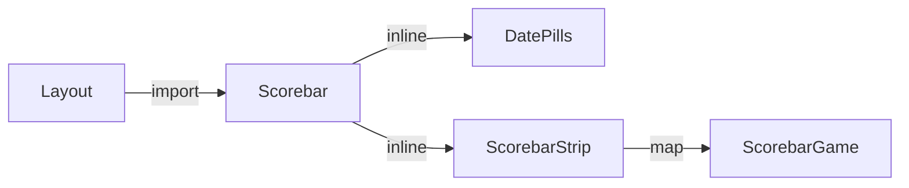

# Scorebar — Horizontally Scrollable Game Scores Ticker

> A persistent, site-wide, horizontally scrollable scorebar showing live scores,
> final results, and upcoming match times — patterned after NBA.com's top-of-page
> score ticker.
>
> **Status**: Implemented (2026-07-22) | **Priority**: P1 | **Effort**: S (half day)

> **Implementation note.** This doc was updated after build to record the
> decisions that differed from the original spec. See the
> [Implementation Notes](#implementation-notes-as-built) section for the
> as-built architecture — it supersedes the earlier draft where they conflict.

---

## Table of Contents

1. [Overview](#overview)
2. [UI Research & Competitor Analysis](#ui-research--competitor-analysis)
3. [Design Decisions](#design-decisions)
4. [Component Architecture](#component-architecture)
5. [States & Visual Design](#states--visual-design)
6. [Theming & Tokens](#theming--tokens)
7. [Responsive Behavior](#responsive-behavior)
8. [Accessibility](#accessibility)
9. [Edge Cases](#edge-cases)
10. [Implementation Plan](#implementation-plan)
11. [Verification](#verification)
12. [Non-Goals](#non-goals)
13. [Evidence Ledger](#evidence-ledger)

---

## Overview

Onoo currently has a "tonight's games" ticker only on the homepage (lines 203-265 of
`src/app/page.tsx`) showing team logos + names + **times only** — no scores, no live
indicators, no date navigation, not site-wide.

The scorebar elevates this to a persistent site-wide navigation element placed below
the SiteNav. It shows all games for the selected day — live scores for active games,
final scores for completed games, and scheduled times for upcoming games — in a
compact horizontally scrollable strip with day-pill date navigation.

**Primary UX goal**: A fan visiting any page (player profile, standings, leaders,
teams) can immediately see "what's happening now" and tap to a game. No need to
return to the homepage to check scores.

---

## UI Research & Competitor Analysis

### Competitors Studied

| Competitor | Type | Pattern Observed |
|------------|------|-----------------|
| **NBA.com** | Direct | Two-row scorebar: date pills (Sun19–Sat25 arrows) + game cards with team logos, scores, "FINAL" badges. HIDE SCORES toggle. Dark background. Site-wide, below nav. |
| **Sofascore** | Direct | Dark navy bar with compact match cards. Tab-based navigation. Minimal match info (logo, score, time). |
| **ESPN** | Adjacent | Horizontal scroll with team logos, scores, game status. Server-rendered with client hydration. |
| **Sportradar** | Adjacent | Widget-based ticker with compact layout option, horizontal selectors, date navigation. |
| **NBAScoresWebsite (OSS)** | Aspirational | Next.js NBA scores site with horizontal scrollable calendar + card-based game layout, dark theme. |

### Evidence IDs

| ID | Source | Confidence |
|----|--------|------------|
| E1 | NBA.com `/games` page — observed live | High |
| E2 | NBA.com scorebar described in design review (Muffin Group) | Medium |
| E3 | Sofascore NBA page — observed live | High |
| E4 | ljmakaronica/NBAScoresWebsite — OSS source code | High |
| E5 | Sportradar Score Ticker widget docs | Medium |
| E6 | Onoo homepage current ticker (lines 203-265) — read source | High |
| E7 | Onoo GameCard component — read source | High |
| E8 | Onoo data layer (`getGamesByDate`, `getLiveGames`) — read source | High |

### Current Onoo State (E6-E8)

**What exists**:
- Homepage ticker: flex `overflow-x: auto` with team logos + names + times — no scores
- `/games` page with `DateNav` day-picker component, groups games by status
- `GameCard` component with full game display (scores, teams, venue, status badge)
- Data layer: `getGamesByDate()` returns `home_score`, `away_score`, `status` — all needed data ready

**Gaps**:
1. ❌ Not site-wide — homepage only
2. ❌ No scores shown — times only
3. ❌ No date navigation
4. ❌ No live indicator
5. ❌ Not sticky/always accessible

---

## Design Decisions

### Layout: Two-row scorebar

**Decision**: Two rows — date pills (top) + game cards (bottom) [E1]

```
bg-sidebar text-sidebar-foreground border-b sticky z-40
├── Row 1: [◀] [Mon 21] [● Tue 22] [Wed 23] [Thu 24] [Fri 25] [▶]
├── Row 2: [team-A: 89 | team-B: 85 ● LIVE] [team-C: 72 | team-D: 68 FINAL] ...
```

### Scroll Technique: CSS flexbox `overflow-x: auto` — **no carousel library** [E6]

**Why not Carousel**: NBA.com's ticker is not a paginated carousel — it's a continuous
scroll strip where users scrub through all games at once. The existing homepage ticker
already uses this pattern at line 224: `flex gap-3 overflow-x-auto scrollbar-none`.
Adding Embla (the shadcn Carousel engine) would add ~12KB for no benefit.

### Background: `bg-sidebar text-sidebar-foreground`

Using the existing sidebar palette (dark) for contrast with the white page content
below. Same palette as the homepage hero section (`player-showcase-hero`). [E1/E3]

### Shadcn Components Used

| Component | Where | Why |
|-----------|-------|-----|
| `Badge` + `GameStatusBadge` | Status labels on game cards | Already exists with `variant="live"` (built-in pulsing red dot via `BadgeIndicator`), `variant="outline"` for final/scheduled |
| No new shadcn components needed | — | Everything else is plain Tailwind-styled elements |

**What we DON'T use or install**:
- ❌ `Card` — too heavy (padding, header/footer). Scorebar cards are compact `<Link>` elements
- ❌ `Carousel` — overkill for continuous scroll; would need Embla install
- ❌ `ScrollArea` — `scrollbar-none` + native scroll is simpler
- ❌ `Button` for date pills — pill shape needs custom rounded-full styling

### Data Strategy

- **Server Component** for `Scorebar` — fetches games at request time, no client load
- **Client Component** only for `ScorebarGame` — needs CSS animation for the live pulse indicator
- No real-time polling in V1 (deferred to Phase 5 live experience)

---

## Component Architecture



```
Layout (src/app/layout.tsx)
  └─ SiteNav
  └─ Scorebar <-- NEW: below SiteNav
  └─ main>{children}
```

### Scorebar (`src/app/components/scorebar.tsx`) — Server Component

```tsx
async function Scorebar() {
  const today = getUlaanbaatarDate();
  const games = await getGamesByDate(today);
  const dateRange = getDateRange(today); // past 2 + today + next 5

  // Order: live first, then scheduled, then finals
  const ordered = [...games].sort(/* live > scheduled > final */);

  return (
    <div className="border-b bg-sidebar text-sidebar-foreground sticky top-[52px] z-40">
      <div className="mx-auto max-w-7xl px-4 py-1.5 sm:px-6 lg:px-8">
        {/* Row 1: Date pills */}
        <div className="flex gap-1 overflow-x-auto pb-1 scrollbar-none">
          {dateRange.map(date => <DatePill key={date} date={date} today={today} />)}
        </div>
        {/* Row 2: Game cards */}
        {ordered.length > 0 ? (
          <div className="flex gap-2 overflow-x-auto pb-1 scrollbar-none">
            {ordered.map(game => <ScorebarGame key={game.id} game={game} />)}
          </div>
        ) : (
          <p className="text-xs text-sidebar-foreground/40 py-2">
            Өнөөдөр тоглолт алга
          </p>
        )}
      </div>
    </div>
  );
}
```

### ScorebarGame (`src/app/components/scorebar-game.tsx`) — Client Component

Client component only for the `animate-pulse` CSS animation on the live indicator.
The component is a thin wrapper — all markup is static.

### DatePills (inline in Scorebar)

Plain `<Link>` elements styled with Tailwind. 8-day rolling window (past 2 + today +
next 5). Today highlighted with amber accent.

---

## States & Visual Design

### Live Game
```
┌──────────────────────┐
│ [logo] HAWKS 89      │
│ [logo] BULLS 85      │
│ ● Шууд                │  ← pulsing red dot + Badge variant="live"
└──────────────────────┘
```
- Scores in `text-warning` (amber)
- Badge with `variant="live"` — includes `animate-pulse` red dot via `BadgeIndicator`
- Strong font weight on scores

### Final Game
```
┌──────────────────────┐
│ [logo] LIONS   101   │
│ [logo] WOLVES  95    │
│ Дуусгавар            │  ← Badge variant="outline"
└──────────────────────┘
```
- Scores in `text-sidebar-foreground`
- `text-sidebar-foreground/60` for muted label
- Normal weight

### Scheduled Game
```
┌──────────────────────┐
│ [logo] TIGERS   —    │
│ [logo] BEARS    —    │
│ 20:00                 │  ← time, no score
└──────────────────────┘
```
- Time in `text-sidebar-foreground/60`
- Dashes in score positions
- No Badge

### Empty State (no games today)
```
Өнөөдөр тоглолт алга          ← centered, text-sidebar-foreground/40
```
- Date pills still visible and interactive
- Minimal, doesn't draw attention

### Loading
Not applicable — Scorebar is a Server Component, fetched at request time.

---

## Theming & Tokens

```css
/* Background */
Scorebar := bg-sidebar text-sidebar-foreground

/* Date pills */
default     := bg-sidebar-accent/50 text-sidebar-foreground/70
today       := bg-warning/20 text-warning ring-warning/30
hover       := hover:bg-sidebar-accent
focus       := focus-visible:ring-sidebar-ring

/* Game cards */
container   := border border-sidebar-border rounded-lg bg-sidebar
hover       := hover:bg-sidebar-accent
focus       := focus-visible:ring-sidebar-ring

/* Status */
live        := Badge variant="live"    → text-warning bg-warning/10 + pulse dot
final       := Badge variant="outline" → text-sidebar-foreground/60
empty       := text-sidebar-foreground/40
```

### Typography

| Element | Size | Weight | Class |
|---------|------|--------|-------|
| Date pill weekday | 10px | 500 | `text-[10px]` |
| Date pill number | 12px | 700 tabular | `text-xs font-bold tabular-nums` |
| Team short name | 12px | 600 | `text-xs font-semibold truncate` |
| Score | 14px | 800 tabular | `text-sm font-black tabular-nums` |
| Status label | 10px | 500 | `text-[10px]` |
| Empty state | 12px | 400 | `text-xs` |

---

## Responsive Behavior

| Breakpoint | Card width | Date pills | Team names |
|------------|-----------|------------|------------|
| **360px** (mobile-first) | 140px min-width | Compact day-only (Mon21) | Short codes only (LIONS) |
| **640px+** (sm) | 180px | Show weekday + date | Full names |
| **1024px+** (lg) | 200px | Full format with game count | Full names |

- Cards use `shrink-0` to prevent compression
- Container is `max-w-7xl` centered on desktop, full-width on mobile
- Scrollbar hidden via `scrollbar-none` Tailwind utility
- Touch drag works natively on mobile (flexbox + overflow)
- At 360px, the scorebar collapses to show cards with only short team codes and
  scores — still readable and tappable

---

## Accessibility

- All game cards are `<Link>` elements with semantic text content
- Date pills are `<Link>` with `aria-label` describing the full date
  (e.g., `"2026-07-22, мяггар"`)
- Status colors are never the only differentiator — text labels accompany badges
- `focus-visible:ring-2` on all interactive elements
- Reduced motion: live pulse animation only plays when `prefers-reduced-motion: no-preference`
- Scorebar is a `<section>` with `aria-label="Тоглолтын мэдээ"`

### Heuristic Evaluation

| Heuristic | Before | After |
|-----------|--------|-------|
| Visibility of system status | ⚠️ Homepage only | ✅ Site-wide |
| User control & freedom | ❌ No date nav | ✅ Date pills |
| Consistency & standards | ⚠️ Inconsistent | ✅ Every page |
| Recognition vs recall | ⚠️ Must visit homepage | ✅ Always visible |

---

## Edge Cases

- **No games today**: Date pills still show with game counts (0). Strip shows
  "Өнөөдөр тоглолт алга" centered text. If yesterday had games and today
  doesn't, silently shows yesterday's games instead so the bar isn't empty.
- **All games final**: Show all scores normally. No live indicators. Strip still
  scrollable. Label shows "Дуусгавар" on each card.
- **Single game**: Card is compact enough (160px). Left-aligned, no scroll needed.
- **Many games (10+)**: Natural scroll on the flex container. All cards visible
  by scrolling or scrubbing.
- **Admin/internal pages**: Not shown — layout conditionally renders Scorebar
  only on public routes.
- **Mobile landscape / tablet**: Same as mobile, wider viewport means more cards
  visible at once. Still scrollable.

---

## Implementation Plan

### Files to Change

| File | Action | What changes |
|------|--------|--------------|
| `src/app/components/scorebar.tsx` | **Create** | Server Component: fetches games, renders date pills + game strip |
| `src/app/components/scorebar-game.tsx` | **Create** | Client Component: single compact game card with live pulse animation |
| `src/app/layout.tsx` | **Modify** | Import and render `Scorebar` below `SiteNav`, above `{children}` |
| `src/app/page.tsx` | **Modify** | Remove the "tonight's games ticker" section (lines 203-265) |
| `src/app/lib/data.ts` | **Modify** | Add `getDateRange()` helper + export

### Implementation Order

1. **Add `getDateRange()` helper to `src/app/lib/data.ts`** — simple pure function that
   returns an array of 8 date strings (past 2 + today + next 5). Exported from shared.ts.
2. **Create `src/app/components/scorebar-game.tsx`** — compact game card. Client component
   only for `animate-pulse`. Takes `GameWithTeams`, renders team logos + short names +
   score/time + status badge. Links to `/games/${game.id}`.
3. **Create `src/app/components/scorebar.tsx`** — Server Component that calls
   `getGamesByDate(today)`, sorts games, renders date pills + game strip. Uses `Badge`
   from existing components. Inline date pills as `<Link>` elements.
4. **Modify `src/app/layout.tsx`** — import `Scorebar`, render below `SiteNav`.
5. **Modify `src/app/page.tsx`** — delete the "tonight's games ticker" section
   (lines 203-265 inclusive). The scorebar replaces it site-wide.
6. **Verify** — `pnpm check`, `pnpm dev`, manual cross-page testing.

## Verification

> There is no `pnpm check` script. Use the commands below.

1. `pnpm validate:types` — typecheck (scorebar files clean; note the repo has
   pre-existing type errors in unrelated files)
2. `pnpm lint` (Biome) — scorebar files clean; `pnpm format` to auto-fix
3. `pnpm test:unit` — `scorebar.test.ts` (helpers) + `scorebar-game.test.tsx`
   (component states) pass
4. `pnpm dev` — scorebar visible on homepage, players, standings, teams, leaders pages
3. Mobile 360px — scrollable, cards compact enough, date pills visible
4. Click game card → navigates to `/games/{id}` game detail page
5. Live game → pulsing red dot + scores in amber
6. Final game → scores shown + "Дуусгавар" badge
7. Scheduled game → time shown, no scores
8. All games final → strip scrollable, no pulse animation
9. No games today → "Өнөөдөр тоглолт алга" + date pills still interactive
10. Date pill click → navigates to `/games?date=YYYY-MM-DD`

## Implementation Notes (as-built)

The build deviated from the original draft in these ways — each is an
improvement over the spec:

### 1. `ScorebarGame` is a Server Component (not client)

The live indicator is a **pure CSS** pulse (`animate-live-pulse`, applied by the
existing `Badge` / `GameStatusBadge`). CSS animations need no JavaScript, so
`ScorebarGame` stays a Server Component with **no `"use client"`** — zero added
client bundle. The draft's "Client Component only for the animation" reasoning
was incorrect.

### 2. Robust sticky via a combined wrapper (no magic offset)

Instead of `sticky top-[52px]` (brittle — breaks whenever the nav's height
changes), `SiteNav` and `Scorebar` are wrapped in a single
`<div className="sticky top-0 z-50">` in `layout.tsx`. The two pin to the
viewport top **as one unit**, so no nav-height constant is needed. `SiteNav` is
left untouched.

### 3. Non-blocking data fetch (own Suspense boundary)

Because the `Scorebar` lives in the root layout, a bare `await` would block
**every page's** shell from streaming until the games query resolves. It's
wrapped in its own `<Suspense>` with a fixed-height fallback
(`SCOREBAR_MIN_HEIGHT`, exported from `scorebar.tsx`) so the nav + page stream
immediately and the bar fills in without layout shift. ("Loading: Not
applicable" in the draft was wrong.)

### 4. Hidden on internal routes via a client gate

The root layout is a Server Component and can't read the pathname (there is no
middleware exposing it). `ScorebarGate` (`scorebar-gate.tsx`, `"use client"`,
`usePathname`) hides the bar on `/admin` and `/tracker`. Tradeoff: the server
still renders `Scorebar` for those routes, so the games query runs even when
hidden — negligible on low-traffic authenticated pages, and documented in the
component.

### 5. Empty-day fallback is a bounded data helper

`getScorebarGames(today)` (in `lib/data.ts`) returns today's games; if today has
none it walks back up to 7 days to surface the most recent match day (so the bar
isn't empty in sparse schedules), returning `{ games, activeDate, isFallback }`.
Bounded to ≤8 lightweight queries (1 in the common case). When `isFallback` is
true the strip is prefixed with the active date so scores aren't mistaken for
today's. Pure ordering/window logic lives in `lib/shared.ts`
(`orderScorebarGames`, `getDateRange`, `shiftDate`) and is unit-tested.

### 6. Team tricodes instead of responsive name switching

Cards show the team `short_code` (tricode) at all breakpoints — the NBA ticker
pattern — rather than switching between short codes and full names by
breakpoint. Simpler, more compact, and the accessible name on the `<Link>`
still carries the full team names.

### 7. Date pills removed — single compact horizontal row

The original two-row layout (date pills + games) was too tall. Per user
feedback the date-pill row was **removed entirely**; the scorebar is now a
single horizontally scrollable row of games only (`min-h-[44px]`). Date
navigation lives on the `/games` page (`DateNav`). The pure `getDateRange` /
`shiftDate` helpers remain (unit-tested) in case pills return later.

### 8. Game cards are a single inline row

Each `ScorebarGame` renders on one line — `[logo] HOME score – [logo] AWAY
score │ status/time` — instead of the earlier stacked three-row card, keeping
the whole bar short. Winner bold, loser dimmed, live scores in amber.

### Files (as-built)

| File | Action |
|------|--------|
| `src/app/lib/shared.ts` | Add `shiftDate`, `getDateRange`, `orderScorebarGames` (pure) |
| `src/app/lib/data.ts` | Add `getScorebarGames` + `ScorebarStrip`; re-export new helpers |
| `src/app/components/scorebar.tsx` | Server Component: date pills + games strip + `SCOREBAR_MIN_HEIGHT` |
| `src/app/components/scorebar-game.tsx` | Server Component: one compact game card |
| `src/app/components/scorebar-gate.tsx` | Client gate: hides bar on `/admin`, `/tracker` |
| `src/app/layout.tsx` | Sticky wrapper: `SiteNav` + gated, Suspense-wrapped `Scorebar` |
| `src/app/page.tsx` | Remove the old homepage "tonight's games" ticker |
| `src/app/lib/__tests__/scorebar.test.ts` | Unit tests for the pure helpers |
| `src/app/components/__tests__/scorebar-game.test.tsx` | Component tests for the card states |

## Non-Goals (Phase 1)

- ❌ Real-time polling / auto-refresh — deferred to Phase 5 live experience
- ❌ Marquee/auto-scroll animation — NBA.com doesn't do this either
- ❌ HIDE SCORES toggle — defer until Phase 5 when live updates exist
- ❌ Monthly calendar view — date pills + `/games` page DateNav covers this
- ❌ Mobile collapsible variant — keeps consistent across all breakpoints
- ❌ Embla/Carousel library — unnecessary for continuous scroll

## Evidence Ledger

| ID | Source | Method | Confidence |
|----|--------|--------|------------|
| E1 | NBA.com `/games` page | `read` URL | High |
| E2 | Muffin Group sports design review | `web_search` | Medium |
| E3 | Sofascore NBA tournament page | `read` URL | High |
| E4 | NBAScoresWebsite (GitHub) | `web_search` | High |
| E5 | Sportradar Score Ticker widget docs | `web_search` | Medium |
| E6 | Onoo homepage current ticker (page.tsx:203-265) | `read` source | High |
| E7 | Onoo GameCard component (game-card.tsx) | `read` source | High |
| E8 | Onoo data layer (data.ts) | `read` source | High |

---

_Last updated: 2026-07-22_

**See also**:
- `plans/scorebar-implementation.md` — executable step-by-step implementation spec
- `notes/ui-research/2026-07-22-scorebar/` — full UI research report with captures and analysis