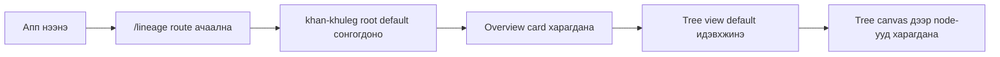
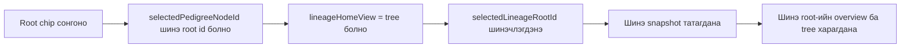
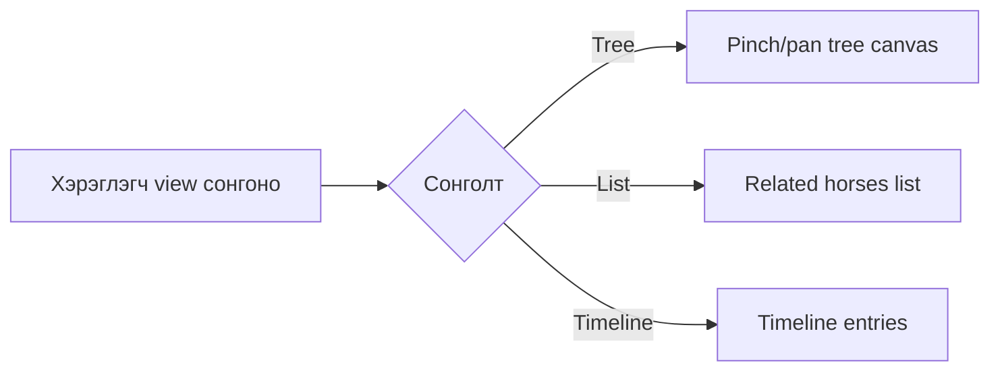
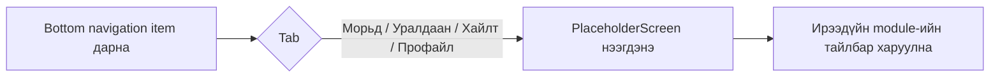

# Удамын хэрэглэгчийн урсгал

## Урсгал 1: Апп нээгээд үндсэн удам харах

## Урсгал 2: Өөр root сонгох

## Урсгал 3: Харах хэлбэр солих

## Урсгал 4: Бусад tab руу шилжих

## QA-д хэрэгтэй ажиглалт
- Default дэлгэц нь `lineage`.
- `Tree` view дээр л үеийн шүүлтүүр харагдана.
- Node сонгоход card border болон edge highlight өөрчлөгдөнө.
- `Морьд` tab ажиллаж байгааг widget test баталж байна.

## Evidence
- `lib/src/app/router/app_router.dart`
- `lib/src/features/lineage/presentation/lineage_home_screen.dart`
- `lib/src/features/lineage/presentation/pedigree_tree_view.dart`
- `test/widget_test.dart`
