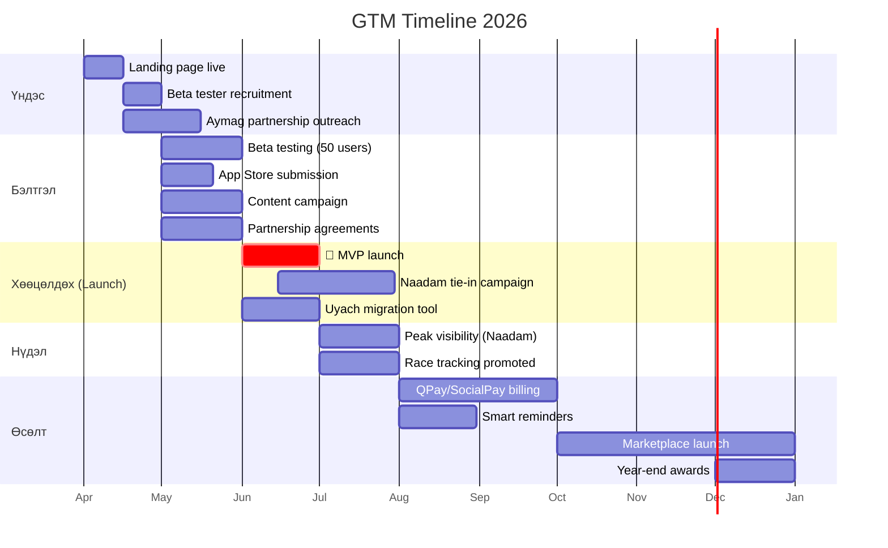

# Marketing — Go-to-Market Strategy

> The plan to take Tamga from zero to Mongolia's default horse management app.

---

## Brand Identity

### Name

**Tamga** (Тамга) — Mongolian for "the brand mark."

> The brand burned into a horse to mark ownership — every Mongolian herder family has their own unique тамга passed down for generations. It is identity, lineage, and proof of ownership in one symbol.

A registry app is essentially a digital тамга. The name is uniquely Mongolian — no equivalent exists in Western apps.

### Domains

| Domain | Status | Use |
|---|---|---|
| `tamga.mn` | ✅ Acquired | Primary website |
| `tamga.app` | ✅ Acquired | App landing page |

### Tagline

> Морины тань цорын ганц үнэн эх сурвалж
> *(The single source of truth for your horse)*

### Brand Personality

| Trait | Expression |
|---|---|
| **Trustworthy** | Clean UI, no visual noise, consistent patterns |
| **Proud** | Rich earth tones, heritage-aware, not clinical |
| **Practical** | Every screen does something useful |
| **Modern** | Feels like 2026, not 2017 |

---

## 🧭 Этикийн Зураглал (Ethical Persuasion Guardrails)

Research shows 97% of popular EU apps contain dark patterns (European Commission 2025). Amazon paid $2.5B, Epic Games $245M, TikTok €345M in fines. Tamga must be different.

### Бид ХИЙХГҮЙ:

| Dark Pattern | Орлогын эрэлд | Бидний байр суурь |
|---|---|---|
| **Хуурамч яарал (Fake urgency)** | "Зөвхөн 5 VIP үлдсэн!" (хэрэв үнэн биш бол) | ❌ Хийхгүй — хэрэв VIP байршил үнэн хязгаарлагдмал биш бол худал хэлнэ |
| **Нотлох сэтгэл зүй (Confirmshaming)** | "Үгүй, би мөнгө хэмнэхийг хүсдэггүй" | ❌ Хийхгүй — ямар ч буцах товчийг ил тод байлгана |
| **Ноцтой хуурамч нийгмийн нотолгоо** | "50,000+ хэрэглэгч" (хэрэв бодит биш бол) | ❌ Хийхгүй — зөвхөн бодит тоо эсвэл үнэн түүх ашиглана |
| **Нууц төлбөр** | Нэмэлт зардал нуух | ❌ Хийхгүй — бүх үнийг ил тод харуулна |
| **Мөшгих (Nagging)** | Зөвшөөрөл асуусны дараа дахин асуух | ❌ Хийхгүй — "Одоохондоо үгүй" гэсэн бол дахин асуухгүй |

### Бид ХИЙХ ЁСТОЙ:

| Ethical Technique | Хэрэглээ | Зорилго |
|---|---|---|
| **Бодит нийгмийн нотолгоо** | Бодит хэрэглэгчийн түүх, үнэн тоо | Итгэлцэл бий болгох |
| **Алдагдлаас зайлсхийх** | "Юу алдах вэ?" framing (зөвхөн үнэнтэй) | Шийдвэр гаргахад туслах |
| **Эцэг эхийн түүх** | Бүтээгчийн хувийн түүх | Хүний нүдээр харах |
| **Үнэ цэнийг харуулах** | Үнэгүй багцын жинхэнэ ашиг тус | Шударга шинэчлэлт |

---

## 👤 Бүтээгчийн Түүх (Founder Story)

Tamga-ийг бүтээх нэг шалтгаан бий: бидний нэг хүн 22 морь эзэмшдэг бөгөөд WhatsApp групп, цаасан бичиг, санах ойгоо ашиглан морио удирдаж байсан. Энэ нь хэтэрхий төвөгтэй байсан.

**Бидний зорилго:** Монголын анхны жинхэнэ морины "цорын ганц үнэн эх сурвалж"-ийг бий болгох.

**Бидний амлалт:
- Хэрэглэгчийн мэдээллийг хэзээ ч зарахгүй
- Үнэгүй багц үнэн хэрэгтэй ашигтай байх болно
- Бүтээгдэхүүн үргэлж хэрэглэгчийн талд байх болно

---

## Positioning

### Against Uyach

| Uyach | Tamga |
|---|---|
| "The only option" | "The better option" |
| Registry-first | Health-first → registry migration |
| 2017 design | Modern, iOS-inspired |
| Mobile only | iOS + Android + Web |
| No health records | Health tracking is the core differentiator |
| Stagnant since 2023 | Actively shipping |

### One-Liner for Different Audiences

| Audience | Message |
|---|---|
| **Breeder** | "Track health, pedigree, and breeding — in one app that actually works." |
| **Casual owner** | "Your horse's passport. Free for 1 horse." |
| **Race organizer** | "Register horses, track results, manage insurance — all digital." |
| **Vet** | "See your patients' full health history, right from their phone." |
| **Investor** | "3M+ horses, zero competition, dormant incumbent. We're building the Stripe for Mongolian equine." |

---

## Go-to-Market Phases

### Phase 0: Pre-Launch (Now → May 2026)

**Goal:** Build anticipation, recruit beta testers, secure 2–3 partnerships.

| Action | Channel | Timeline |
|---|---|---|
| Landing page with email signup | tamga.mn | April |
| Beta tester recruitment | Facebook equestrian groups | April–May |
| 1–2 aymag breeder association partnerships | Direct outreach | April–May |
| Content: "Why Uyach isn't enough" articles | Facebook, Instagram | Monthly |
| Teaser videos (UI preview, health tracking demo) | TikTok, Instagram Reels | Bi-weekly |

### Phase 1: MVP Launch (June 2026 — Before Naadam)

**Goal:** 500 users, marketplace live, on-site registration started.

| Action | Channel | Notes |
|---|---|---|
| App Store + Play Store launch | iOS, Android | Free tier: 1 horse |
| Marketplace MVP launch | In-app | Free listings + Featured tier (₮3,000/week) |
| On-site registration service | Ops team | Photography + registration (₮29,900/horse) |
| Naadam tie-in campaign | Facebook, Instagram | "Track your race horses with Tamga" |
| Free health records module | All channels | "Uyach doesn't have this" |
| Uyach data migration tool | In-app | One-click import from Uyach |
| PR: "Mongolia's first modern horse app" | Mongolian media | Press release |

### Phase 2: Monetization (July–September 2026)

**Goal:** 1,500+ users, marketplace revenue flowing, 75+ paid subscribers.

| Action | Channel | Notes |
|---|---|---|
| VIP tier + Boost live | In-app | ₮8,000/week VIP, ₮2,000 Boost |
| Horse sale commissions | In-app | 3% on completed sales |
| Digital certificate sales | In-app | Ownership transfer + pedigree certificates |
| QPay/SocialPay billing live | In-app | Frictionless Mongolian payments |
| Smart reminders launch | Push notifications | Breeding season, vet, insurance |
| Facebook Marketplace integration | Social | One-tap horse listing |
| Referral program | In-app | Invite breeder → get 1 month Pro free |

### Phase 3: Community & Marketplace (October–December 2026)

**Goal:** 3,000+ users, marketplace mature, supply shop live.

| Action | Channel | Notes |
|---|---|---|
| Supply shop launch | In-app | Feed, vitamins, equipment — seller commission model |
| Vet marketplace | In-app | Directory + booking, vets pay for verified badge |
| Race organizer dashboard | B2B | Registration + results management |
| Insurance referral integration | B2B | Mortality + transport insurance |
| Year-end "Horse of the Year" awards | Social, PR | Community engagement event |
| Partnership with 2+ insurance companies | B2B | Digital insurance integration |

### Phase 4: AI & Premium (Q1–Q2 2027)

**Goal:** 5,000+ users, B2B revenue growing, all revenue streams active.

| Action | Channel | Notes |
|---|---|---|
| B2B sponsorship deals | Direct sales | Feed companies, vet pharma, insurance brands |
| AI breeding advisor (Claude API) | Premium tier | Unique feature — no competitor has this |
| GPS herd tracking | Premium tier | Hardware + software integration |
| Expand to cattle/sheep tracking | In-app | 58M animals vs 5M horses — 6× TAM increase |
| English language support | In-app | International breeders, Mongol Derby |

### Phase 5: Institutional (2027+)

**Goal:** 10,000+ users, data licensing, institutional partnerships.

| Action | Channel | Notes |
|---|---|---|
| Data licensing (insurance, research) | B2B | Risk assessment models, breeding genetics |
| API for race organizers | B2B | Naadam, Ikh Hurd |
| Insurance company integrations | B2B | Digital policy management |
| Veterinary clinic portal | B2B | Vet access to patient records |

---

## Channels

### Primary: Facebook (Mongolia's #1 Platform)

- **Equestrian groups** — 50K+ members across multiple groups
- **Horse trader groups** — active buy/sell communities
- **Breeder communities** — professional network
- **Strategy:** Organic posts, not paid ads. Share value: health tips, pedigree tools, race results.

### Secondary: Instagram + TikTok

- **Content:** Short-form video (UI demos, health tracking, pedigree tree animation)
- **Influencer partnerships:** Mongolian equestrian content creators
- **Naadam content:** Race day stories, horse profiles

### Tertiary: PR & Media

- **Mongolian tech media:** "Mongolia's first modern horse app"
- **Equestrian media:** Partnership announcements, feature stories
- **National media:** If we hit 10K users, it's a "Mongolian tech success story"

### Partnerships (Grassroots, Not Institutional)

| Partner Type | Target | Why |
|---|---|---|
| **Aymag breeder associations** | 2–3 aimags | Grassroots credibility, not MMSUH (they're with Uyach) |
| **Race organizers** | Ikh Hurd, local races | Direct distribution to engaged users |
| **Vet clinics** | Urban + rural | Health records drive adoption |
| **Insurance companies** | MIG Daatgal competitors | Digital integration = stickiness |
| **Facebook group admins** | Equestrian communities | Organic amplification |

---

## 📞 Худалдааны Скриптүүд (Sales Playbooks)

### Vendor Pre-Sales Script

```
Сайн байна уу, [Нэр] аа.

Би Тамга аппликейшийн багаас холбогдож байна. Манай апп нь Монголын анхны дижитал морины удам судалгаа, эрүүл мэндийн бүртгэлийн платформ юм.

Одоогоор [X] морь эзэмшигч манай апп-д бүртгүүлсэн байна. Бид дэлгүүрийн хэсгийг нээх гэж байгаа бөгөөд өвс, витамин, хэрэгсэл зардаг бизнесүүдэд эртний түншийн боломж олгож байна.

**Анхны түнш:** ₮500,000/жил — Танай бүтээгдэхүүн манай дэлгүүрийн эхэнд гарч, "Анхны түнш" badge авна.

Энэ бол зүгээр нэг зар биш — та шинэ сувагтай болно. Манай хэрэглэгчид бүгд морь эзэмшигчид бөгөөд өвс, витамин хэрэглэгчид юм.

Туршиж үзэх боломжтой юу?
```

### Race Organizer Outreach Script

```
Сайн байна уу, [Нэр] аа.

Та Наадам/уралдааны бүртгэл хийдэг гэж сонссон. Бид тэмцээний бүртгэл, үр дүн удирдах цахим хэрэгсэл хийсэн.

Одоо бол туршилтын үе — 4 арга хэмжээг үнэгүй буюу хямд үнээр турших боломжтой.

**Туршилтын үнэ:** ₮300,000/арга хэмжээ (стандарт ₮500,000-ын оронд)

Таны оролцогчид гар утсаараа бүртгүүлж, үр дүнгээ харах боломжтой болно. Хэрэв таалагдвал жилийн гэрээ хийнэ.

Туршиж үзэх боломжтой юу?
```

### On-Site Registration Day Campaign

```
🏇 Адууны бүртгэлийн өдөр!

📅 [Огноо]
📍 [Газар]

Таны адууг мэргэжлийн зурагчин бүртгүүлж, дижитал гэрчилгээ авах боломжтой.

✅ Профессын зураг
✅ Дижитал бүртгэл
✅ Удам судрын гэрчилгээ

Үнэ: ₮29,900/адуу (5+ адуу бол хөнгөлөлт)

Урьдчилан бүртүүлэх: [Холбоо барих]
```

---

## 🏪 Оффлайн Сувгууд (Offline Channels)

Research on agricultural apps in developing countries shows offline channels are MORE effective than online for rural farmers.

| Сувг | Үр нөлөө | Зардал | Хэрэгжүүлэх |
|---|---|---|---|
| **Хоршоо (Farmer groups)** | Хамгийн өндөр — итгэлцэл + нийгмийн нотолгоо | Үнэгүй | Аймгийн хоршоонуудад демо өдөрлөг |
| **Малын дэлгүүр (Agri shops)** | Бодит туршилтын цэг — QR код наах | Бага | Дэлгүүрүүдэд постер + QR код |
| **SMS мэдэгдэл** | 30% илүү бүртгэл (PxD Кенийн судалгаа) | ₮50–100/SMS | Uyach хэрэглэгчдэд SMS аян |
| **Реферал код** | Нөхөрлөлийн сүлжээгээр дамжуулан хүлээн авалт | Урамшууллын зардал | "3 хүн урих → 1 сар Pro үнэгүй" |
| **Аймгийн үзэсгэлэн худалдаа** | Олон хэрэглэгчид нэг дор | Аяллын зардал | Наадам, хаврын үзэсгэлэн |

### Хоршооны Демо Өдөрлөг (Farmer Group Demo Day)

```
1. Аймгийн хоршоотой холбогдох → өдөрлөг товлох
2. 20–30 малчин цуглуулах
3. 15 минутын демо: профайл үүсгэх, эрүүл мэндийн бүртгэл
4. Бүртгүүлсэн бүх хүнд 1 сар үнэгүй Pro
5. Реферал код өгөх: "Найзаа уриарай"
```

---

## 🎁 Реферал Систем (Referral System)

Research shows referral codes are the most effective adoption channel in rural communities.

| Шаг | Хэрэглэгч А (Уригч) | Хэрэглэгч Б (Шинэ) |
|---|---|---|
| **Урилга илгээх** | Реферал код үүсгэнэ | Код оруулан бүртгүүлнэ |
| **Шагнал** | 1 сар Pro үнэгүй | 50 MB нэмэлт багтаамж (үнэгүй багц дээр) |
| **Нэмэлт шагнал** | 5 хүн урибал Breeder үнэгүй 1 сар | — |

**Механик:**
- Реферал код = хэрэглэгчийн нэр + тоо (жишээ: `TEMUULEN22`)
- Код ашигласан тохиолдолд хоёр талд шагнал
- Дээд хязгаар: уригч бүр хамгийн их 10 хүн урих боломжтой

---

## Content Strategy

### What to Create

| Content Type | Frequency | Channel | Purpose |
|---|---|---|---|
| **Health tracking tips** | Weekly | Facebook | Value-first — build trust |
| **Pedigree tool demos** | Bi-weekly | Instagram, TikTok | Show product in action |
| **User stories** | Monthly | All | Social proof from real breeders |
| **Race day coverage** | During events | Stories, Reels | Real-time engagement |
| **"Did you know?"** | 2× week | Facebook | Horse health facts + app tie-in |
| **Competitor comparison** | Monthly | Blog, Facebook | "Why Tamga > Uyach" (subtle) |

### Voice & Tone

- **Mongolian first** — all content in Mongolian
- **Proud, not arrogant** — respect Uyach's legacy, position as evolution
- **Practical** — every post teaches something or shows value
- **Visual** — horse photos, UI screenshots, infographics over text walls

---

## Launch Timeline (Critical Path)



---

## Key Metrics to Track

| Metric | Phase 1 (June) | Phase 2 (Sept) | Phase 3 (Dec) |
|---|---|---|---|
| Downloads | 500 | 2,000 | 5,000 |
| MAU | 200 | 800 | 2,500 |
| Paid subscribers | — | 100 | 500 |
| MRR | — | ₮5M | ₮15M |
| Horse records entered | 1,000 | 8,000 | 30,000 |
| NPS | >40 | >45 | >50 |
| Uyach migrations | 50 | 200 | 500 |

---

## Budget Allocation (Monthly, Phase 1–2)

| Category | Amount (MNT) | % of Budget | Notes |
|---|---|---|---|
| **Content creation** | ₮500,000 | 25% | Video, graphics, copywriting |
| **Facebook/Instagram ads** | ₮400,000 | 20% | Targeted at equestrian groups |
| **Influencer partnerships** | ₮300,000 | 15% | 2–3 equestrian micro-influencers |
| **PR & media** | ₮200,000 | 10% | Press releases, media outreach |
| **Events & partnerships** | ₮300,000 | 15% | Aymag visits, race sponsorships |
| **Community management** | ₮200,000 | 10% | Facebook group engagement |
| **Contingency** | ₮100,000 | 5% | Unexpected opportunities |
| **Total** | **₮2,000,000** | **100%** | ~$550/month |

---

## Risks & Mitigations

| Risk | Impact | Mitigation |
|---|---|---|
| Uyach ships health records | Removes our key differentiator | Move fast — launch before they react (they haven't shipped in 2 years) |
| MMSUH endorses Uyach exclusively | Blocks institutional partnerships | Go grassroots (aymag associations, not national union) |
| Low adoption in rural areas | Limits growth to UB only | Offline-first + partnership with rural vet clinics |
| Naadam timing missed | Lose peak launch window | Have MVP ready by May, soft-launch then |
| Negative Uyach response | PR risk | Stay positive: "We love what Uyach built. We're adding what's missing." |

---

## Related

- [Competitor](./competitor.md) — full Uyach analysis
- [Product](./product.md) — what we're building
- [Finance](./finance.md) — revenue model and pricing
- [Pricing](./pricing.md) — detailed pricing psychology
- [Development](./development.md) — technical launch checklist
