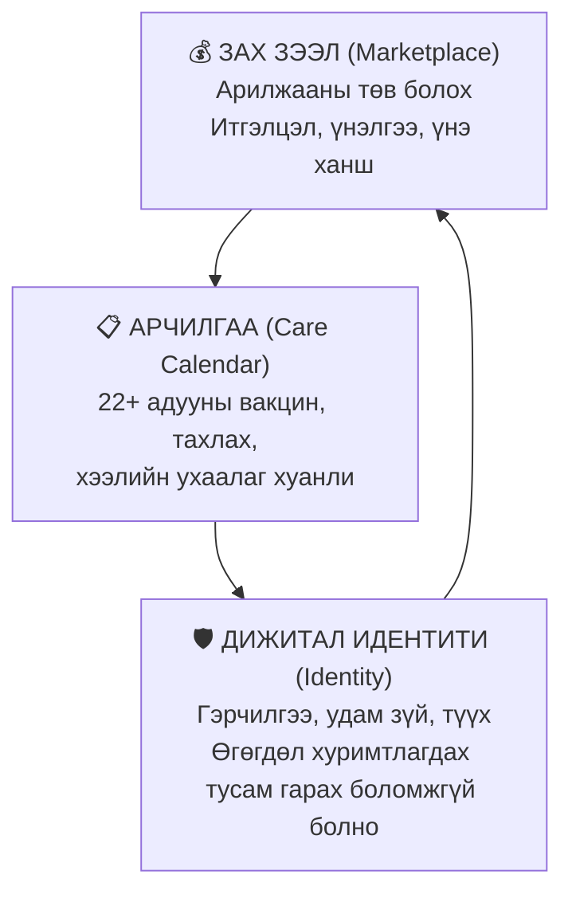

# Хэрэглэгчийн идэвх ба үнэнч байдал (Engagement & Retention)

> **Зорилго**: Tamga аппликейшнийг малчид, уяачдын өдөр тутмын амьдралын салшгүй хэсэг, адууных нь цорын ганц үнэн эх сурвалж болгох урт хугацааны стратеги.

---

## 🎯 Үндсэн зарчим (Core Philosophy)

Tamga-д хиймэл тоглоомын аргачлал (badges, streaks, levels) тохирохгүй. Учир нь:
1. **Малчдын өдөр тутмын амьдрал хүнд хүчир хөдөлмөр**: Өглөө 5 цагт босоод гүү сааж, морьдоо эмээллэдэг хүмүүс өглөө утас шагайж "daily streak" харахгүй.
2. **Амьдралын хэв маяг**: Жилийн 365 хоног адуу малтайгаа зууралддаг хүмүүст апп өдөр бүр "7-day streak! 🔥" гэж сануулах нь тоглоом шиг санагдаж, итгэлцлийг бууруулна.

Тиймээс манай стратеги бол **хиймэл dopamine биш, бодит үнэ цэнэ** юм. Үнэнч хэрэглээг дараах 3 тулгуурт суурилуулан бий болгоно:

---

## 🗺️ Хэрэгжүүлэх үе шатууд (Roadmap)

### Үе 1: Арчилгааны Хөдөлгүүр (Month 1–3)
*Малчны цаг зав, адууны эрүүл мэндийг хамгаалах бодит хэрэгцээг хангах.*

#### 1. Ухаалаг хуанли ("Хяналт" цэс)
Аппын үндсэн нүүр хэсэгт адууны жагсаалт бус, тухайн долоо хоногт анхаарах ёстой ажлуудын нэгдсэн хураангуйг харуулна:
- **Багц ажлын сануулга**: "5 адуу: Хаврын вакцин хийх хугацаа 3 хоногийн дараа" (Адуу бүрээр тусад нь биш, нэгтгэж харуулна).
- **Хээлийн тоолуур**: Огноог толгойдоо тооцоолох шаардлагагүй, "Бор: Хээлтэй (327/340 хоног)".
- **Цаг агаарын онцгой дохио (Зуд, шуурганы анхааруулга)**: Зөвхөн өнөөдрийн температур биш, ойрын 5-10 хоногийн температурын огцом уналт, цасны зузааны урьдчилсан мэдээг харуулж, "Морьдоо дулаалах, өвөлжөө рүүгээ нүүх" зэрэг зөвлөгөө өгнө.
- **Оффлайн ажиллагаа**: Бүх тооцоолол, орон нутгийн оффлайн баазад (Isar) хийгдэх тул сүлжээгүй бэлчээрт ч ажиллана.

#### 2. Exception-Based буюу Сонгож бүртгэх систем
22+ адуутай малчин адуу бүрээр орж бүртгэл хийх завгүй.
- **"Бүгд хэвийн" товч**: Нүүр хуудаснаас ганц товшилтоор "Өнөөдөр бүгд хэвийн" төлөвийг бүртгэнэ (Энэ нь цаашид эрүүл мэндийн түүхийг баталгаажуулна).
- **Зөвхөн асуудалтайг нь бүртгэх**: Хэрэв моринд асуудал гарвар тухайн морийг сонгоод `Доголон | Идэхгүй | Шарх | Халуурч | Бусад` гэсэн сонголтуудаас 2 секундэд сонгож бүртгэнэ.

#### 3. Долоо хоног тутмын тойм мэдэгдэл (Weekly Push Notification)
Өдөр бүр хэрэггүй push мэдэгдлээр бөмбөгдөхгүй. Харин долоо хоногт **ГАНЦ УДАА** (Бүтэн сайны орой эсвэл Даваа гарагийн өглөө) дараах тоймыг илгээнэ:
> 📋 **Энэ долоо хоногийн тойм:**
> - 🩺 3 морь: вакцин хийх шаардлагатай
> - 🤰 Бор: 334/340 хоног — төллөх дөхсөн
> - 🌡️ Лхагва гарагт -12°C хүрч хүйтэрнэ.

*Шуурхай мэдэгдэл (зөвхөн дараах тохиолдолд илгээнэ):*
- Зуд, байгалийн аюултай үзэгдлийн дохио
- Хээлтэй гүү төллөх сүүлийн 5 хоног
- Marketplace-ээр хүн холбогдох үед

---

### Үе 2: Дижитал Итгэлцэл (Month 4–6)
*Апп доторх өгөгдлийг зах зээлд борлуулалтын үнэ цэнэ болгон хувиргах.*

#### 1. Facebook-тэй уялдаатай ажиллах
Малчид адууныхаа мэдээлэл, зураг, удам зүйг аль хэдийн Facebook группүүдэд идэвхтэй хуваалцдаг.
- **Нэг товшилтоор хуваалцах**: Апп доторх удам зүйн зураглал, цахим гэрчилгээ, тэмцээний амжилт зэргийг гоёмсог визуал карт болгон Facebook рүү шууд постлох боломж.
- **Deep Linking**: Facebook дээрх постын линк дээр дарахад тухайн адууны Tamga дээрх нээлттэй профайл руу шууд үсэрч, бусад уяачдад апп татах сэдэл өгнө (Вирус өсөлтийн гол хөшүүрэг).

#### 2. Зах зээлийн итгэлцлийн үнэлгээ (Marketplace Trust Score)
Зах зээлд зарж буй адууны мэдээллийн үнэн бодит байдлыг үнэлнэ:
- **Баталгааны түвшин (Trust Score)**: Адууны профайлын гүйцэтгэл (зураг, нас, зүс), эрүүл мэндийн түүхийн урт (хэдэн сар бүртгэсэн), удам зүйн баталгаажуулалт, цахим гэрчилгээ байгаа эсэхээс хамаарч "Өндөр | Дундаж | Бага" үнэлгээ олгоно.
- **Борлуулагчийн үнэлгээ**: Худалдан авагчдаас авсан сэтгэгдэл, үнэлгээ (1-5 од).

> [!TIP]
> Малчид адуугаа өндөр үнээр зарахын тулд эрүүл мэндийн түүх, удмын бичгийг апп дээр чин сэтгэлээсээ, үнэн зөв хөтөлж эхэлнэ. Ингэснээр өгөгдөл оруулах сэдэл нь тоглоом биш, **санхүүгийн ашиг** болж хувирна.

---

### Үе 3: Экосистем (Month 7–12)
*Тасралтгүй ашиглах олон талт холбоосуудыг үүсгэх.*

#### 1. Арилжааны дотоод чат (In-App Messaging)
Marketplace-ээр адуу худалдан авах, түрээслэх, азарга тавиулах асуудлаар шууд апп дотроо харилцах боломж. Сүлжээгүй үед ч зурвасууд хадгалагдаж, сүлжээнд ормогц илгээгдэнэ.

#### 2. Орон нутгийн үйлчилгээний лавлах (Directory)
Аймаг, сумаар шүүж малын эмч, туурай засах уяач, тэжээл өвс нийлүүлэгчдийн холбоо барих мэдээллийг авах боломжтой шар хуудас.

#### 3. Наадам ба Тэмцээний интеграци
Наадмын бэлтгэл үе болон тэмцээний түүхийг морины профайлд автоматаар холбоно:
- **Адууны амжилтын батламж**: Уяачийн профайлд биш, **тухайн морины профайлд** "Улсын наадам 2026 - Айргийн тав" гэх мэт тэмдэглэгээ орж, морины зах зээлийн үнэлгээг нэмэгдүүлнэ.

#### 4. Уяач (Uyaach) апп-аас өгөгдөл хөрвүүлэх
Одоогийн байдлаар идэвхгүй болсон Уяач апп-ын хэрэглэгчдийг өөртөө татах зорилгоор тэдний түүхэн өгөгдлийг (удам, морьдын жагсаалт) нэг товшилтоор Tamga руу хөрвүүлэн оруулах импортлогч багаж хөгжүүлнэ.

---

## 🗑️ Хассан функциуд (What We Cut)

| Хассан зүйл | Шалтгаан | Өөрчилсөн шийдэл |
|---|---|---|
| **Streaks (Идэвхтэй хоног)** | Малчдад хүүхдийн тоглоом шиг санагдана. | Профайлын гүйцэтгэлийн хувь (Profile Completeness) болгож өөрчилсөн. |
| **Уяачийн зэрэг (Foal → Master)** | 60 настай туршлагатай уяачийг апп дөнгөж суулгаснаар нь "Унага" гэж нэрлэх нь соёлд нийцэхгүй. | Зөвхөн адууны үзүүлэлт болон бодит өгөгдөлд суурилсан ангилал ашиглах. |
| **Дотоод Сошиал суваг (Social Feed)** | Facebook-тэй өрсөлдөж чадахгүй. | Мэдээллийг Facebook рүү хуваалцах (Share to FB) холбоос болгов. |
| **Өдрийн бүрэн бүртгэл** | 22+ адуу бүрээр орж мэдээлэл шинэчлэх нь хэтэрхий их ажил. | "Бүгд хэвийн" болон зөвхөн асуудалтайг нь сонгож бүртгэдэг систем болгож хялбарчилсан. |

---

## 📊 Бодит зорилтот үзүүлэлтүүд (Realistic Metrics)

Мал аж ахуйн мэргэжлийн аппликейшнд сошиал медиа шиг 50% DAU/MAU байх боломжгүй. Дараах үзүүлэлтүүдийг зорилтот түвшин болгон тодорхойлно:

- **DAU/MAU**: 20–25% (Улирлын шинж чанартай; өвөл, хаварт идэвх нэмэгдэж, зун бэлчээрт буурна)
- **D1 Retention (Суулгасны дараах өдөр)**: 45–50%
- **D30 Retention (Суулгаснаос хойш 30 хоног)**: 15–20%
- **Апп ашиглах дундаж хугацаа**: 2–3 минут (Хурдан ороод, хэрэгтэйгээ бүртгээд гарах зориулалттай)
- **Free → Pro conversion (Төлбөртэй шилжилт)**: 5–8% (Үндсэн хөшүүрэг: 2-хоос дээш адуу бүртгэх)
